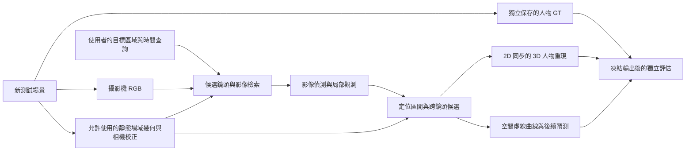

# 受控新場景與 2D → 3D 重現提案

日期：2026-10-18（Asia/Taipei）

狀態：**使用者已決定採用為新的 Demo 方向；正式契約／操作草圖（A 包）待 Claude 起草並交回 Codex 檢視。A 包確認前不建 `.blend`、不渲染。**

本文件整理本次人工審查後的使用者需求、建議做法、預期成果與待決問題，供 Claude 提議分工與修改，再交回 Codex 檢視。本輪只產出文件，不建立 `.blend`、渲染、修改估計器、啟動服務或發布 PR／issue。既有資產、凍結結果與研究狀態保留。

## 0. 使用者決定與協調者的初步建議（2026-10-18）

使用者已決定：本受控新場景直接成為新的 Demo；舊 Office 人形 run 不再反覆修正。**舊分支與 PR 全部保留，不刪除、不關閉；之後再標明重用或暫停。** 本次文件提交不變更它們的狀態。

Claude 正在準備逐節正式回覆、§8 八題答覆與 A 包：`OFFICE_CONTROLLED_SCENE_V1`（scene schema、事件規格、payload 範例、驗收表）以及操作草圖。這些文件尚未在本提案中驗證，不由 Codex 另行起草競爭契約。

協調者的初步建議，**待 A 包確認**：

- 事件 B 分成 B1（兩人錯開、不交會）與 B2（兩人交會）；B2 不混進第一輪 B1 的通過宣稱。
- 3D 第一版必須表達接地區間，不能把區間中點畫成確定人物位置；舊 RQ1 的 REAR 0/6 是診斷背景，不是新場景測試結果或調參依據。
- 新場景 walkable 標記作為有來源、版本與幾何的正式靜態場域資料；C7／K7 改作核對與驗證器。這不會提升舊 annotation proxy 的權限，具體 authority/schema 由 A 包訂明。
- 等待期間只有磁碟／產出預算、後端重用盤點與文件提交；**不建場景、不渲染、不清理資產**。

預算暫定事件 A：3 鏡頭 × 10 s；事件 B1：4 鏡頭 × 20 s。解析度、幀率、格式、B2 長度與正式產出門檻仍待確認。

## 1. 目的與改變方向的原因

目前人工審查感受到的主要變化是增加腳點像素帶；綠球仍跳動，畫面中的人物、投影、物理曲線與預測關係不夠清楚。使用者希望從最終展示與操作需求倒推資料規格，另建一個資訊完整、可控制的場景，據此集中重構必要功能，避免持續卡在舊場景難以釐清的問題。

使用者懷疑初始標記可能不完整。**這是待驗證假說，不能記為原 `.blend` 有錯或標記人員已確認漏標。** 新場景的用途是建立可檢查的參考基準，後續讓其他場景依同一規格補齊。

「從終點回推」是從工作台的最終行為倒推介面、資料與標記需求；不是用已知人物軌跡補推論答案。

## 2. 使用者已明確指定的需求

| 項目 | 需求 |
| --- | --- |
| 綠球 | **取消顯示。** 不以移動綠球代表人物、物理結果或預測；不是預設隱藏後仍讓使用者依賴綠球操作。原始診斷資料保留。 |
| 物理曲線 | 在 **3D 空間以虛線** 表示。人物重現、曲線與候選預測的意義必須能辨識。顏色與細部樣式待討論，先前「綠色實線」建議不作定案。 |
| 2D 同步畫面 | 可切換 **1／2／4／8 格**；同一時間軸播放、暫停、拖曳。不是現在的 8／12／16 格固定時間診斷縮圖牆。 |
| 查找模式 | 起始畫面可呈現任意／隨機選取的鏡頭。使用者詢問「人走過目標區域」後，切換為查找模式，把可能拍到目標周邊進出活動的相關鏡頭帶到當前畫面。 |
| 搜尋結果 | 顯示最值得檢視的候選畫面，並保留所有符合查找範圍的候選鏡頭。排序不能以 GT 或預設事件腳本直接指定答案。 |
| 3D 主目標 | **由 2D 攝影機影像重現人物與事件。不能直接讀 Blender 人物位置／GT 當作正式 3D 重現。** |
| 時間與互動 | 像影片一樣播放／暫停／定位時間；在 3D 點擊人物或曲線，可查看對應影像與證據。預測也應能按時間檢視。 |
| 預設事件 A | **單人直線經過**目標區域。 |
| 預設事件 B | **多人跨轉角**，包含跨鏡頭移動；協調者建議先 B1（兩人錯開、不交會），再 B2（交會），待 A 包確認。 |
| 推進方式 | 先訂好場景、相機、路線與資料規格，確認兩個事件的輸入影像符合需求，再擴充物理預測。 |

### 對先前討論的更正

- **撤回「先以 Blender 已知人物位置作正式 3D 主展示」的建議。** GT 回放至多是獨立評估／debug 的參考，不是此次產品成果，也不能讓正式播放自動退回 GT。
- 不再把物理曲線設計成綠球游標；預測時間可用曲線高亮、區段或範圍呈現，具體互動由 Claude 提案。
- 先前提議的三台鏡頭、前廳／座椅／走廊／樓梯配置都是草案，不是已確認規格。1／2／4／8 格也不等於一定要建八台攝影機。
- 多鏡頭與多人可在新的測試場景中一開始就規劃；這不代表直接恢復舊 run 的第二人渲染或變更既有凍結結果。

## 3. 預期使用體驗

1. 使用者開啟場景，看到目前選取的 1／2／4／8 格同步鏡頭；初始鏡頭排列可以和查詢無關。
2. 使用者選定目標區域與時間範圍，提出「找出走過／進出這附近的人」之類的查詢。
3. 系統進入查找模式：先找可能涵蓋該區域及進出通路的鏡頭，再檢索該時間範圍的影像／觀測，依可追溯的證據排序。
4. 當前鏡頭區切換成相關結果，保留原查詢、時間、候選清單及選取狀態；必要時可回到查找前的排列。
5. 3D 顯示由這些 2D 觀測估出的個體位置、方向或區間，與 2D 同步；點擊可回到支持該結果的鏡頭與影格。
6. 資料足夠後，以空間虛線呈現曲線；後續加入預測候選。缺資料或多解時保留缺口、區間與多個候選，不強接成唯一動線。

**顯示容量與候選完整性：**建議將「候選鏡頭集合」和「當頁格數」分開。候選超過八台時用分頁／群組／候選列保留，而不是丟棄。候選不足格數時不複製鏡頭湊滿。此為實作提案，請 Claude 評估操作方式。

「最有可能」在此表示建議檢視順序；在沒有校準與驗證前，不顯示為身份機率、事件已發生的機率或確定追蹤結果。

## 4. 新 `.blend` 的規劃

### 4.1 資產選擇

使用者偏好 **全新的獨立 `.blend`**，參考目前建築風格，從建立物件時就加入完整標記。Codex 建議採用此方向，待本提案討論後確認實作範圍。

原建築、影片、校正、GT 與凍結預測不覆寫。新場景使用獨立 scene/run/版本與產製紀錄。能否省去舊問題，須由新場景驗收證明，不能事先保證。

### 4.2 成品外觀與內容草案

- 灰色室內建築、房間／座椅區、入口、走廊與轉角，保留目前風格但控制場景大小。
- 簡化人形具頭、軀幹、手腳與行走動畫；最終人物外觀、細節及工作台顯示形式待討論。
- 兩個預設事件共用場景與資料規格，使用獨立 run；初版建議單人與雙人。
- 相鄰鏡頭有可核對的重疊區，並有無關鏡頭作查找模式的對照。攝影機數量與位置由事件覆蓋需求決定。
- 樓梯可預留完整分類與幾何；是否進入首輪事件待決，不能讓多樓層問題擋住單人直線與多人轉角的首輪驗收。

### 4.3 必須事先訂好的資料規格

| 類別 | 必須可描述／核對的內容 |
| --- | --- |
| 座標與尺度 | 單位、世界軸、transform、樓層、地板高度／支撐面、時間單位。 |
| 靜態物件 | 穩定 ID、分類、來源 mesh、幾何版本與 hash；不只依賴易變的顯示名稱。 |
| Walkable | 區域邊界、支撐面、樓層與連通關係、來源／核准方式；區分可通行地面、障礙物與未知區域。 |
| 牆與障礙物 | 幾何邊界、高度、實體／顯示用途、碰撞範圍與淨空檢查依據。 |
| 門與樓梯 | 開口、兩側連接、樓層／階梯幾何與限制；首輪未使用時明確標示未驗收。 |
| 攝影機 | 穩定 ID、內外參、影像尺寸、clip、時鐘、frame/timestamp 對應與適用範圍。 |
| 事件情境 | 目標區域、進出口、應觀察的時間窗、每段應由哪些鏡頭覆蓋、跨鏡頭重疊需求。 |
| 人物產製設定 | 人數、尺寸與接地定義、動作與測試路線；**人物實體 ID／實際路徑留在模擬與評估側，不變成推論身份或預設答案。** |
| 來源紀錄 | scene/run/clock/hash、產生腳本與設定版本、隨機種子、相機／標記／RGB 對應。 |

「完整標記」指對約定測試範圍及 schema 無遺漏、可驗證，不等於整座建築或真實人物的全面物理／語意認證。

## 5. 先驗證輸入場景，再做影像重現與預測

兩個事件都要先定義「哪個時間、哪個區域、哪些鏡頭必須看得到」，再配置鏡頭、路線並產製素材。若需求指定雙鏡頭同步可見，就要用產出的同步 RGB 驗收；不能用現有攝影機配置解釋未達需求。

單人直線是可完整覆蓋、低歧義的第一個情境。多人轉角要明列交會／分離、重疊、遮擋與轉角段的覆蓋要求；是否刻意存在盲區待決，不能把未預期的缺影格視為已設計的盲區。

場景驗證可在模擬／評估側檢查人物路線接地、身體淨空與指定可見性；正式系統必須另外通過不讀人物 GT 的影像檢索與重現檢查。「場景符合指定測試條件」與「影像估計正確」分別驗收。

## 6. 正式資料流與 GT 邊界

既有規則依 [DEVELOPMENT_RULES](../DEVELOPMENT_RULES.md)；本提案不放寬 GT 隔離。工作台沿用 `frontend/workbench/` 共用入口。

- 建築背景可使用來源綁定、用途允許的靜態模型；**人物位置、運動與跨鏡頭關聯由影像證據推得**。本提案不宣稱從 RGB 重建整棟建築幾何。
- 不把 Blender 人物座標、renderer 軌跡／visibility／depth、演員 ID 或事件腳本提供給檢索、排序、關聯、定位或預測。預設事件腳本供模擬產製與測試流程，不能直接決定應回傳哪些人物／影格。
- 可以使用通過契約核對的相機校正、地板／場域幾何、來源可見範圍索引；這不等於允許讀取每影格 renderer visibility。用於建議鏡頭的範圍也不自動成為負證據。
- 人物的 3D 位置可能是點、區間或未知；示意人形不是量測姿態，不能因放上人物模型就掩蓋位置不確定性。
- 靜態定位結果與時間曲線不是同一種保證。保留來源觀測、投影、插值、預測與 UNKNOWN 的分界；不能因全部採虛線就失去 evidence state。
- 物理候選若與已確認障礙物／身體淨空衝突，應拒絕或保留不確定，而非移動原始觀測來讓曲線看似合理。未確認範圍不能宣稱完整無碰撞。
- 舊綠球實驗只作診斷與可用元件參考；錯誤投影、已看過的 RQ1 評估結果或 GT 不能拿來回填、調整或重新凍結目前預測。

## 7. 建議的交付與驗收邊界

以下是從最終成果倒推的工作包，**不是沿舊管線逐點修補的承諾，也不是已指派任務**。

| 工作包 | 預期產物 | 可檢查的結果 |
| --- | --- | --- |
| A. 成果與契約 | 兩事件腳本、操作草圖、標記 schema、資料流與責任表 | 對 2D/3D/曲線各自代表什麼有一致定義；GT 無推論入口。 |
| B. 受控場景 | 新 `.blend`、可重現產生腳本／設定、標記與校正匯出、兩個 run 的 RGB、安全 bundle、獨立 GT | 路徑接地／淨空、指定相機覆蓋、時鐘／hash／標記無遺漏；原資產不變。 |
| C. 查找與重現 | 查找模式、候選鏡頭 API、1/2/4/8 同步畫面、2D 推得的 3D 人物與點選連動 | 查詢能從無關鏡頭切到相關集合；人物與證據可追溯，沒有 GT 捷徑與綠球。 |
| D. 物理曲線與預測 | 空間虛線曲線、多解／不確定表示與時間檢視 | 曲線來自允許的觀測／推論，已知障礙物衝突不被當成有效物理結果。 |
| E. 標記範本 | 標記人員說明、範例、匯出格式與 validator | 新場景可作對照；其他場景能明確列出缺欄位與不一致，而非只口頭要求「補完整」。 |

驗收建議包括：查詢前後相機集合與排序理由、少於格數／超過八台的處理、各畫面的同一時刻、相機缺影格的 MISSING、人物交會後的多解／未關聯、點擊回到來源證據、曲線不穿已確認障礙物、GT 資料不可被正式重現讀取。準確率、位置／同步容差、數據量、時間長度與效能門檻須在生成與凍結前約定，本文不發明通過數字。

## 8. 請 Claude 提議分工與修改

既有責任依 [Office 計畫 §6](OFFICE_DEMO_PLAN_20261101.md#6-分工2026-10-16-起取代舊claude-只做前端)；以下僅作討論起點：

| 工作範圍 | 建議主責 | 另一方的檢視 |
| --- | --- | --- |
| 新場景生成、完整標記匯出、相機／路線、RGB 與安全 bundle | Codex | Claude 審核情境、抽查影像／完整性。 |
| 感知、定位、候選檢索 API 與後端整合 | Codex | Claude 獨立評估與證據核對。 |
| 資料契約／scene schema 草案 | Claude 起草，Codex 確認可供應欄位與邊界 | 雙方在平行開發前確認。 |
| 可分離的關聯／物理假設／負證據純模組 | Claude；與後端邊界先議定 | Codex 接介面並作 focused integration。 |
| 1/2/4/8 查找介面、3D 人物／虛線曲線、同步播放與點選 | Claude | Codex 核對 payload、來源與可用能力。 |
| 評估工具、瀏覽器驗收、操作腳本與標記文件 | Claude | Codex 交付凍結輸出；使用者作最終人工審查。 |

請 Claude 回覆：

1. 對本文件各節給「同意／修改」，把新增建議與使用者已指定需求分開。
2. 提出兩個事件的最小場景、鏡頭數量／覆蓋表、人物數與查詢示例。是否需要八台以上來驗證候選完整性，或另用 UI fixture 測試？
3. 定義 3D 人物重現的第一版：簡化人形、2D 輪廓／貼片或姿態模型？哪些資訊由 RGB 估出，哪些只是顯示設定？位置只有區間時怎麼畫？
4. 定義虛線物理曲線與預測的區別、顏色、時間播放及點選；取消綠球後如何表達目前時間，不重新引入球狀人物替身？
5. 查找模式如何把「目標區域／周邊進出」變成有限查詢？第一版用選區＋查詢模板或其他解析方式？不預設恢復 Agent／外部模型呼叫。
6. 列出必填標記、scene schema、consumer API 欄位及驗收項目，優先提供端到端操作草圖／payload 範例。
7. 盤點可重用與需集中重構的模組，以檔案集合指定單一主責，避免兩人改同一組檔案；列出既有 PR／CP 與此提案的依賴，不能把舊工作當作已合併。
8. 評估哪些現有計畫／契約需要修改、先做哪些最小交付，以及如何讓標記人員以新場景為範本補其他場景。若涉及舊 GT 或研究結果，另列隔離與保留方式。

討論順序：**Claude 提修改與分工 → 使用者帶回 → Codex 檢視可行性與契約 → 使用者確認範圍後再實作。** 本文件不直接重啟 C6、舊 #55 或 Agent 重播，也不取代既有 checkpoint 核准。

## 9. 參考與未驗證項目

- 本次使用者對話：以最新「取消綠球、空間虛線、1/2/4/8、兩事件、2D 推得 3D」為準；有衝突的先前建議依 §2 更正。
- 使用者提供的視覺參考：LOCAL `/Users/polalabear/Desktop/Screen Recording 2026-10-07 at 13.40.38.mov`。本文件沒有逐影格檢視附件，外觀／互動細節待 Claude 與使用者對照；沒有複製或更動影片。
- [既有管線圖](../engineering/OFFICE_PIPELINE_MAP.md)、[綠球診斷](../engineering/OFFICE_MARKER_DIAGNOSIS_20261016.md)、[RQ1 唯讀診斷](../engineering/RQ1_ESTIMATOR_DIAGNOSIS_20261018.md)可作背景，不能視為新方案通過證據。
- 新場景、標記 schema、覆蓋與幾何檢查、兩事件 RGB、正式 3D 重現與多人關聯，**均未在本文件任務中產生或驗證**。

## 實際產出 / Actual output

- Model / effort: UNKNOWN
- PR / commits: 提案提交至純文件分支 `codex/office-demo-rehearsal-docs`，精確 SHA 見交接回覆；不新增／關閉舊 PR，不更動其審查狀態。
- Files changed: 本文件；`docs/README.md` 新增一筆提案索引。
- Commands run and results: 讀取 `AGENTS.md`、開發規則與既有計畫 §6；文件內本機相對連結與需求清單核對；`git diff --check` PASS。沒有執行程式測試。
- Artifacts: 本 Markdown 提案；未產出 `.blend`／RGB／GT／重建結果。
- Verified: 最新使用者的新 Demo 決定、前次 GT 主展示建議更正、使用者定案／協調者初步建議／未完成分開；既有分工與資料邊界以原規則為準。
- Not verified: 新場景或新資料流實作、影片逐影格對照、場景／估計品質、效能與瀏覽器結果。
- Deviations, UNKNOWN items and follow-ups: 攝影機數、多人數、人物表示法、查詢解析、曲線狀態樣式、場景尺寸／時長／門檻待 Claude 提案；交回 Codex 後再確認，不由本文件自行定案。
