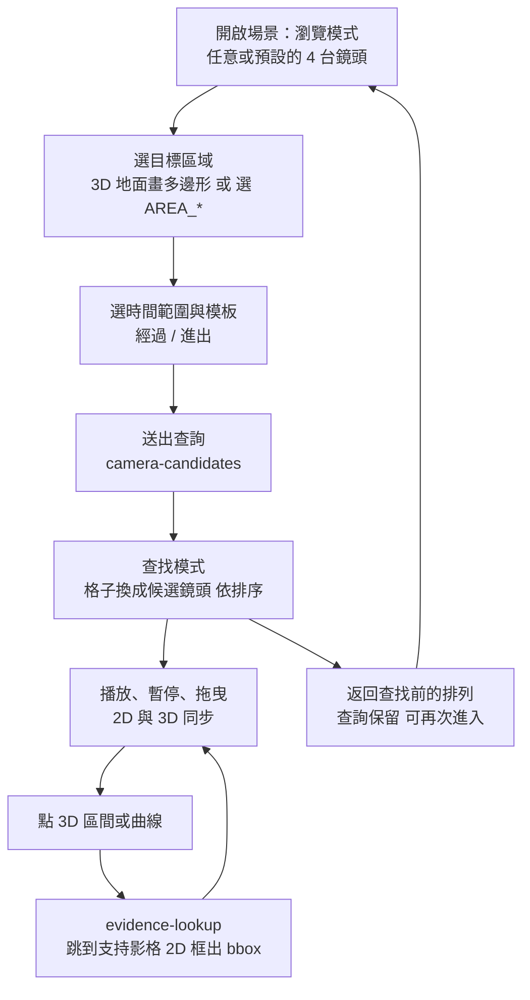
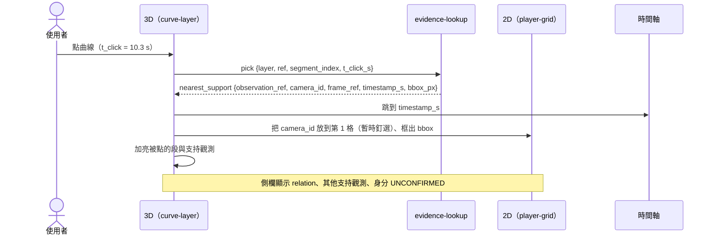

# 受控場景 Demo 操作草圖

日期：2026-10-18（Asia/Taipei）

狀態：**A 包草稿。只有文字與示意圖，沒有實作。**這份草圖描述工作台 `frontend/workbench/` 在新 Demo 裡的端到端操作。資料欄位以 [OFFICE_CONTROLLED_SCENE_V1](../contracts/OFFICE_CONTROLLED_SCENE_V1.md) 為準。設計理由見 [Claude 回覆](CONTROLLED_SCENE_CLAUDE_REPLY_20261018.md) Q2–Q5。

- 綠球、游標球、球狀人物替身一律不出現。
- 2026-10-18 更新：第一版取樣是 960×540、5 fps（使用者已決定），影格間隔 0.2 s。新增影格之間的時間內插說明（§5.4）；事件 A 只有 3 台鏡頭。
- 所有數字都是示意。

## 1. 畫面配置

```text
┌──────────────────────────────────────────────────────────────────────────────┐
│ 場景：受控 L 形走廊 v1 ▾   事件：B1 ▾   模式：[瀏覽] 查找    格數：1 2 [4] 8 │
├───────────────────────────────────────┬──────────────────────────────────────┤
│ 2D 同步畫面（player-grid）            │ 3D（person-layer + curve-layer）     │
│ ┌──────────────┐ ┌──────────────┐     │                                      │
│ │ CAM_W1       │ │ CAM_W2       │     │   北走廊                             │
│ │ 12.4 s READY │ │ 12.4 s READY │     │     ┆ ░░ 範圍帶（假設）              │
│ └──────────────┘ └──────────────┘     │     ┆                                │
│ ┌──────────────┐ ┌──────────────┐     │ ━━━━╋━ ─ ─ ─ ━━━ ← 加亮 [t−1 s, t]    │
│ │ CAM_N1       │ │ CAM_R102_CTRL│     │      ┃ ← 時間刻度「t = 12.4 s」      │
│ │ 12.4 s READY │ │ 12.4 s READY │     │ ▭ R101                               │
│ └──────────────┘ └──────────────┘     │                                      │
├───────────────────────────────────────┴──────────────────────────────────────┤
│ ◀ ▶ ❚❚  0 s ═══════════════●═══════════════════════ 20 s   速度 1×           │
│ 時間軸：  ▇▇▇▇ 觀測   ┄┄ 推論   ▒▒ 假設（盲區）   ╱╱ MISSING                 │
├──────────────────────────────────────────────────────────────────────────────┤
│ 圖例：觀測 ━  推論 ┄  假設 ╌ + 範圍帶  MISSING ╱╱  UNKNOWN ?   身分：UNCONFIRMED │
└──────────────────────────────────────────────────────────────────────────────┘
```

- 時間軸上的 `●` 是**播放頭**，只在時間軸上，不在 3D 裡。
- 2D 格子、3D、時間軸共用同一個時間 `t`。播放、暫停、拖曳都同時作用。
- 時間軸上每 0.2 s 有一個影格刻點（5 fps）。播放頭可以停在刻點之間，那時畫面上影格之間的東西都是推論（§5.4）。

## 2. 端到端流程



## 3. 格數切換（1／2／4／8）

| 格數 | 版面 | 規則 |
| --- | --- | --- |
| 1 | 單格放大 | 顯示目前排序第 1 名，或使用者釘選的鏡頭 |
| 2 | 1×2 | 依排序 |
| 4 | 2×2 | 依排序 |
| 8 | 2×4 | 依排序 |

- **候選集合和格數分開。**候選清單永遠列出所有候選，格子只是目前這一頁。
- **候選少於格數：**剩下的格子留空，顯示「無更多候選」，**不複製鏡頭補位**。例如事件 B1 只有 4 台，切到 8 格時後 4 格是空的。
- **候選多於格數：**用分頁（`第 1／3 頁`），不丟棄。12 台以上的情況用 UI fixture 測，fixture 的鏡頭全部標 `FIXTURE`。
- **釘選：**使用者可以把某台鏡頭釘在第 1 格，其餘依排序遞補。釘選只改版面，不改排序。
- 每格的角標：`camera_id`、該格的 `timestamp_s`、狀態（`READY`、`MISSING`、`OUT_OF_RANGE`）。`MISSING` 時整格灰色斜線，不用其他影格補。

```text
8 格、4 台候選（事件 B1）：
┌────────┬────────┬────────┬────────┐
│ CAM_W2 │ CAM_W1 │ CAM_N1 │ R102   │
│ #1     │ #2     │ #3 不相交│ #4 不相交│
├────────┼────────┼────────┼────────┤
│ 無更多 │ 無更多 │ 無更多 │ 無更多 │
│ 候選   │ 候選   │ 候選   │ 候選   │
└────────┴────────┴────────┴────────┘
```

## 4. 查找模式：前後狀態

**查找前（瀏覽模式）：**

```text
模式：[瀏覽]   格子：CAM_R102_CTRL, CAM_N1, CAM_W1, CAM_W2（預設順序，與任何查詢無關）
3D：所有已估出的區間與曲線（若已載入）
側欄：（空）
```

**輸入查詢：**

```text
目標區域：AREA_R101_FRONT（或 3D 地面上畫的多邊形，地面高亮）
時間範圍：8.0 – 20.0 s
模板：( ) 經過   (•) 進出
[送出]
```

**查找後（查找模式）：**

```text
模式：瀏覽 [查找]   查詢：進出 AREA_R101_FRONT 8.0–20.0 s   [返回查找前]
側欄 候選清單（4 台，全部列出）：
  #1 CAM_W2        相交等級 1｜重疊 7.2 m²｜31 張有偵測（不代表同一人）
  #2 CAM_W1        相交等級 1｜重疊 6.1 m²｜…
  #3 CAM_N1        相交等級 3｜不相交
  #4 CAM_R102_CTRL 相交等級 3｜不相交
  排序依據：相交等級 → 重疊面積 → 有偵測影格數 → camera_id
格子：依上面的排序重排
3D：目標區域多邊形 + 通路（門與相鄰走廊格）淡色顯示；候選鏡頭的地面足跡用細外框
時間軸：跳到 8.0 s，查詢範圍外的時間變暗
```

- 「返回查找前」恢復原本的鏡頭排列與時間，查詢保留在側欄，可以一鍵再進入。
- 每個候選都附排序理由，滑過即可看到；排序不讀 GT、事件腳本或設計的覆蓋表。
- 「最值得看」只表示建議檢視順序，不顯示成機率。

## 5. 3D 圖層與時間表示

### 5.1 人物（person-layer）

```text
POINT（腳點可見）：        ╳  地面短十字 ＋ 半透明人形（1.70 m／r 0.25 m，顯示設定）

SEGMENT 且長度 ≤ 門檻：    ├──────┤  實線段 ＋ 沿整段掃過的半透明人形範圍
                         ⌒⌒⌒⌒⌒⌒⌒

SEGMENT 且長度 > 門檻：    ├──────────────┤  只有實線段，不畫人形
```

- 門檻 `HUMANOID_DISPLAY_MAX_INTERVAL_M` 待約定。
- 絕不在區間中點放實心人形，也不放球。
- 方向（推論）：在區間旁畫一個小箭頭，用琥珀色。前後影格任一是 `UNKNOWN` 時不畫。

### 5.2 曲線（curve-layer）

```text
   觀測       推論連接（緞帶）   盲區假設             觀測
 ├──┤├──┤   ┄┄┄┄┄┄┄┄┄┄┄┄     ╌ ╌ ╌ ╌ ╌ ╌ ╌ ╌    ├──┤├──┤
            ┄┄┄┄┄┄┄┄┄┄┄┄     ░░░░ 範圍帶 ░░░░
   青綠實線    琥珀短虛線（兩條邊） 玫紅長虛線＋半透明帶   青綠實線

   … ├──┤        ╱╱ MISSING（3D 不畫，只在時間軸）        ├──┤ …
```

- 預測（D 包）：玫紅長虛線，尾端開口，範圍帶往前變寬，標「預測」。

### 5.3 目前時間

| 狀況 | 3D 的表示 | 時間軸 |
| --- | --- | --- |
| t 落在觀測或推論段 | 曲線 [t−Δ, t] 加亮加粗；末端畫垂直於曲線的短刻度，標 `t = 12.4 s` | 播放頭 |
| t 落在盲區 | 只加亮那一刻的範圍帶切片；不畫位置 | 播放頭在 ▒▒ 區 |
| t 落在 `MISSING` | 3D 不加亮任何東西 | 播放頭在 ╱╱ 區，標「此時無觀測」 |
| t 落在 `UNKNOWN` | 3D 不加亮；側欄列原因 | 播放頭旁標「?」 |

- Δ 預設 1 s，可在設定調整。
- 刻度只標時間，不代表人物在那一點。

### 5.4 影格之間的時間內插（5 fps）

```text
影格時間：  12.2        12.4        12.6
             |           |     ▲     |
                             t = 12.47 s（播放頭）

2D 格子：   顯示 12.4 s 的影格，角標「12.40 s　+0.07 s」  ← 影格本身是觀測
3D 觀測：   只在 12.2、12.4、12.6 s 畫青綠實線區間          ← 觀測
3D 加亮：   12.4 → 12.47 s 這一小段用琥珀色                  ← 推論（內插）
時間刻度：  畫在 12.47 s 的推論位置，標「t = 12.47 s（內插）」
```

| 狀況 | 規則 |
| --- | --- |
| 播放頭正好落在影格時間 | 觀測照常顯示，刻度不加「內插」 |
| 播放頭在兩張影格之間 | 2D 顯示 `timestamp_s ≤ t` 的最後一張，標差值；3D 在影格之間畫出的任何東西都是 `INFERRED_INTERPOLATION`，琥珀色，不用觀測色 |
| 前後影格之一是 `MISSING`、`UNKNOWN`，或位在盲區、或不屬於同一局部軌跡 | 不內插；3D 不加亮，刻度只留在時間軸上 |
| 局部軌跡還沒有（契約 CS-Q10） | 3D 只顯示各影格的觀測，不畫內插段 |
| 點擊落在內插段 | 跳到最近的那張影格自己的時間，不跳到點擊的時間 |

- 播放速度可調，但不會因此多出觀測。把 5 fps 包成較高幀率播放，只是重複顯示同一張影格。

## 6. 點擊回溯



| 點到的東西 | 結果 |
| --- | --- |
| 觀測（點或區間） | 跳到那張影格，2D 框出 bbox |
| 觀測段 | 跳到時間最近的支持觀測 |
| 推論連接 | 跳到較近的一端，另一端列在側欄 |
| 盲區假設 | 不跳轉；側欄列出兩端觀測與負證據影格，每一項可點 |
| `MISSING` 段 | 不跳轉；側欄寫「此段沒有支持證據」 |

## 7. Evidence state 圖例

| 狀態 | 意思 | 3D | 2D | 時間軸 |
| --- | --- | --- | --- | --- |
| 觀測 `PROJECTED_OBSERVATION` | 由一張影格的偵測投影到地面 | 青綠實線段或十字 | bbox 實線框 | ▇▇ |
| 推論 `INFERRED_INTERPOLATION` | 兩筆觀測之間的連接，或由前後影格推得的方向 | 琥珀短虛線緞帶、箭頭 | — | ┄┄ |
| 假設 `INFERRED_HYPOTHESIS` | 盲區或預測的可能範圍，排序是合理程度，不是機率 | 玫紅長虛線＋範圍帶 | 負證據影格加註「未偵測」 | ▒▒ |
| `MISSING` | 應有資料但沒有，例如影格缺失或 hash 不符 | 不畫 | 整格灰色斜線 | ╱╱ |
| `UNKNOWN` | 無法判斷，例如估計器 fail closed、區域未標 | 不畫；側欄列原因 | 角標「?」 | ? |

- 身分一律 `UNCONFIRMED`，常駐顯示在圖例列。
- 合成或 fixture 資料一律加浮水印 `FIXTURE`，不和真實渲染混在同一畫面。

## 8. Demo 步驟（建議，取代舊 D24）

| 步驟 | 事件 | 畫面 |
| --- | --- | --- |
| 1 | A | 瀏覽模式，4 格同步播放（事件 A 只有 3 台，第 4 格顯示「無更多候選」） |
| 2 | A | 選 `AREA_R101_FRONT`、0–10 s、經過 → 查找模式，`CAM_W1`、`CAM_W2` 排前面，`CAM_R102_CTRL` 標「不相交」 |
| 3 | A | 3D 區間與觀測曲線；暫停在影格之間，說明琥珀色內插段；點曲線跳回影格 |
| 4 | B1 | 進出查詢 8–20 s → 候選重排 |
| 5 | B1 | 轉角盲區：範圍帶，不畫位置；時間在盲區時只加亮切片 |
| 6 | B1 | P1 在 `CAM_N1` 再出現；K8c 判定可達，身分 `UNCONFIRMED`；兩人沒被連成同一條 |
| 7 | B1 | 1／2／4／8 切換、空格與分頁（8 格時後 4 格空） |

B2 與預測（D 包）在各自的檢查點通過後才加入。

## 實際產出 / Actual output

- Model / effort: Claude Opus 5.5（`claude-opus-5-5`）／ effort 未由本 session 指定（UNKNOWN）
- Files changed: 本文件
- Verified: 圖例顏色對照 K4 `blind-hypothesis.mjs` @ `5a2c613`；欄位名稱對照 [OFFICE_CONTROLLED_SCENE_V1](../contracts/OFFICE_CONTROLLED_SCENE_V1.md)
- Not verified: 沒有實作，沒有瀏覽器驗收；Mermaid 沒有檢查渲染
