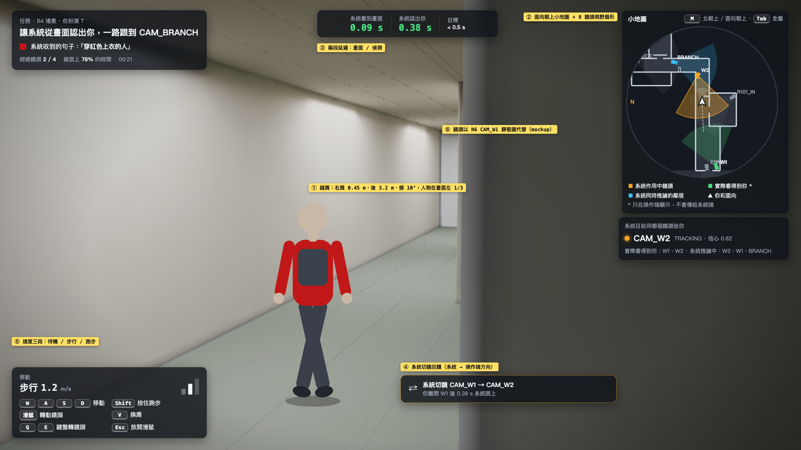
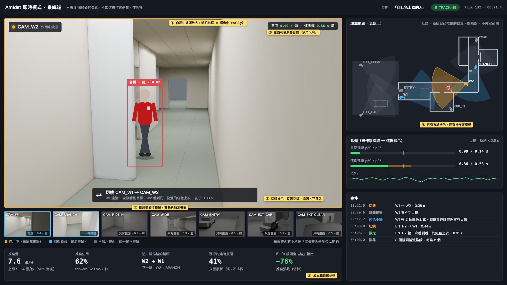

# 即時模式遊戲化設計 v1（D210，2026-11-15）

> **2026-11-15 更新：** [`LIVE_MODE_GAME_DESIGN_V2.md`](LIVE_MODE_GAME_DESIGN_V2.md) 取代這份文件的 §1.2 決策 G1、§3 畫面顯示、§5.1、§5.2 的 P1、§6、§8。§2 操作設計、§4 人物動畫、§5.3–§5.5、§7 現有資產仍然有效。

分支 `claude/feat-live-mode`，PR [#544](https://github.com/Polalalabear/amidst/pull/544)。這份文件只有設計，沒有功能程式碼。它回應使用者試玩 spike 後的五點回饋：

| 回饋 | 對應章節 | 設計上的回答 |
| --- | --- | --- |
| 系統端要 1–3 秒才反應 | §5 | 畫面和偵測拆成兩條路，只推論作用中鏡頭和鄰居，只留最新一張畫面 |
| 要小地圖，有俯視圖和攝影機位置 | §3 | 操作端右上角的面向朝上小地圖，系統端的北朝上場域地圖 |
| 畫面以人物面向為主（越肩） | §2 | 右肩越肩鏡頭，移動方向以鏡頭為準 |
| 移動沒有腳步動畫 | §4 | 用 N6 的 idle、walk、run 三段動作，依速度混合 |
| 想要像設計遊戲一樣 | §2–§6 | 每一項都標注參考的遊戲或 UI 慣例 |

這是工程 demo 的設計，不是辨識、身分或實體安全的正式驗收。數字分三種：**量出**（來自 spike 報告）、**設計值**（本文件決定，實作後可調）、**推估**（由量出的數字算出，還沒實測）。

## 1. 現況和主要決策

### 1.1 spike 現況（量出，來源 [`docs/evaluation/LIVE_MODE_SPIKE_20261115.md`](../evaluation/LIVE_MODE_SPIKE_20261115.md)）

- 延遲 p50 / p95：3 鏡頭 320×180 @5 fps 是 421 / 663 ms；8 鏡頭 320×180 @5 fps 是 1111 / 1908 ms，最大 2219 ms。使用者感覺到的 1–3 秒和 8 鏡頭的數字一致。
- 偵測器 forward 占伺服器時間 90% 以上。每張影像 70–115 ms（MPS），吞吐上限約 9–14 張/秒。
- 8 鏡頭一批的各階段中位數：擷取 127 ms、forward 911 ms、顏色判斷 1 ms、頻道到顯示 31 ms。
- 系統端的畫面是跟著推論結果一起送的，所以畫面也被推論拖慢。
- 操作端鏡頭固定在人物後方朝北，WASD 對應世界座標，人物是膠囊，沒有動畫。
- 膠囊的偵測率 16.7%，N6 WIP 角色約 60%。

### 1.2 主要決策

| 編號 | 決策 | 理由 |
| --- | --- | --- |
| G1 | 延遲拆成兩個指標：**畫面延遲**目標 p50 ≤ 0.15 s，**偵測延遲**目標 p50 ≤ 0.5 s、p95 ≤ 0.8 s | 使用者看到的「系統有沒有反應」先取決於鏡頭畫面有沒有動。畫面不需要等推論 |
| G2 | 每一輪只推論作用中鏡頭加一個鄰居鏡頭，其餘 6 個只顯示畫面 | 8 張一批要 911 ms，2 張一批推估 140–230 ms |
| G3 | 推論端主動拿最新一張畫面，不排隊、不固定節拍 | 現在的固定節拍在推論超過週期時丟掉 55–87% 的 tick，剩下的畫面也是舊的 |
| G4 | 鏡頭用右肩越肩，WASD 以鏡頭方向為準，滑鼠轉鏡頭，Q/E 是鍵盤備援 | 回應「以人物面向為主」。鍵盤備援讓量測腳本和沒有滑鼠鎖定的環境也能操作 |
| G5 | 人物和場景改用 N6 的 `character.glb` 和 `scene.glb`，膠囊只留作測試替身 | N6 已經合併到 main，有骨架動作和烘焙光照，偵測率也比膠囊高 |
| G6 | 操作端小地圖可以顯示「哪些鏡頭實際看得到你」，這項資訊只留在操作端視窗 | 這是 Ground Truth，系統端永遠拿不到。操作端顯示它，玩家才知道自己走進哪個鏡頭 |
| G7 | 系統端推論用的攝影機參數改讀攝影機 catalog，不讀 `R004_SCENE_GEOMETRY_2D_V1.json` | 這個幾何檔標明 `must_not_enter: RUNTIME_INFERENCE`。spike 的 `server.py` 目前從它讀攝影機矩陣，要改掉。地圖底圖只用於顯示，可以繼續用 |
| G8 | 這一版不做手把、不做手機版面、不做聲音 | 工作台是桌面專用；聲音和手把不影響延遲和成本這兩個主要指標 |

## 2. 操作設計

### 2.1 按鍵和滑鼠

| 輸入 | 動作 | 參考慣例 |
| --- | --- | --- |
| W / A / S / D | 以鏡頭方向為準的前、左、後、右移動。人物轉向移動方向 | 第三人稱動作遊戲的鏡頭相對移動（camera-relative movement） |
| Shift（按住） | 跑步 | PC 第三人稱遊戲常見的「按住衝刺」 |
| 滑鼠移動 | 轉動鏡頭（水平、垂直）。點一下主畫面後鎖定滑鼠 | 瀏覽器 Pointer Lock，PC 遊戲的 mouse look |
| Q / E | 鍵盤轉鏡頭，每秒 120° | 沒有滑鼠鎖定時的備援；早期第三人稱遊戲的鍵盤轉鏡頭 |
| V | 換肩（右肩 ↔ 左肩） | 越肩射擊遊戲的 shoulder swap |
| M | 小地圖切換「面向朝上／北朝上」 | 開放世界遊戲的小地圖方向設定 |
| Tab（按住） | 顯示全場地圖 | 多人遊戲按住 Tab 看總覽的慣例 |
| Esc | 放開滑鼠 | Pointer Lock 的標準行為 |
| H | 顯示或隱藏操作提示 | 遊戲的 HUD 開關 |

設計值：滑鼠靈敏度 0.12°/像素，可在 URL 參數調整。不做垂直反轉設定。

### 2.2 越肩鏡頭

| 參數 | 設計值 | 說明 |
| --- | --- | --- |
| 支點 | 人物腳底上方 1.45 m | 大約肩膀高度 |
| 距離 | 支點後方 3.2 m | 走廊寬 2.4 m，這個距離能同時看到人物全身和前方 |
| 肩偏移 | 往右 0.45 m | 人物落在畫面左側三分之一，前方視野不被擋住 |
| 俯角 | 預設 −10°，可調範圍 −35° 到 +20° | 攝影機裝在 1.8–3.0 m 高，稍微俯視才看得到它們 |
| 垂直視角 | 55°（沿用 spike） | |
| 位置平滑 | 臨界阻尼，時間常數 0.12 s | 人物起步和停下時鏡頭不會頓一下 |
| 轉動 | 滑鼠直接控制，不加延遲 | 轉動加平滑會讓人暈 |
| 自動回正 | 移動中且 1.0 s 沒有動滑鼠時，鏡頭以每秒 90° 轉回人物背後 | 只用鍵盤也能維持「以人物面向為主」 |
| 碰牆 | 從支點往鏡頭位置掃一顆半徑 0.2 m 的球，碰到牆就把鏡頭拉到碰撞點前面。拉近立刻生效，放遠用 0.3 s 緩出 | 遊戲引擎的 spring arm 做法 |
| 最近距離 | 0.6 m。距離小於 0.8 m 時人物變成 30% 不透明 | 避免鏡頭鑽進人物裡 |

現在 spike 把牆壁變成 18% 不透明來避開遮擋。新設計改用碰牆拉近，牆壁保持不透明，這樣操作端看到的場景和攝影機看到的一致。

參考慣例：越肩第三人稱鏡頭（《惡靈古堡 4》普及的肩後視角、《戰爭機器》的換肩）；Unreal 的 Spring Arm 和 Unity Cinemachine 的 Third Person Follow 處理碰牆拉近的方式；動作冒險遊戲在玩家不動鏡頭時自動回到背後。只參考手法，不使用這些作品的美術或素材。

### 2.3 移動和轉向手感

| 參數 | 設計值 | 來源 |
| --- | --- | --- |
| 步行速度 | 1.2 m/s | N6 walk 動作的速度（量出） |
| 跑步速度 | 2.5 m/s | N6 run 動作的速度（量出） |
| 加速度 | 8 m/s² | 0.15 s 內到步行速度 |
| 減速度 | 10 m/s² | 放開按鍵 0.12 s 內停下 |
| 人物轉向 | 每秒最多 540°，轉向移動方向 | 轉身看得到過程，但不拖泥帶水 |
| 碰撞半徑 | 0.25 m，碰牆沿牆滑動 | 沿用 `sim.mjs` 的 `blocked()` |
| 斜向移動 | 正規化，不會比直走快 | 沿用 spike |

碰撞繼續用 2D 淨空線段（`clearance_segments`），這只在操作端使用。

參考慣例：角色控制器的加減速曲線和沿牆滑動（collide and slide）是第三人稱遊戲的通用做法。

## 3. 畫面顯示

### 3.1 操作端



主畫面是全螢幕的越肩 3D 視角。mockup 裡的 3D 畫面用 N6 的 CAM_W1 靜態圖代替，人物是示意圖形。

| 區域 | 位置 | 內容 | 參考慣例 |
| --- | --- | --- | --- |
| 任務卡 | 左上 | 扮演的角色、系統收到的句子、已經過的鏡頭數、被跟上的時間比例、計時 | 遊戲的任務目標卡（objective tracker） |
| 系統反應 | 上方中央 | 「系統看到畫面」和「系統認出你」兩個延遲值，低於目標是綠色，0.5–1.0 s 是黃色，超過 1.0 s 是紅色 | 線上遊戲的 ping 和幀時間顯示 |
| 小地圖 | 右上 | 見 §3.3 | 見 §3.3 |
| 系統正在看你 | 小地圖下方 | 系統作用中的鏡頭名稱、狀態、信心；實際看得到你的鏡頭；系統正在推論的鏡頭 | 潛行遊戲的「被發現」指示 |
| 切鏡通知 | 下方偏右 | 系統切鏡時顯示 3 秒：從哪到哪、花多久 | 遊戲的事件通知（toast） |
| 移動狀態 | 左下 | 待機／步行／跑步和目前速度 | 遊戲的姿態和速度指示 |
| 操作提示 | 左下 | 按鍵說明，按 H 隱藏 | 遊戲的按鍵提示（control hints） |

HUD 只放在四個角落和上下邊緣，畫面中央留給人物和場景。面板用半透明深色底。

「系統作用中的鏡頭」和「切鏡通知」是系統的輸出，從系統送回操作端，這個方向不違反 Ground Truth 隔離。

### 3.2 系統端



| 區域 | 位置 | 內容 | 參考慣例 |
| --- | --- | --- | --- |
| 標題列 | 最上方 | 查詢句子、追蹤狀態（SEARCHING／TRACKING／LOST）、tick 和時間 | 監控軟體的狀態列 |
| 作用中鏡頭 | 左側大畫面（1280×720） | 琥珀色外框、偵測框和標籤、畫面和偵測框各自的時間差 | 導播台的 tally 燈：播出中的機位亮燈 |
| 切鏡提示 | 大畫面下緣 | 顯示 3 秒：從哪到哪、原因、花多久。同時外框閃一下，地圖上畫一條從舊鏡頭到新鏡頭的箭頭 | 導播切換的提示，遊戲的事件橫幅 |
| 其餘 7 個鏡頭 | 大畫面下方一排 | 鄰居鏡頭是青色框，標「推論」；其餘變暗，標「只有畫面」。每個都標畫面的時間差 | 監控牆的主畫面加縮圖列 |
| 成本列 | 左下 | 推論張數/秒、推論佔用比例、這一輪和下一輪推論哪些鏡頭、丟掉的過時畫面比例、和 8 鏡頭全推論相比省多少 | 遊戲的效能面板（performance overlay） |
| 場域地圖 | 右上 | 見 §3.3 | 見 §3.3 |
| 延遲 | 右中 | 畫面延遲和偵測延遲的 p50／p95、0.5 s 目標線、最近 30 秒的曲線 | 線上遊戲的網路圖表（net graph） |
| 事件 | 右下 | 鎖定、切鏡、離開視野、同色干擾、遺失、重新鎖定，新的在上面 | 多人遊戲的事件列 |

系統端沒有任何操作者的資訊。地圖上的紅點是系統從偵測框腳點投影到地面算出來的位置，虛線圈是不確定範圍（設計值：TRACKING 時半徑 0.9 m，每漏一輪加 0.3 m，上限等於追蹤器的 3.0 m 關聯門檻）。

同色干擾是這個場景的重點：T 和 A 都穿紅色。作用中鏡頭裡有兩個紅色上衣時，目標用實線框，另一個用虛線框，事件列記一筆「同色干擾」。

### 3.3 小地圖

| 項目 | 操作端 | 系統端 |
| --- | --- | --- |
| 底圖 | `R004_SCENE_GEOMETRY_2D_V1.json` 的地板和牆線 | 相同 |
| 方向 | 預設面向朝上，玩家固定在中心，按 M 切成北朝上 | 固定北朝上，顯示整個場域 |
| 比例 | 1 m = 13 px，顯示半徑約 14 m | 1 m = 14.6 px |
| 攝影機 | 8 個圖示加視野扇形。扇形角度用各鏡頭的水平視角（70°、75° 或 90°），長度 8 m，被牆擋住的部分裁掉 | 相同，長度 9 m |
| 攝影機顏色 | 琥珀色是系統作用中；青色是系統正在推論的鄰居；綠色是實際看得到玩家；灰色是其他 | 琥珀色是作用中；青色是鄰居；灰色是其他。**沒有綠色** |
| 玩家 | 白色箭頭和面向扇形，加最近 10 秒的軌跡 | **不顯示** |
| 系統推估 | 不顯示 | 紅點、不確定範圍、最近 60 個點的軌跡 |

8 個攝影機的位置和視角（由 `R004_SCENE_GEOMETRY_2D_V1.json` 的 `camera_to_world` 和內參算出）：

| 鏡頭 | 位置 x, y, z (m) | 朝向（度，東為 0，逆時針為正） | 俯角 | 水平視角 |
| --- | --- | --- | --- | --- |
| CAM_BRANCH | 16.8, 6.5, 2.5 | −102 | −22° | 75° |
| CAM_ENTRY | −2.5, 0.4, 2.5 | −173 | −23° | 75° |
| CAM_EXT_CAR | −13.0, −6.0, 3.0 | 31 | −19° | 70° |
| CAM_EXT_CLEAR | −13.0, 7.0, 3.0 | −18 | −18° | 70° |
| CAM_R101_IN | 10.4, −4.5, 2.5 | 122 | −18° | 70° |
| CAM_W1 | −2.6, −1.4, 2.0 | 17 | −6° | 75° |
| CAM_W2 | 14.4, 2.1, 1.8 | −172 | −7° | 75° |
| CAM_WIDE | 17.0, 13.5, 2.7 | −97 | −11° | 90° |

參考慣例：玩家置中、會旋轉的圓形小地圖（《俠盜獵車手》系列的雷達）；地圖上畫敵人視野錐（《潛龍諜影》的 Soliton 雷達、《盟軍敢死隊》的視野錐），這裡把「敵人」換成攝影機；MOBA 遊戲在小地圖上區分己方視野。

## 4. 人物動畫

N6 `character.glb` 有三段原地動作（量出，來源 `docs/operations/N6_LIVE_ASSETS_20261115.md`）：

| 動作 | 對應速度 | 步幅 | 循環長度 |
| --- | --- | --- | --- |
| idle | 0 m/s | 0 | 2 s |
| walk | 1.2 m/s | 1.05 m | 0.875 s |
| run | 2.5 m/s | 1.60 m | 0.64 s，有騰空期 |

混合規則（設計值），v 是人物實際的地面速度：

| 速度範圍 | idle 權重 | walk 權重 | run 權重 | 播放速率 |
| --- | --- | --- | --- | --- |
| v < 0.05 | 1 | 0 | 0 | idle 1.0 |
| 0.05 ≤ v ≤ 1.2 | 1 − v/1.2 | v/1.2 | 0 | walk = max(v, 0.6) / 1.2 |
| 1.2 < v ≤ 2.5 | 0 | (2.5 − v)/1.3 | (v − 1.2)/1.3 | 見下 |

- **腳步和速度同步**：N6 文件指定用 `action.timeScale = 實際速度 / 動作速度`。walk 和 run 混合時，兩段動作用同一個正規化相位（0 到 1 走完一個循環），混合後的循環長度是 `w_walk × 0.875 + w_run × 0.64` 秒，兩段動作各自調整播放速率來對齊這個長度。這樣左右腳不會錯開。
- **過渡**：權重變化用 0.15 s 的時間常數平滑，起步和停下不會跳。
- **轉身**：不另外做轉身動作，人物直接繞垂直軸旋轉（每秒最多 540°）。
- **四個角色**：用 `KHR_materials_variants` 切換 T、A、B、C 的材質。玩家是 T，三個干擾者沿 v2.3 路線走，用同一套混合規則，速度從路線點算出。
- **攝影機也看得到動畫**：8 個虛擬攝影機渲染的是同一個場景，所以系統端收到的像素裡人物也在走路。這會改變偵測率，要重測（§7 的 L7）。

參考慣例：Unreal 的 1D Blend Space 和 Unity 的 Blend Tree 依速度混合待機、走、跑；sync group（相位同步）避免混合時腳步錯開；用播放速率對齊地面速度來避免滑步。

## 5. 延遲預算和改法

### 5.1 兩個指標的定義

- **畫面延遲**：操作端擷取鏡頭畫面的時刻，到系統端把這張畫面畫出來的時刻。
- **偵測延遲**：操作端擷取畫面的時刻，到系統端顯示根據這張畫面算出的偵測框和追蹤狀態的時刻。這等於 spike 報告的「延遲」。
- **操作到反應**：按下按鍵到系統端有反應，等於「等下一次擷取的時間」加上面其中一個延遲。這是使用者感覺到的數字，也是 0.5 秒目標的對象。

### 5.2 改法

| 編號 | 改法 | 現況（量出） | 改後（推估） |
| --- | --- | --- | --- |
| P1 | **畫面和偵測分開送**。操作端擷取後立刻把畫面送到系統端，偵測結果晚一點再送，用 tick 編號對上 | 畫面等推論完才送，延遲 421–1111 ms | 畫面延遲約 60–130 ms |
| P2 | **只推論作用中鏡頭和鄰居**。TRACKING 時每一輪推論作用中鏡頭加一個鄰居，鄰居輪流 | 8 張一批 forward 911 ms，3 張一批 218–323 ms | 2 張一批 140–230 ms |
| P3 | **只留最新一張**。推論端空下來就拿當下最新的畫面，中間的丟掉，不排隊 | 固定節拍，丟掉 55–87% 的 tick，畫面平均多等半個週期以上 | 等待時間接近 0，每張被推論的畫面都是剛擷取的 |
| P4 | **擷取頻率分級**。作用中鏡頭 10 fps，鄰居 5 fps，其餘 2 fps，全部 320×180 | 全部同一個頻率 | 每秒擷取約 10 + 2×5 + 5×2 = 30 張，每張約 16 ms，要再量 |
| P5 | **搜尋狀態輪流掃**。SEARCHING 和 LOST 時每一輪推論 2 個鏡頭，8 個鏡頭 4 輪掃完 | 8 張一批 | 掃完一圈約 0.6–0.9 s |
| P6 | **降低操作端主畫面的負擔**。主畫面上限 30 fps，解析度比例上限 1.0 | Chrome 的 WebGL 和 MPS 共用同一顆 GPU，量測時 GPU 使用率 84–92% | 未知，要量 |

解析度維持 320×180。spike 已經量出提高解析度沒有改善偵測率，模型輸入固定拉伸成 640×640。

不建議的做法：改用 CPU（比 MPS 慢 3–5.6 倍）；提高 fps 硬拚（吞吐上限是 9–14 張/秒）。

### 5.3 延遲預算（TRACKING 狀態，設計值和推估）

| 階段 | 畫面這條路 | 偵測這條路 | 依據 |
| --- | --- | --- | --- |
| 等下一次擷取（作用中鏡頭 10 fps） | 平均 50 ms | 平均 50 ms | 週期 100 ms 的一半 |
| 渲染和擷取 | 約 16 ms（1 張） | 約 35 ms（2 張） | 量出：3 張 47–51 ms，8 張 121–130 ms |
| 傳到伺服器、解碼 | — | 約 15 ms | 量出：HTTP 往返減伺服器時間約 4 ms |
| 偵測器 forward（2 張） | — | 140–230 ms | 量出：每張 70–115 ms |
| 顏色判斷、追蹤 | — | 約 2 ms | 量出：0.7–2.1 ms |
| 傳到系統端、畫出來 | 約 10–30 ms | 約 10–30 ms | 量出：6–31 ms |
| **合計（從擷取算起）** | **約 30–50 ms** | **約 200–310 ms** | |
| **合計（從按鍵算起）** | **約 80–100 ms** | **約 250–360 ms** | |
| 目標 | p50 ≤ 150 ms | p50 ≤ 500 ms，p95 ≤ 800 ms | |

這些合計是推估。spike 的量測有同機負載，每組只跑一次，所以實作後要在空閒的機器上重測（L7）。

切鏡時間另外算：追蹤器在作用中鏡頭連續 2 輪沒看到目標、且鄰居看到時切鏡。每輪約 250 ms，鄰居每隔一輪推論一次，所以切鏡推估要 0.5–1.0 秒。要更快，可以在目標接近畫面邊緣時把鄰居改成每輪都推論（3 張一批，約 220–340 ms）。這項列為 L5 的可選項。

### 5.4 鄰居鏡頭怎麼定

鄰居表是系統端的設定，只能來自系統端可以用的資料。兩個來源：

1. r004 既有的攝影機圖（graph v3，D89）。它在 repo 裡的路徑：**UNKNOWN**，這一輪沒有查。
2. 找不到時，在 `src/amidst/live_mode/` 放一份手寫的鄰居表。

下面是依攝影機位置和朝向寫的草稿，**沒有驗證**，實作時要對照 graph v3 或實際走一遍確認：

| 鏡頭 | 鄰居（草稿） |
| --- | --- |
| CAM_EXT_CAR | CAM_EXT_CLEAR、CAM_ENTRY |
| CAM_EXT_CLEAR | CAM_EXT_CAR、CAM_ENTRY |
| CAM_ENTRY | CAM_EXT_CAR、CAM_EXT_CLEAR、CAM_W1 |
| CAM_W1 | CAM_ENTRY、CAM_W2、CAM_R101_IN |
| CAM_W2 | CAM_W1、CAM_R101_IN、CAM_BRANCH |
| CAM_R101_IN | CAM_W1、CAM_W2 |
| CAM_BRANCH | CAM_W2、CAM_WIDE |
| CAM_WIDE | CAM_BRANCH |

鄰居表不能從 `R004_SCENE_GEOMETRY_2D_V1.json` 在執行時算出來，因為這個檔不能進入執行時推論（G7）。

### 5.5 成本指標

系統端的成本列顯示：

- 推論張數/秒，旁邊標上限 9–14 張/秒（量出）。
- 推論佔用：每秒有多少毫秒花在 forward。
- 丟掉的過時畫面比例。在「只留最新一張」的設計下，丟畫面是正常行為，不是錯誤。
- 和 8 鏡頭全推論相比省下的推論張數。

本機推論沒有 API 費用，所以成本用推論量和佔用時間表示，不換算成金額。

## 6. Ground Truth 隔離

沿用 spike 的做法並加強：

- `protocol.mjs` 的白名單是唯一的出口。新增的訊息類型（獨立的畫面訊息、系統送回操作端的狀態訊息）都要加進白名單和 `validateSystemMessage`。
- 系統端模組不 import `world.mjs`、`sim.mjs`、`person.mjs`、控制器和越肩鏡頭模組。用測試檢查 import 關係。
- 操作端的「實際看得到你」只在操作端視窗裡計算和顯示，不進 BroadcastChannel，不進 `/infer` 的請求。
- 系統端推論用攝影機 catalog（G7）。地圖底圖只用於顯示。
- 身分仍然是未確認。系統端的標籤寫「目標」和顏色，不寫角色代號 T。

## 7. 能直接用的現有資產

| 資產 | 路徑 | 狀態 |
| --- | --- | --- |
| 即時模式前端 | `frontend/live-mode/`（`src/operator.mjs`、`system.mjs`、`world.mjs`、`sim.mjs`、`person.mjs`、`capture.mjs`、`protocol.mjs`、`common.mjs`、`sweep.mjs`；`measure/`；`test/protocol.test.mjs`） | 在 `claude/feat-live-mode`（`5af38c2d`），Draft PR #544。可以直接改 |
| 即時模式後端 | `src/amidst/live_mode/`（`server.py`、`detector.py`、`tracker.py`、`color.py`）、`tests/live_mode/test_live_mode.py` | 同上。`server.py` 的攝影機來源要改（G7） |
| N6 人物 | LOCAL `local/data/live-assets-20261115/character.glb`（658,080 bytes） | PR [#539](https://github.com/Polalalabear/amidst/pull/539) 已合併到 main（`1aea09cd`）。17 骨，walk／run／idle，T／A／B／C 材質。GLB 不進 Git。人工步態和外觀驗收還沒做 |
| N6 場景 | LOCAL `local/data/live-assets-20261115/scene.glb`（33,941,072 bytes） | 同上。15 個元件，4096² 烘焙光照，`n6Collider=true` 的節點可以當鏡頭碰牆用的碰撞體 |
| N6 攝影機 | LOCAL `local/data/live-assets-20261115/cameras.three.json`、`cameras.catalog.json` | 同上。矩陣是 row-major，用 `Matrix4.set(...rows.flat())` |
| N6 載入範例 | `scripts/n6_viewer/index.html`、`scripts/verify_n6_assets.mjs` | 在 main。有 three.js 載入和 variants 切換的範例 |
| N6 文件 | `docs/operations/N6_LIVE_ASSETS_20261115.md`、`N6_LIVE_ASSETS_MANIFEST_20261115.json` | 在 main。**`claude/feat-live-mode` 還沒有這些檔**，實作前要先把 main 合併進來 |
| 小地圖底圖 | `docs/evaluation/R004_SCENE_GEOMETRY_2D_V1.json` | 在 main 和本分支。7 塊地板、260 條淨空線段、8 個攝影機。只能用於顯示和操作端碰撞 |
| v2.3 路線 | `docs/evaluation/R004_A4B4_SCENARIO_V2_3_4ACTOR_DRAFT.json` | 在本分支。A4-1（50 s）和 B4-1（42 s），T／A／B／C 四個角色的路線點。`server.py` 已經在讀 |
| 工作台元件 | `frontend/workbench/geometry.mjs`、`ground-estimate.mjs`、`scene.mjs`、`style.css` | 已下線（D268）。需要重用時從 commit `0606b164` 取檔；能不能直接重用：**UNKNOWN**，不能用就在 `frontend/live-mode/` 另寫 |
| spike 量測 | `docs/evaluation/LIVE_MODE_SPIKE_20261115.md`、`docs/evaluation/live_mode_spike_20261115/`、`docs/engineering/live_mode_spike_data/`；LOCAL `local/evidence/live-mode-spike-20261115/lat/*.latency.json` | 在本分支。量測腳本 `frontend/live-mode/measure/run_latency.sh`、`run_sweeps.sh` 可以重跑 |
| mockup | `docs/design/img/live-mode-game-v1/`（兩張 PNG、兩個 HTML、`mockup-common.js`、`scene-data.js`、`make_scene_data.py`） | 這個 PR 新增。`mockup-common.js` 的小地圖畫法可以當 L4 的起點 |

## 8. 實作拆分

每一塊交給一個 Sonnet session，測試通過才算完成。全部在 `claude/feat-live-mode` 上做（D216，一次一個寫入者），或照下面的檔案範圍分開，最多三個同時寫。開工前先把 main 合併進分支，取得 N6 的文件和腳本。

| 編號 | 功能塊 | 主要檔案 | 依賴 |
| --- | --- | --- | --- |
| L1 | 接入 N6 人物和場景 | `src/world.mjs`、`src/person.mjs`、`server.py`（提供 GLB 和攝影機 catalog） | 無 |
| L2 | 角色控制器和動畫混合 | 新增 `src/controller.mjs`、`src/anim-blend.mjs`；改 `src/sim.mjs` | L1（只有接上畫面的部分） |
| L3 | 越肩鏡頭 | 新增 `src/ots-camera.mjs` | 無（純計算），接上畫面要 L1 |
| L4 | 操作端 HUD 和小地圖 | 新增 `src/minimap.mjs`、`src/hud-operator.mjs`；改 `src/operator.mjs`、`index.html` | L2、L3 |
| L5 | 延遲管線 | `src/capture.mjs`、`src/protocol.mjs`、`src/operator.mjs` 的擷取迴圈；`server.py`、`tracker.py`；新增 `scheduler.py` | 無 |
| L6 | 系統端版面 | `src/system.mjs`、`index.html`；新增 `src/hud-system.mjs` | L5 的訊息格式，L4 的 `minimap.mjs` |
| L7 | 重新量測和驗收 | `measure/`、`docs/evaluation/` | L1–L6 |

L2、L3、L5 的檔案不重疊，可以同時做。L4 和 L6 都改 `index.html`，要排先後。

### 驗收條件

**L1 接入 N6**
- `npm test`：載入 `character.glb` 後有 `walk`、`run`、`idle` 三段動作，長度是 0.875、0.64、2.0 秒（誤差 1 ms 以內）；有 T、A、B、C 四個 variant。GLB 不存在時測試標示跳過並說明原因，不能算通過。
- `pytest tests/live_mode`：`server.py` 的投影器從攝影機 catalog 讀參數；程式裡沒有從 `R004_SCENE_GEOMETRY_2D_V1.json` 讀攝影機矩陣給推論用。
- 瀏覽器冒煙測試（`measure/smoke.mjs`）：操作端和系統端頁面錯誤數是 0，8 個鏡頭都有畫面。

**L2 角色控制器和動畫**
- `controller.mjs` 不依賴 three.js。單元測試：鏡頭朝向 0°、90°、180° 時按 W 的移動方向正確；斜向速度不超過直走；按住 W 0.15 s 後速度達到 1.2 m/s（誤差 5% 以內）；放開後 0.15 s 內停下；跑步速度 2.5 m/s；碰牆時沿牆滑動，不穿牆（用 `clearance_segments` 的線段當測試資料）。
- `anim-blend.mjs` 單元測試：速度 0、0.6、1.2、1.85、2.5 m/s 的三個權重符合 §4 的表；權重總和是 1；walk 和 run 的正規化相位在混合時相等。
- 瀏覽器量測：以 1.2 和 2.5 m/s 直走 5 秒，支撐腳在世界座標的滑動速度中位數低於 0.05 m/s。

**L3 越肩鏡頭**
- `ots-camera.mjs` 不依賴 three.js 的渲染。單元測試：沒有遮擋時，鏡頭位置等於支點加上（後 3.2 m、右 0.45 m）的偏移；俯角被限制在 −35° 到 +20°；支點和鏡頭之間有牆時，鏡頭在牆的支點這一側，離牆至少 0.2 m；離開遮擋後 0.3 s 內回到原距離的 95%；距離不小於 0.6 m；按 V 後肩偏移變成 −0.45 m；移動中 1.0 s 沒有輸入時開始回正。

**L4 操作端 HUD 和小地圖**
- `minimap.mjs` 單元測試：世界座標到畫面座標的轉換在面向朝上和北朝上兩種模式都正確；8 個攝影機的扇形角度等於 §3.3 的表；扇形被牆擋住的部分有裁掉（用一個攝影機和一面牆的測試資料）。
- 隔離測試：`npm test` 檢查操作端小地圖的「實際看得到你」資料沒有出現在任何 BroadcastChannel 訊息和 `/infer` 請求裡。
- 截圖驗收：1920×1080 的操作端截圖有 §3.1 的七個區域，面板不互相重疊，不蓋住畫面中央 40% 的範圍。

**L5 延遲管線**
- `pytest tests/live_mode`：排程器在 TRACKING 時每一輪回傳作用中鏡頭加一個鄰居，鄰居輪流；在 SEARCHING 時 4 輪內涵蓋全部 8 個鏡頭；作用中鏡頭改變後，下一輪就用新的鄰居表。
- `npm test`：新的畫面訊息和狀態訊息通過 `validateSystemMessage`；加入 `operator_xy`、`person_id`、`gt` 任何一個鍵都會被擋下；推論端忙碌時送進 3 張畫面，只有最後一張被推論。
- 量測驗收（B4 自動路線 50 秒，MPS，N6 人物，機器上沒有其他重負載，重複 3 次）：畫面延遲 p50 ≤ 150 ms；偵測延遲 p50 ≤ 500 ms、p95 ≤ 800 ms；`protocol_violations` 是 0。沒達到時回報實際數字和各階段時間，不調整門檻。

**L6 系統端版面**
- 隔離測試：`system.mjs` 和 `hud-system.mjs` 的 import 清單裡沒有 `world.mjs`、`sim.mjs`、`person.mjs`、`controller.mjs`、`ots-camera.mjs`。
- 單元測試：切鏡事件會產生一則提示，內容有來源鏡頭、目標鏡頭和花費時間；延遲面板的 p50 和 p95 由最近 30 秒的資料算出。
- 截圖驗收：1920×1080 的系統端截圖有 §3.2 的八個區域；作用中鏡頭有琥珀色框；地圖上沒有玩家圖示。

**L7 重新量測**
- 用 N6 人物加動畫重跑偵測掃描（`measure/run_sweeps.sh`），回報各鏡頭的偵測率。
- 在空閒的機器上重跑延遲量測，每組 3 次，回報 p50、p95、切鏡時間和正確作用中鏡頭的比例。
- 結果寫成 `docs/evaluation/` 下的報告，更新這份設計稿裡標「推估」的數字。

## 9. 沒驗證和未決的部分

- §5 的延遲合計全部是推估。2 張一批的 forward 時間沒有直接量過。
- 偵測率是另一個獨立的問題：N6 WIP 角色約 60%，加上動畫後的數字 UNKNOWN。偵測率不夠時，延遲再低系統也跟不上。這份設計沒有解決偵測率。
- 鄰居表是草稿，沒有對照 graph v3。graph v3 在 repo 的路徑 UNKNOWN。
- 工作台元件能不能重用 UNKNOWN。
- mockup 是靜態圖：操作端的 3D 畫面用 N6 的 CAM_W1 靜態圖代替，人物是示意圖形，畫面上的數字是示意值，不是量測結果。
- mockup 的小地圖扇形沒有被牆裁切，實作時要裁（§3.3、L4）。
- 越肩鏡頭的距離、偏移、平滑時間都是設計值，要試玩後調整。
- mockup 的鏡頭畫面來自 LOCAL `local/data/live-assets-20261115/verification/CAM_*.png`（N6 #539 產出，SHA-256 見 `docs/operations/N6_LIVE_ASSETS_SCREENSHOTS_20261115.json`）。重新產生截圖的方法：

```bash
python3 docs/design/img/live-mode-game-v1/make_scene_data.py
```

```bash
"/Applications/Google Chrome.app/Contents/MacOS/Google Chrome" --headless=new --hide-scrollbars --allow-file-access-from-files --window-size=1920,1080 --force-device-scale-factor=1 --screenshot=operator-mockup.png "file://$PWD/docs/design/img/live-mode-game-v1/operator-mockup.html?assets=file://$PWD/local/data/live-assets-20261115/verification"
```

系統端把指令裡的 `operator` 換成 `system`。
