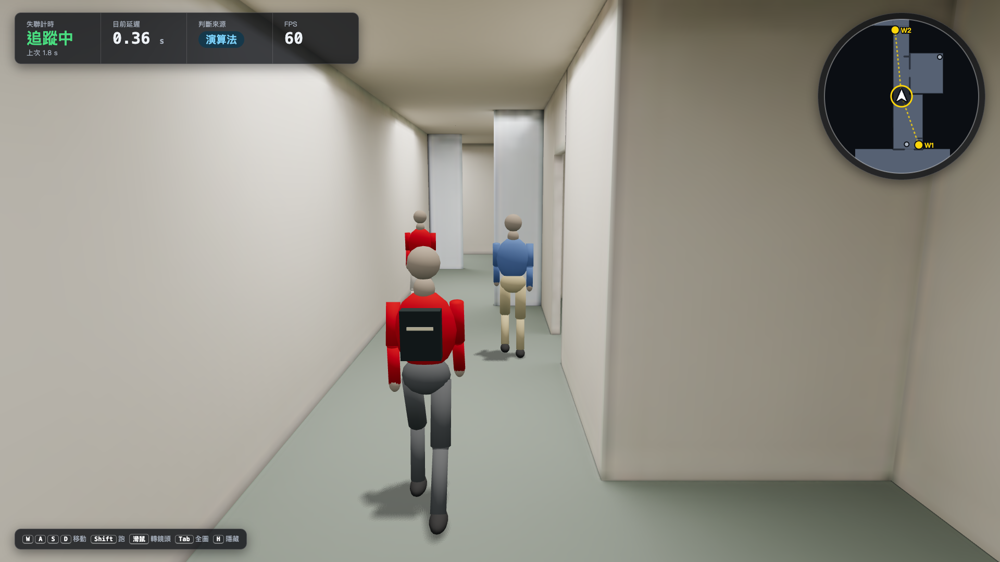
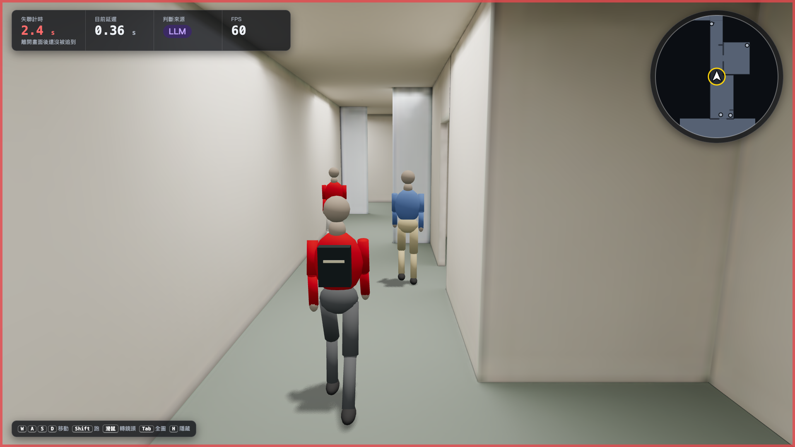
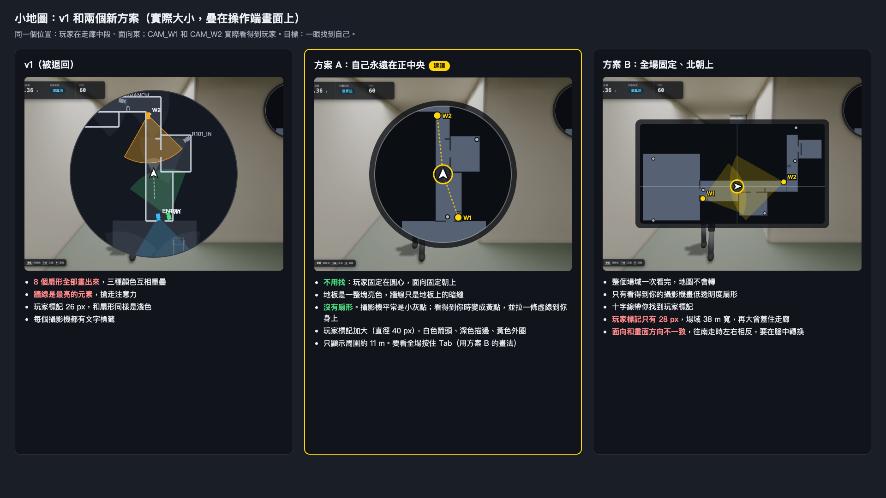
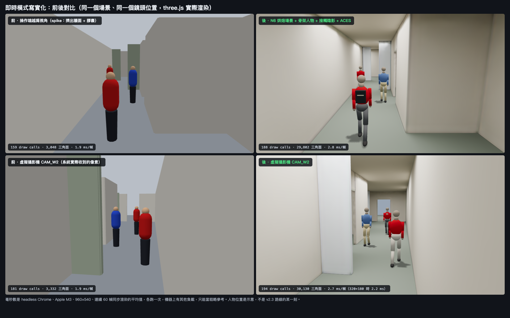

# 即時模式遊戲化設計 v2（D210，2026-11-15）

分支 `claude/feat-live-mode`，PR [#544](https://github.com/Polalalabear/amidst/pull/544)。這份文件只有設計，沒有功能程式碼。

> **2026-11-15 更新（使用者）：** B 畫面要保留，改成單一的跟隨視角，由 LLM 判斷並切鏡跟著目標。這取代本文件 §2.1「預設只有操作端一個視窗」和 §2.2。B 畫面的設計、LLM 的接法和 T1 量測結果見 PR [#547](https://github.com/Polalalabear/amidst/pull/547) 的 `docs/design/LIVE_MODE_LLM_DECISION_V1.md` 和 [`LIVE_MODE_T1_20261115.md`](../evaluation/LIVE_MODE_T1_20261115.md)。§3 後台紀錄、§4 HUD、§5 小地圖、§6 寫實化仍然有效。

**和 v1 的關係。** v2 取代 [`LIVE_MODE_GAME_DESIGN_V1.md`](LIVE_MODE_GAME_DESIGN_V1.md) 的 §1.2 決策 G1、§3 畫面顯示、§5.1 和 §5.2 的 P1、§6、§8。v1 的 §2 操作設計、§4 人物動畫、§5.3–§5.5、§7 現有資產仍然有效，這裡不重複。

**分支上的新進展。** 寫這份文件的同時，另一個 commit（`971b9763`）已經把 N6 接進即時模式並重新量測，結果在 [`LIVE_MODE_SPIKE_20261115.md`](../evaluation/LIVE_MODE_SPIKE_20261115.md) 的 §10。這份文件引用的「N6 量測」都來自那裡。

數字分三種：**量出**、**設計值**、**推估**。這是工程 demo 的設計，不是辨識、身分或實體安全的正式驗收。

## 1. 使用者看完 v1 後的四點要求

| 要求 | 章節 | v2 的回答 |
| --- | --- | --- |
| 不顯示系統端畫面，後台自己記錄 | §2、§3 | 預設只有一個視窗。系統在後台照常推論、追蹤、切鏡，結果寫進後台紀錄。原本的系統端視窗改成選用的除錯頁，預設不開 |
| 小地圖太複雜，要一眼找到自己 | §5 | 兩個方案並排比較，選方案 A：玩家固定在圓心，不畫扇形 |
| HUD 數據只留 4 項 | §4 | 失聯計時、目前延遲、判斷來源、FPS。其他數字全部進後台紀錄 |
| 畫面更寫實 | §6 | 用 N6 烘焙場景和骨架人物，加接觸陰影和 ACES。逐項列了效能成本和對偵測率的影響 |



這張圖是 three.js 在瀏覽器裡載入 N6 的 `scene.glb` 和 `character.glb` 實際渲染的，不是示意圖形。HUD 上的數字是示意值。人物位置是示意，不是 v2.3 路線的某一刻。

## 2. 視窗和資料流

### 2.1 預設只有操作端一個視窗

| 項目 | v1 | v2 |
| --- | --- | --- |
| 視窗 | 操作端和系統端兩個，用 BroadcastChannel 同步 | 只有操作端 |
| 系統的推論、追蹤、切鏡 | 在後台跑，結果畫在系統端 | 在後台跑，結果寫進後台紀錄 |
| 操作端從系統拿到什麼 | 作用中鏡頭、切鏡通知、兩個延遲 | 只有 HUD 的三個欄位：追蹤狀態、失聯計時、判斷來源 |
| 鏡頭畫面 | 送到系統端顯示 | 只送到後台推論，畫面上不顯示 |

資料流：

1. 操作端渲染越肩主畫面，同時把虛擬攝影機的畫面擷取成 JPEG。
2. 操作端把 JPEG 送到後台 `/infer`。請求裡只有 tick、時間、鏡頭名稱和像素，和 spike 一樣。
3. 後台推論、判斷顏色、追蹤、決定切鏡，把完整結果寫進後台紀錄（§3）。
4. 後台回給操作端的只有 `hud` 欄位：`state`、`gap_ms`、`last_gap_ms`、`decider`。
5. 操作端自己算延遲（收到回應的時刻減擷取時刻）和 FPS，畫出 4 項 HUD。

### 2.2 系統端視窗的去留

決定：**保留成除錯頁，預設不開。**

- 網址 `?role=debug`，內容就是 spike 現有的 `system.mjs`（8 個鏡頭畫面、偵測框、地圖、事件）。
- 操作端網址加 `debug=1` 時才透過 BroadcastChannel 轉送，沒加就不送，不花任何成本。
- 用途是開發時檢查追蹤器，不是 demo 的一部分。v1 的系統端版面（大畫面、成本列、延遲面板）不做。
- 事後看結果用後台紀錄。要不要做回放頁列為選用項（§8 的 L8）。

### 2.3 Ground Truth 隔離

規則不變：後台拿不到操作者的人物代號和座標。v2 的變化：

- 回給操作端的 `hud` 欄位加進 `protocol.mjs` 的白名單。這是系統送回操作端的方向。
- 操作端的評估資料（玩家座標、實際可見的鏡頭）寫到另一個檔，經另一個端點送出，後台的推論和追蹤程式不讀它（§3.3）。
- 小地圖上「看得到你的攝影機」是操作端自己算的，不送出去。
- 後台推論用攝影機 catalog，不讀 `R004_SCENE_GEOMETRY_2D_V1.json`（v1 的 G7，仍然有效）。

## 3. 後台紀錄

### 3.1 位置和檔案

每次執行一個資料夾：LOCAL `local/evidence/live-mode-runs/<run_id>/`。`run_id` 的格式是 `YYYYMMDDTHHMMSSZ-<4 位十六進位>`。

| 檔案 | 誰寫 | 內容 |
| --- | --- | --- |
| `run.json` | 後台，開始時 | 這次執行的設定和來源 |
| `ticks.jsonl` | 後台，每一輪推論一行 | 推論了哪些鏡頭、偵測結果、追蹤狀態、各階段時間 |
| `events.jsonl` | 後台，有事件時一行 | 鎖定、切鏡、離開視野、遺失、重新鎖定、LLM 呼叫 |
| `llm.jsonl` | 後台，每次 LLM 呼叫一行 | 只有開啟 LLM 時才有 |
| `frames/` | 後台，選用 | 被推論的鏡頭畫面 JPEG。預設不存 |
| `operator_eval.jsonl` | 操作端，經 `/evallog` | 只供評估：玩家座標、實際可見的鏡頭、FPS、操作端量到的延遲 |
| `summary.json` | 結束時由彙整腳本產生 | 整次執行的統計 |

### 3.2 欄位

`run.json`（schema `amidst.live-mode-run.v1`）：

```json
{
  "schema": "amidst.live-mode-run.v1",
  "run_id": "20261115T110500Z-3fa2",
  "started_at": "2026-11-15T11:05:00Z",
  "git_sha": "<commit>",
  "device": "mps",
  "detector": {"model": "rtdetr_r18", "weights_sha256": "<sha>"},
  "camera_catalog_sha256": "<sha>",
  "assets_manifest_sha256": "<N6 MANIFEST sha>",
  "scenario": "B4-1-v2-4actor",
  "query": "穿紅色上衣的人",
  "config": {"width": 320, "height": 180, "capture_fps": {"active": 10, "neighbor": 5, "other": 2}, "neighbors": {}},
  "llm": {"enabled": false, "model": null},
  "frames_saved": false
}
```

`ticks.jsonl` 每行：

```json
{"tick": 132, "t_capture_ms": 0, "t_recv_ms": 0, "t_done_ms": 0,
 "cams": ["CAM_W2", "CAM_W1"],
 "dets": {"CAM_W2": [{"bbox": [0, 0, 0, 0], "score": 0.82, "color": "red", "est_xy": [9.7, 1.1]}]},
 "tracking": {"state": "TRACKING", "active_cam": "CAM_W2", "seen_cams": ["CAM_W2"], "est_xy": [9.7, 1.1], "lost_ticks": 0},
 "decider": "algorithm",
 "timing_ms": {"decode": 0, "forward": 0, "color": 0, "track": 0, "total": 0},
 "skipped_frames": 0}
```

`events.jsonl` 每行：`{"t_ms", "tick", "type", "cam", "detail"}`。`type` 是 `ACQUIRE`、`SWITCH`、`TARGET_OUT_OF_VIEW`、`LOST`、`REACQUIRE`、`LLM_CALL` 其中之一。`SWITCH` 的 `detail` 有 `from`、`gap_ms`、`reason`。`REACQUIRE` 的 `detail` 有 `gap_ms`，就是 HUD 的失聯計時停下時的值。

`llm.jsonl` 每行：`{"t_ms", "purpose", "model", "input_tokens", "output_tokens", "latency_ms", "cost_usd_est", "decision"}`。

`operator_eval.jsonl` 每行：`{"tick", "t_ms", "player_xy", "heading_deg", "speed", "gt_visible_cams", "fps", "hud_latency_ms"}`。檔案第一行標 `"eval_only": true`。

`summary.json`：執行長度、推論輪數、延遲 p50／p95／最大值、每次失聯的秒數清單和 p50／最大值、切鏡次數和時間、推論張數/秒、每秒 forward 毫秒數、略過的畫面比例、LLM 呼叫次數和估算費用、FPS 的 p50 和 p5。「系統作用中的鏡頭是否真的看得到目標」這個比例要對照 `operator_eval.jsonl`，由離線的彙整腳本算，後台不算。

### 3.3 規則

- **隔離**：`/evallog` 只做一件事，把收到的資料附加到 `operator_eval.jsonl`。`detector.py`、`tracker.py`、排程器不 import 也不開啟這個檔。用測試檢查。
- **磁碟**：可用空間低於 8 GiB 時不開始記錄，並在 HUD 旁顯示一行「沒有記錄」。不存畫面時，每分鐘推估約 150 KB（每輪一行約 600 bytes，每秒約 4 輪）。
- **畫面**：`frames/` 預設不存。開啟時只存作用中鏡頭，每 5 輪存一張，單次執行上限 200 MB，到上限就停止存畫面，數據繼續記。
- **LOCAL**：整個資料夾不進 Git。要當作證據引用時，照 AGENTS.md 的規則在提交的文件裡列出相對路徑、大小、檔案數、SHA-256 和重現方法。
- **身分**：紀錄裡的目標只寫「目標」和顏色，不寫角色代號。`operator_eval.jsonl` 也不寫角色代號，只寫座標。

## 4. HUD：只有 4 項

HUD 在左上角一條，四格。除了這四格，畫面上只有小地圖和左下角一行按鍵提示（按 H 隱藏）。v1 的任務卡、系統作用中鏡頭、切鏡通知、速度顯示都拿掉。

| 項目 | 定義 | 顯示 | 資料來源 |
| --- | --- | --- | --- |
| 失聯計時 | 系統在所有推論的鏡頭裡都沒看到目標的那一刻開始計時（後台的 `TARGET_OUT_OF_VIEW` 事件），到下一次配對到目標為止 | 追蹤中：綠色「追蹤中」，下面一行小字是上一次失聯的秒數。失聯中：紅色大數字每 0.1 秒更新，畫面四周加紅框。還沒第一次鎖定：「搜尋中」和已經過的秒數 | 後台回傳的 `state`、`gap_ms`、`last_gap_ms` |
| 目前延遲 | 操作端擷取畫面的時刻，到操作端收到這張畫面的追蹤結果的時刻。取最近 1 秒的中位數 | 秒，兩位小數。低於 0.5 是白色，0.5–1.0 是黃色，超過 1.0 是紅色 | 操作端自己算 |
| 判斷來源 | 最近一次追蹤或切鏡的決定是誰做的 | 「演算法」藍色標籤，或「LLM」紫色標籤。LLM 呼叫進行中時標籤閃動 | 後台回傳的 `decider` |
| FPS | 操作端主畫面每秒畫幾幀，取最近 1 秒 | 整數。低於 30 是黃色 | 操作端自己算 |

失聯中的畫面：



關於失聯計時的定義：計時的起點用的是「系統沒看到目標」，不是「玩家實際走出鏡頭範圍」。後者是 Ground Truth，後台不知道。兩者的差距（系統晚多久才發現、或誤以為失聯）由彙整腳本對照 `operator_eval.jsonl` 算出來，寫在 `summary.json`。

關於判斷來源：spike 的即時模式只有演算法（`tracker.py`），沒有接 LLM。HUD 這一格要有意義，就要先決定 LLM 在什麼時候介入。這是需要使用者決定的問題（§9）。在決定之前，設計上保留這一格，後台固定回傳 `algorithm`。

參考慣例：遊戲 HUD 的最小化原則（只留玩家當下需要的資訊）；潛行遊戲用畫面邊框顏色表示警戒狀態；線上遊戲在角落顯示 ping 和 FPS。

## 5. 小地圖



| 項目 | v1 | 方案 A | 方案 B |
| --- | --- | --- | --- |
| 玩家位置 | 圓心，但被扇形蓋住 | 固定在圓心 | 隨移動改變，用十字線標出 |
| 方向 | 面向朝上 | 面向朝上 | 北朝上 |
| 範圍 | 半徑約 14 m | 半徑約 11 m | 整個場域（38 m × 20 m） |
| 地板和牆 | 深色地板，亮色牆線 | 亮色地板，牆線是地板上的暗縫 | 同方案 A |
| 攝影機視野 | 8 個扇形全畫，三種顏色 | 不畫扇形。看得到你的攝影機變黃點，拉一條虛線到你身上 | 只有看得到你的攝影機畫低透明度扇形 |
| 攝影機標籤 | 8 個都有 | 只有看得到你的才有 | 同方案 A |
| 玩家標記 | 26 px，白色，沒有外圈 | 直徑 40 px，白色箭頭、深色描邊、黃色外圈 | 直徑 28 px，同樣的樣式 |
| 畫面上的大小 | 360 × 360 | 300 × 300 | 400 × 216 |

**選方案 A。** 理由：

- 玩家永遠在同一個位置，不需要找。這直接滿足「一眼找到自己」。
- 面向朝上和越肩鏡頭的方向一致，地圖上的左右就是畫面上的左右。
- 沒有扇形，畫面上只有三種東西：亮色的地板、灰色的攝影機小點、黃色的「看得到你」。
- 方案 B 的玩家標記受場域寬度限制，放不大；往南走時左右相反。

方案 B 的畫法留給「按住 Tab 看全場」使用，那時候玩家是主動要看全局。按 M 切換北朝上的功能拿掉，少一個設定。

「看得到你的攝影機」是操作端自己用射線算的 Ground Truth，只在操作端顯示。它不是系統的輸出，所以不違反「不顯示系統認出的數據」。

參考慣例：玩家置中、面向朝上的圓形小地圖（《俠盜獵車手》系列的雷達）；只在被看到時才提示來源方向（潛行遊戲的偵測指示）。

## 6. 畫面寫實化



四張圖都是 three.js 的實際渲染（960×540）。左邊是接入 N6 之前的 spike，右邊是 v2 的做法（N6 場景和人物，加上接觸陰影和 ACES）。上排是操作端越肩視角，下排是虛擬攝影機 CAM_W2，也就是後台實際收到的像素。

### 6.1 逐項評估

渲染時間的量測條件：headless Chrome、Apple M3、同一幀連續渲染 60 次取平均、各跑一次、機器上有其他負載。只能當粗略參考。

| 項目 | 做法 | 效能成本 | 對偵測率的影響 | 決定 |
| --- | --- | --- | --- | --- |
| N6 烘焙場景 | 載入 `scene.glb`。材質是 `KHR_materials_unlit`，光照已經烘進貼圖。分支上已經接好 | 量出：整組「後」的做法在 960×540 是 2.8 ms/幀，spike 是 1.9 ms；1920×1080 是 4.3 ms。三角面從 3,048 增加到 29,802，draw call 從 159 到 188。下載 34 MB。一張 4096² 貼圖在 GPU 上推估約 64–85 MB | **量出：變差。** 同樣是 N6 人物，spike 場景 83.8%，烘焙場景 69.1%，少 14.7 個百分點。膠囊則從 16.7% 升到 25.6% | 做，因為使用者要寫實的畫面。偵測率用下面幾項補回來 |
| N6 骨架人物和動畫 | 載入 `character.glb`，4 個角色各一份，用 variants 換材質，依速度混合動作（v1 §4） | 包含在上面的量測裡（3 個角色）。每個角色約 4 千個三角面 | **量出：明顯變好。** 烘焙場景裡膠囊 25.6%，N6 人物 69.1%（320×180，靜止姿勢掃描）。加上走路動作後未知，要量 | 做。分支上已經接好 |
| 接觸陰影 | 一盞方向光，2048² 陰影貼圖。烘焙地板是 unlit，收不到陰影，所以在地板上方 1 cm 放一片只顯示陰影的透明平面 | 包含在上面的量測裡。陰影貼圖每幀重畫一次，只畫人物 | 未知，要量。N6 量測報告推測烘焙場景偵測率下降的原因之一是「人物沒有陰影」，這一項正好可以驗證 | 做，並優先量 |
| ACES tone mapping | 只套用在人物。場景材質設 `toneMapped = false`，因為烘焙貼圖已經套過 Blender 的 AgX，再套一次會變灰 | 幾乎為零，是材質 shader 裡的幾行運算 | 未知，預期很小 | 做 |
| PBR 場景材質 | 改用 N6 內嵌的線性 irradiance EXR 當 lightmap，搭配未烘焙的材質 | 要寫自訂材質。float16 的 4096² 貼圖在 GPU 上推估約 128 MB。沒有量 | 場景是靜態的，畫面和烘焙貼圖幾乎一樣，預期沒有差別 | 不做 |
| HDRI 環境光 | repo 裡沒有 HDRI 檔。替代做法：用 `PMREMGenerator.fromScene` 從烘焙場景本身產生環境貼圖，讓人物的受光顏色接近牆面 | 載入時算一次，每幀成本接近零。沒有量 | 未知，預期很小 | 選用，排在後面（L8） |
| SSAO | 全螢幕後製，需要深度和法線 | 沒有量。全螢幕多一到兩個 pass，而且只能用在主畫面；套到 8 個虛擬攝影機等於多 8 組 pass | 烘焙光照已經包含靜態場景的環境光遮蔽，SSAO 只會補人物腳邊，這一點接觸陰影已經做了 | 不做 |
| 景深 | 全螢幕後製 | 沒有量 | 虛擬攝影機：監視器鏡頭本來就是全景深，加模糊會讓人物邊緣變糊，預期降低偵測率。主畫面：玩家需要看清楚遠處 | 不做 |
| 鏡頭效果 | 主畫面可以用 CSS 加一層很淡的暗角 | 零 | 不影響（不進虛擬攝影機） | 選用 |
| 監視器質感 | 在虛擬攝影機畫面加雜訊、壓縮痕跡、桶狀變形 | 每個鏡頭多一個 pass，沒有量 | 預期降低偵測率，但比較接近真實監視器畫面 | 這一版不做，只列為量測項 |
| 抗鋸齒 | 主畫面用內建 MSAA，擷取用 4 倍取樣的 render target | spike 已經在用 | 不變 | 維持 |

### 6.2 兩個要注意的地方

- **一個 WebGL context。** spike 的主畫面和擷取各用一個 `WebGLRenderer`，場景貼圖會在 GPU 上放兩份。v2 改成共用一個 renderer，擷取時畫到 render target。
- **虛擬攝影機和主畫面看的是同一個場景。** 人物、陰影、tone mapping 兩邊一致。後製效果（暗角）只加在主畫面，不進擷取的像素。

### 6.3 「越寫實偵測率越高」目前不成立

N6 量測的結果是兩個方向相反的效果：

- 人物變寫實：偵測率上升（25.6% → 69.1%，烘焙場景）。
- 場景變寫實：偵測率下降（83.8% → 69.1%，N6 人物）。量測報告的推測是烘焙場景的牆和地板對比低、色調偏暖、人物沒有陰影，人物和背景的色差變小。這個推測沒有單獨驗證。

各鏡頭差異很大：CAM_ENTRY 19%、CAM_R101_IN 47%、CAM_EXT_CAR 67%，其餘 84–95%。近距離（4 m 以內）只有 44%。

所以寫實化不能只看畫面好不好看。接觸陰影、人物受光（ACES、環境光）這幾項要逐項量偵測率，有幫助的才留在虛擬攝影機的畫面裡。主畫面和虛擬攝影機可以用不同的設定：主畫面以好看為主，虛擬攝影機以偵測率為主。

### 6.4 人物本身的限制

N6 的人物是分件的人偶（球形頭、圓柱四肢），不是有連續皮膚和衣服的人。從對比圖可以看出，場景已經接近真實，人物還不像。RT-DETR 是用真人照片訓練的，所以人物的外形很可能仍然是偵測率的限制之一（目前 69.1%）。換成更像真人的模型能提高多少沒有量過，是推測。

要換成更像真人的模型，需要找有授權的外部素材，這超出這一輪的範圍，列為需要使用者決定的問題（§9）。

### 6.5 效能預算

| 項目 | 預算（設計值） | 目前（量出或推估） |
| --- | --- | --- |
| 主畫面 | 60 FPS，每幀 16.7 ms 以內 | 量出：1920×1080 渲染 4.3 ms/幀（headless，靜止畫面，不含動畫更新和擷取） |
| 一次虛擬攝影機渲染（320×180） | 3 ms 以內 | 量出：2.2 ms（只有渲染，不含讀回和 JPEG 編碼）。spike 量出的完整擷取是每個鏡頭約 16 ms |
| 每秒擷取約 30 張（v1 §5.2 的 P4） | 不讓主畫面低於 30 FPS | 推估，要量 |
| 偵測延遲 | p50 ≤ 0.5 s，p95 ≤ 0.8 s（v1 §5.3） | 量出（N6 場景，固定節拍）：2 鏡頭 × 3 fps 是 160 / 191–203 ms，3 鏡頭 × 2 fps 是 240 / 277 ms。已經低於目標 |

Chrome 的 WebGL 和 MPS 推論共用同一顆 GPU。畫面變複雜後，推論的 forward 時間有沒有變長，要一起量。

### 6.6 量測項（併入 L7）

1. 偵測率，320×180，8 個鏡頭，用分支上的 `measure/detect_sweep.mjs`。已經有的：人物｛膠囊、N6｝× 場景｛spike、烘焙｝。要補的：N6 烘焙場景下，陰影｛開、關｝× 人物受光｛現狀、ACES 加環境光｝× 姿勢｛靜止、走路中的幾個相位｝。
2. 操作端 FPS 的 p50 和 p5，邊走邊擷取邊推論時量。
3. 每個鏡頭的擷取時間（渲染、讀回、編碼分開）。
4. 寫實化前後的 forward 時間，確認沒有變差。

## 7. 延遲

v1 的 P1（畫面和偵測分開送到系統端）拿掉，因為畫面不再顯示。延遲只剩一個指標，就是 HUD 的「目前延遲」。v1 的 P2–P6 不變：只推論作用中鏡頭和鄰居，只留最新一張，擷取頻率分級。

N6 量測已經證實方向是對的（MPS，320×180，B4 路線，各 50 秒跑 2 次，機器不是空閒的）：

| 設定 | 延遲 p50 / p95 | 丟掉的 tick | 每張 forward |
| --- | --- | --- | --- |
| 2 鏡頭 × 3 fps | 160 / 191–203 ms | 2% | 約 58 ms |
| 3 鏡頭 × 2 fps | 240 / 277 ms | 1% | 約 58 ms |
| 2 鏡頭 × 4 fps | 195 / 300–358 ms | 20–24% | 約 73 ms |
| 3 鏡頭 × 5 fps | 265–406 / 315–1381 ms | 51–66% | — |

延遲已經低於 0.5 秒的目標。剩下的問題在兩個地方：

- **切鏡慢**：量出 1.2–2.7 秒（每組只有 1–3 個事件，不能當統計）。HUD 的失聯計時會直接顯示這個數字。L5 的鄰居排程和「只留最新一張」主要是為了縮短它。
- **跟對的比例低**：系統作用中的鏡頭真的看得到目標的比例是 0.45–0.62，受偵測率和延遲共同影響。

## 8. 實作拆分（取代 v1 §8）

| 編號 | 功能塊 | 和 v1 的差別 | 主要檔案 | 依賴 |
| --- | --- | --- | --- | --- |
| L1 | 寫實化基礎 | N6 場景、攝影機、variants、依速度調整播放速率已經在 `971b9763` 接好（`src/n6.mjs`、`test/n6.test.mjs`）。剩下：接觸陰影、ACES、共用一個 renderer、後台改讀攝影機 catalog、鏡頭碰牆用 `n6Collider` | `src/world.mjs`、`src/person.mjs`、`src/capture.mjs`、`server.py` | 無 |
| L2 | 角色控制器和動畫混合 | 不變 | 新增 `src/controller.mjs`、`src/anim-blend.mjs` | L1 |
| L3 | 越肩鏡頭 | 不變 | 新增 `src/ots-camera.mjs` | 無 |
| L4 | 操作端 HUD 四項和小地圖 A | HUD 縮成 4 項；小地圖改方案 A，Tab 全場用方案 B | 新增 `src/minimap.mjs`、`src/hud-operator.mjs`；改 `src/operator.mjs`、`index.html` | L2、L3 |
| L5 | 延遲管線 | 拿掉獨立的畫面訊息；回應只帶 `hud` 欄位 | `src/capture.mjs`、`src/protocol.mjs`、`src/operator.mjs`；`server.py`、`tracker.py`；新增 `scheduler.py` | 無 |
| L6 | **後台紀錄和除錯頁** | 取代 v1 的系統端版面 | 新增 `src/amidst/live_mode/runlog.py`、`scripts/summarize_live_run.py`；改 `server.py`；`system.mjs` 改掛在 `?role=debug` | L5 的資料格式 |
| L7 | 重新量測 | 增加 §6.5 的量測項 | `measure/`、`docs/evaluation/` | L1–L6 |
| L8 | 選用：回放頁、環境光 | 新增 | 新增 `src/replay.mjs` | L6 |

L2、L3、L5 的檔案不重疊，可以同時做。L6 和 L5 都改 `server.py`，要排先後。main 已經合併進分支（`1ee33cd8`）。

目前分支上的操作端鏡頭是高處俯視並隱藏天花板，L3 的越肩鏡頭會取代它。L2 的動畫部分只剩「walk 和 run 之間依速度混合」，單一動作的播放速率已經有了。

### 有變動的驗收條件

L2、L3 的驗收條件和 v1 相同。

**L1 寫實化基礎**
- 分支上現有的 `npm test`（12 項）維持通過。
- `pytest tests/live_mode`：`server.py` 的投影器從攝影機 catalog 讀參數，不從 `R004_SCENE_GEOMETRY_2D_V1.json` 讀（目前仍然從它讀）。
- `npm test`：場景材質的 `toneMapped` 是 false；人物的 mesh 有 `castShadow`；頁面只建立一個 `WebGLRenderer`。
- 量測：1920×1080 主畫面在邊走邊擷取時 FPS 的 p50 ≥ 55、p5 ≥ 30。沒達到時回報數字，不調整門檻。
- 量測：開陰影後 N6 烘焙場景的偵測率不低於 69.1%（現在的數字）。變低的話，虛擬攝影機關掉陰影，只留在主畫面。

**L4 操作端 HUD 和小地圖**
- `hud-operator.mjs` 單元測試：三種狀態（搜尋中、追蹤中、失聯中）顯示的文字和顏色符合 §4；延遲的顏色門檻是 0.5 和 1.0 秒；延遲取最近 1 秒的中位數。
- `minimap.mjs` 單元測試：玩家標記的畫面座標永遠是圓心；面向 0°、90°、180° 時，玩家正前方 5 m 的點都畫在圓心正上方；不在 `seeing` 清單裡的攝影機沒有連線也沒有標籤。
- 隔離測試：`seeing` 清單沒有出現在 `/infer` 請求和 BroadcastChannel 訊息裡。
- 截圖驗收：1920×1080 的畫面上，數字只出現在 HUD 的四格裡；面板不蓋住畫面中央 60% 的範圍。

**L5 延遲管線**
- v1 的排程器測試和「只留最新一張」測試。
- `npm test`：`/infer` 的回應經過白名單後只剩 `hud` 的四個欄位；加入 `operator_xy`、`person_id`、`gt` 任何一個鍵都會被擋下。
- 量測驗收（B4 自動路線 50 秒，MPS，N6 人物，機器上沒有其他重負載，重複 3 次）：延遲 p50 ≤ 500 ms、p95 ≤ 800 ms；8 個鏡頭都啟用時丟掉的畫面不造成排隊；切鏡時間的中位數回報實際數字，和現在的 1.2–2.7 秒比較。

**L6 後台紀錄和除錯頁**
- `pytest tests/live_mode`：跑 10 輪假的推論後，資料夾裡有 `run.json`、`ticks.jsonl`（10 行）、`events.jsonl`，每一行都能用 §3.2 的欄位解析；`run.json` 有 `git_sha` 和三個 SHA-256。
- 隔離測試：`detector.py`、`tracker.py`、`scheduler.py` 的原始碼裡沒有出現 `operator_eval`；`/evallog` 收到的資料只出現在 `operator_eval.jsonl`。
- 磁碟測試：可用空間的檢查函式回報低於 8 GiB 時，不建立資料夾，回應裡帶 `recording: false`。
- 畫面上限測試：`frames/` 超過設定的上限後不再寫入新檔，`ticks.jsonl` 繼續增加。
- `scripts/summarize_live_run.py` 測試：給一份固定的假紀錄，算出的延遲 p50／p95、失聯秒數清單、切鏡次數和預期值相等。
- 除錯頁：沒有 `debug=1` 時，操作端沒有建立 BroadcastChannel。

**L7 重新量測**
- v1 的兩項，加上 §6.5 的四項。結果寫成 `docs/evaluation/` 下的報告。

## 9. 需要使用者決定的問題

1. **LLM 在什麼時候介入？** 這決定 HUD「判斷來源」會不會出現 LLM。
   - 建議：平常全部由演算法判斷。只有兩種情況叫 LLM：失聯超過 3 秒，或同一個畫面有兩個以上符合描述的人。LLM 預設關閉，手動開啟，受 API 預算保護（#537）限制。
   - 另一個選項：這一版完全不接 LLM，HUD 這一格固定顯示「演算法」。
2. **人物要不要換成更像真人的模型？**
   - 建議：N6 人物在烘焙場景的偵測率是 69.1%。先量陰影和受光能補回多少（L7），還是不夠再換模型。
   - 另一個選項：現在就找有授權的寫實人物模型。偵測率可能明顯提高，但要處理授權、骨架和動作重新對應。
3. **後台紀錄要不要存鏡頭畫面？**
   - 建議：預設只存數據（每分鐘推估約 150 KB）。需要回放畫面時手動開啟，單次上限 200 MB。
   - 另一個選項：每次都存。可以完整回放，但磁碟目前只剩約 9 GiB。

## 10. 沒驗證的部分

- 每分鐘紀錄大小、GPU 記憶體用量是推估。延遲的量測只有 2 或 3 個鏡頭的固定節拍，8 個鏡頭加鄰居排程的做法還沒實作，沒有量過。
- 渲染時間是 headless Chrome 各跑一次的結果，機器上有其他負載；畫面是靜止的，不含動畫更新、擷取和推論。
- 接觸陰影、ACES、環境光對偵測率的影響未知。這一輪沒有跑推論；引用的偵測率和延遲來自分支上的 N6 量測報告，我沒有重跑。
- mockup 的寫實化做法（陰影、ACES）是在 mockup 頁面裡做的，沒有接進 `frontend/live-mode/`。
- 接觸陰影用的是一盞方向光，方向是手動設的，沒有對照 Blender 場景裡的燈光位置。
- 主畫面 mockup 的人物位置和 HUD 數字是示意。
- 鄰居鏡頭表、graph v3 的路徑、工作台元件能不能重用，和 v1 §9 一樣還沒確認。

## 11. mockup 的重現方法

圖片和程式在 `docs/design/img/live-mode-game-v2/`。渲染頁 `live-render.html` 需要一個靜態伺服器，提供這幾個路徑：`/three`（three.js 0.186.1）、`/assets`（LOCAL `local/data/live-assets-20261115/`）、`/spike`（`frontend/live-mode/src/`）、`/geom`（`docs/evaluation/`）、`/m`（`docs/design/img/`）。這次用符號連結組出這個目錄，再用 `python3 -m http.server` 提供。

截圖用 `capture.mjs`，它透過 Chrome 的遠端除錯協定等頁面渲染完成再截圖，不需要安裝套件：

```bash
node docs/design/img/live-mode-game-v2/capture.mjs "http://127.0.0.1:8797/m/live-mode-game-v2/live-render.html?look=after&view=ots&hud=1&w=1920&h=1080" operator-main.png 1920 1080
```

`look=before` 是 spike 的樣子，`view=CAM_W2` 是虛擬攝影機，`state=lost` 是失聯中的 HUD。

LOCAL 截圖：`local/evidence/live-mode-design-v2-20261115/`（8 個檔，不進 Git，重新截圖無法重建為同樣的位元，SHA-256 在 `docs/evaluation/live_mode_design_v2_20261115/SHA256SUMS_local.txt`，可由 `look=`/`view=`/`state=` 參數重新截圖）。

LOCAL 來源：`local/data/live-assets-20261115/scene.glb`（33,941,072 bytes）、`character.glb`（658,080 bytes）、`cameras.three.json`，MANIFEST SHA-256 `d92aa7453f13903252b306b42249239168561766677a5180a85afcc4dbff7b29`（N6 #539）。GLB 不進 Git。
