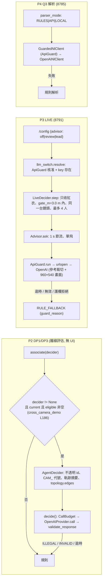
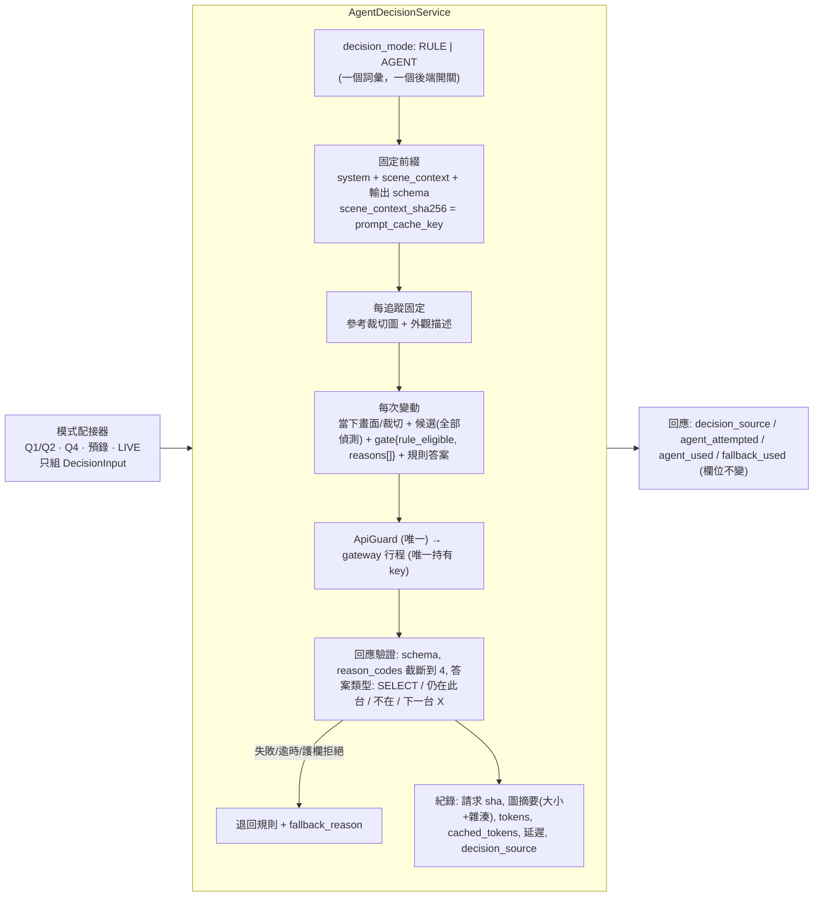

# Agent／LLM 接線、資料交換與 API 傳輸檢查（W2 前置，2026-11-20）

- Issue [#643](https://github.com/Polalalabear/amidst/issues/643)；相關 [#641](https://github.com/Polalalabear/amidst/issues/641)、[#639](https://github.com/Polalalabear/amidst/issues/639)；決策 D340（[#93](https://github.com/Polalalabear/amidst/issues/93#issuecomment-7016410023)）；假設文件 `docs/evaluation/AGENT_VS_RULE_HYPOTHESES_20261120.md`（§4 的 C1–C8、X1–X4、§4.3 三層請求）。
- 基準：`main` `b98fac2a`。Model / effort：Sonnet 5.5 / high。**沒有付費、沒有網路呼叫、沒有讀 API key**（擷取腳本移除環境中的 `OPENAI_API_KEY`、封鎖 socket、用 recorder 取代傳輸層）。只寫檢查與建議，不改產品程式。
- 身分永遠未確認；可行走連通是圖上的宣告，實體可通行是 UNKNOWN。

## 0. 結論（先看這裡）

1. **今天沒有任何一條路徑同時做到 D340 的四件事**：真的呼叫模型、看圖、有場景上下文（空間資訊）、規則閘門只當資訊。LIVE 有圖、沒有空間資訊、閘門仍硬擋；Q5／DP1／DP3 沒有圖、沒有空間資訊（只有「兩台鏡頭有沒有邊」）。
2. **8785 的 A4-1／B4-1 在 Q5 的 Agent 路徑根本走不到模型**：用 8785 同一套 `Demo` 物件在行程內載入（不開 socket），`q2_session` + `AGENT_SEQUENTIAL` 的回應是 `UNKNOWN`／`TRACKING_SCOPE_MISSING`（A4-1、B4-1 另加 `PARAMETERS_NOT_APPROVED`），provider 零次被呼叫。
3. **同一件事有三套請求組裝**（DP1／DP3、Q5、LIVE）加兩個沒人用或只在腳本用的 OpenAI 客戶端；五個 OpenAI HTTP 客戶端、三種傳輸函式、四組逾時／重試設定。
4. **GT 隔離：本次擷取的 8 筆 payload 逐欄掃描沒有命中**（0 筆）。**前端沒有任何 key 或 `api.openai.com`**。ApiGuard：除 `scripts/agent_decision/run_provider.py`（只有 `CallBudget` 階段上限，沒有 ApiGuard 帳本）與沒接線的 `OpenAIPredictionAdapter` 外，每條付費路徑都經過。
5. **沒有一條路徑能吃到提示快取**：所有請求都低於 1024 token 的快取門檻，且可變欄位排在前面。

## 1. 呼叫路徑清單

| ID | 路徑 | 入口 | 組裝請求 | 傳輸／模型 | ApiGuard | 狀態 |
| --- | --- | --- | --- | --- | --- | --- |
| P1 | **Q5 AgentController（8785 預錄／Q2 序列）** | `api.py` `_controller` L478–486，`switch_mode=AGENT_SEQUENTIAL` | `q5_agent.py` L171–198（模板＋`context`＋`last_tool_result`＋`workflow`） | `GatewayProvider`（檔案佇列）→ 獨立 gateway 行程 `openai_chat`；`gpt-6.1-terra`；`openai_gateway.py` L170–260、L344–371 | 是，gateway 內 `guard.run`（L434） | 預設關，`AMIDST_RECORDED_AGENT=openai` 才綁定 |
| P2 | **DP1／DP3：`associate()` 的 `decider`** | `cross_camera_demo.py` L108–228 | `agent_wiring.py` `AgentDecider.handoff`／`continuation`（L77–152） | `OpenAIProvider`（`agent_providers.py` L315–519）直連；`gpt-6-astra` | 評估腳本 `wp5_runner` 是；`scripts/agent_decision/run_provider.py` **否**（只有 `CallBudget`） | **產品 API 沒有用**；只有 `question_bank.py` L197–238、`wp5_*`、`run_provider.py` |
| P3 | **LIVE 看圖裁決** | `live_mode/server.py` `/config`（L259–276）→ `LiveDecider.step` | `advisor.py` `OpenAIAdjudicator.__call__` L84–100 | `urllib.request.urlopen` 直連；`gpt-6.1-sol`（預設） | 是，`Advisor._work` L151–152 | 8791；`off`／`review`／`lead` |
| P4 | **Q3 自然語言解析** | `api.py` `q3_parse`／`nl_query_parse` L536–543 | `nl_query_parse.py` `OpenAINlClient.parse` L242–256 | `agent_providers.default_http_transport` 直連；`astra6`（見 G6） | 是，`GuardedNlClient`（`api_budget.py` L293） | 8785 行程內讀 key |
| P5 | **OpenAIPredictionAdapter（Q2 外部預測）** | `api.py` `_external_prediction` L750–760 | `openai_prediction.py` `build_prediction_request` | 自己的 `default_https_transport` | **否** | **沒接線**：`serve_demo_integration.py` 沒傳 `openai_prediction_adapter`，永遠是 `DISABLED` |
| P6 | 本機模型（Ollama，loopback） | `ollama_runtime.py`、`OllamaProvider`、`OllamaNlClient` | 同 P1／P2／P4 | `127.0.0.1:11434` | 不適用（不花錢） | 預設不綁 |
| P7 | 評估與探測腳本 | `scripts/live_mode/adjudication_probe.py`、`scripts/agent_decision/run_provider.py`、`wp5_runner.py`、`benchmark_q1q5_local_models.py` | 各自 | 各自 | probe、wp5 是；`run_provider.py` 否 | 手動，需核准 |
| — | **Q1 找鏡頭、Q4 證據** | `q1_search.py`、`q4_evidence.py`（docstring：「Index-only … No RGB, inference」） | 無 LLM | — | — | 沒有 Agent 路徑 |

### 1.1 資料流（P1：Q5，8785 預錄）

```mermaid
flowchart LR
  UI["前端 workbench-v2<br/>#q-switch: RULE_ONLY / AGENT_SEQUENTIAL<br/>(shell-view.mjs: agent_available=false 時 disabled)"]
  UI -->|"POST q2_session / q2_start_session<br/>switch_mode"| API["api.py QAPI.call"]
  API --> CTRL{"_controller<br/>switch_mode"}
  CTRL -->|RULE_ONLY| RULE["RuleController"]
  CTRL -->|AGENT_SEQUENTIAL| FAC{"run.agent_factory?<br/>(AMIDST_RECORDED_AGENT=openai)"}
  FAC -->|無| E503["503 AGENT_ADAPTER_NOT_CONFIGURED"]
  FAC -->|有| AC["AgentController<br/>q5_agent.py"]
  AC --> SC{"TRACKING_SCOPE / 參數核准 / 圖核定<br/>(q5_controller L156–161, candidates.py L63–71)"}
  SC -->|"失敗: UNKNOWN + reasons"| RULE
  SC -->|通過| GATE["候選產生 + 規則閘門<br/>(分數、顏色、GRAPH_NOT_APPROVED 先刪)"]
  GATE -->|"零候選"| RULE
  GATE --> REQ["請求組裝: 模板 + JSON(context, last_tool_result, remaining, workflow)<br/>文字 only, 無圖, 無鏡頭幾何"]
  REQ --> GP["GatewayProvider: 寫 queue/requests/<id>.json<br/>(不含 key、不含路徑)"]
  GP --> GW["gateway 行程 (唯一持有 key)<br/>ApiGuard.run → openai_chat"]
  GW -->|"HTTPS"| OAI["OpenAI chat/completions<br/>gpt-6.1-terra, json_schema strict, max 256"]
  OAI --> VAL["回應驗證: schema + 引用證據 + 合法候選"]
  VAL -->|"無效 / 逾時 / 拒絕"| FB["退回規則 (fallback_reason)"]
  VAL -->|有效| CUT["Controller 守衛後才執行切換"]
  FB --> OUT["回應: decision_source, agent_attempted, agent_used, fallback_used"]
  CUT --> OUT
  RULE --> OUT
  OUT --> UI
```



### 1.2 其他路徑的差異（只畫與 P1 不同處）



## 2. 各模式 Agent／規則切換矩陣

| 模式 | 前端開關 | 傳到後端？ | 改變行為？ | 真的呼叫模型 | 看圖 | 空間資訊 | 閘門只當資訊 |
| --- | --- | --- | --- | --- | --- | --- | --- |
| Q1 找鏡頭 | **無** | — | — | 否 | 否 | 否 | — |
| Q2 找人（Q5 序列，8785 即時 API） | `#q-switch`（`switchMode`，名稱 `switch_mode`） | 是（`q-api.mjs` L38、`app.mjs` L39–40） | 是，但**在 A4-1／B4-1／B-05 上被 `TRACKING_SCOPE_MISSING` 擋在 provider 之前**；`agent_available=false` 時選項 disabled | 理論上可（gateway 開啟後）；實測零次 | 否 | 否 | 否（`GRAPH_NOT_APPROVED` 硬擋，#639） |
| 8785 預錄回放（`q2-agent` 錄製） | 選錄製檔（`q-recordings`） | 是，選的是錄製檔 | 是：回放既有決策，**不呼叫模型** | 否（回放） | 否 | 否 | 否 |
| Q3 解析 | `parser_mode`（RULES／API／LOCAL，另一套詞彙） | 是 | 是 | API 模式是 | 否 | 否 | 不適用 |
| Q4 證據 | **無** | — | — | 否 | 否 | 否 | 否（RT-DETR 門檻＋HSV 就是答案，`q4_evidence.py` L123–134） |
| LIVE A／B（8791） | `advisor`：off／review／lead（第三套詞彙），瀏覽器**直接**對 8791 `/config` | 是（CORS 白名單 loopback） | 是 | 是 | **是**（參考裁切＋整張畫面） | **否** | **否**（`gate_m=3.0`、只收紅衣） |
| DP1／DP3（`associate()`） | **無 UI**（只有 `mode` 參數） | — | — | 評估時可 | 否 | 只有 `edges` | 否（`rule_eligible` 才能選，`agent_decision.py` L337） |

三套開關詞彙（`switch_mode`、`parser_mode`、`advisor`）互不相通；H6 要求的「所有模式都能切換」目前只有 Q2（部分）、Q3、LIVE 三處有開關，Q1、Q4 沒有。

## 3. 每條路徑實際送出的內容

擷取方式：`scripts/capture_agent_payloads.py`，真實請求建構器＋假傳輸層；證據在 LOCAL `local/evidence/agent-wiring-20261120/`（11 個 JSON，`SHA256SUMS` 自身 SHA-256 `2af1e2fc472bfdd08d4671f419a6ac5c197c08d43dac2e3e6f42755e338da1c5`，可重新產生，不含圖原檔）。token 數是啟發式估計（ASCII 約 4 字元／token，非 ASCII 約 1 字元／token），不是 tokenizer；LIVE 兩圖用 LIVE 探測量到的 807。

| 項目 | P2 DP1（A4-1／B4-1） | P2 DP3 | P1 Q5（round 1／2） | P3 LIVE | P4 Q3 |
| --- | --- | --- | --- | --- | --- |
| 來源 | A4-1、B4-1 真實 run（`associate` 的真軌跡）；A4-1、B4-1 各 17 筆請求 | 同左 | **合成測試夾具**（A4-1／B4-1 走不到 provider，見 §0-2；請求形狀是真的） | LIVE 探測包的真影像，真的 `crop_jpeg`／`frame_jpeg` | 真的 8785 目錄詞彙 |
| 模型 | `gpt-6-astra` | 同 | `gpt-6.1-terra` | `gpt-6.1-sol` | `astra6`（G6） |
| 圖 | **0** | 0 | **0** | **2**：參考裁切 156×364 JPEG 約 6.9 KB、畫面 960×540 JPEG 約 40 KB（`detail: high`） | 0 |
| 空間資訊 | `topology.edges` 22 條（只有相鄰對，無位置／朝向／FOV／覆蓋／核定等級，`graph_status: GRAPH_NOT_APPROVED`） | 0 條 | `exit_resolution`、候選的轉移（來自圖，無幾何） | **無**（框是畫素；距離閘門在送出前用） | 目錄詞彙（鏡頭名稱） |
| 候選 | 1（A4-1、B4-1 各一筆樣本） | 無（是一段 BOX_CONTINUATION） | 1（夾具） | 2（樣本；上限 4） | — |
| 輸入 token 估計 | 433／429 | 262／261 | 1025／1105 | 912（文字 105＋圖 807）；ApiGuard 預估用 1100 | 539 |
| 輸出上限 | 300 | 300 | 256 | 400 | 400 |
| `response_format` | json_schema，`strict:false` | 同 | json_schema，`strict:true`（`q5_decision`） | json_schema，`strict:true`（`adjudication`） | json_schema，`strict:true` |
| temperature／seed | 不送 | 不送 | **不送**（設定檔有 `temperature:0`、`seed`，gateway 只送 `max_output_tokens`，見 G8） | 不送 | 不送 |
| 逾時／重試 | 5000 ms／1 次（429、5xx）；步驟上限 5000 ms | 同 | 呼叫 8000 ms，總預算 24000 ms（D313）；gateway 不重試 | 5.0 s，不重試，1 s 節流 | 5 s，不重試 |
| 提示快取 | 否：<1024 token，且 `as_of_us` 排第一（鍵排序） | 否 | 否：兩輪共用前綴約 656 token，在 `remaining` 處分岔 | 否：文字在前、圖在後，`k` 與每次的畫面不同 | 否 |
| 規則答案是否附進請求 | **是**（`rule_answer`，錨定風險，H3） | 是 | 否（Q5 不送規則答案，但候選已被規則篩過） | 否 | — |

### 3.1 候選在 Agent 看到前被誰刪掉

- **P2（DP1）**：`cross_camera_demo.py` L141–181。送進 Agent 的只有「規則合格」或「只因顏色不合格」（`COLOR_NOT_COMPATIBLE`）的候選；`CURRENT_CAMERA_STILL_OBSERVED`（重疊，L170–172）直接不進 `considered`；分數 <0.3（`local_track_min_score`，L33）的框在建軌跡時就沒了；`eligible` 為空時 **Agent 根本不被問**（L186）。
- **P1（Q5）**：`candidates.py` L63–71 未核定的轉移一律標 `GRAPH_NOT_APPROVED` 並排除；Q4 證據用 `query_min_score`＋HSV（`q4_evidence.py` L123–134）；零候選時 `q5_agent.py` L176–177 回 `RULE_ONLY`，不呼叫模型。
- **P3（LIVE）**：`advisor.py` L224（只收紅衣）、L282（`gate_m=3.0` m 內才算候選）、`SILENT_PICK` 要 ≥2 人、`LOST_WITH_CANDIDATES` 要 ≥ `lost_min_candidates`、同一台鏡頭、左到右取前 4。

### 3.2 輸出格式與驗證

| 路徑 | 輸出 | 驗證 |
| --- | --- | --- |
| P2 | `{action, candidate_id?, reason_codes, rationale}` | `validate_response`：`reason_codes` ≤ 4（`MAX_REASON_CODES`）、理由 ≤ 240 字、**只能選 `rule_eligible`**（L337，否則 `ILLEGAL_CANDIDATE`） |
| P1 | 工具信封（`get_candidate_evidence` 等）或 `q-demo.agent-decision.v2`（`action`、`candidate_ref`、`cited_observation_ids`、`rationale`） | schema＋引用的證據雜湊＋候選快照雜湊；非法提交最多 2 次（`agent_max_illegal_submissions`） |
| P3 | `{choice: 0..k, reason}`（繁中 ≤40 字） | enum 範圍；遲到的答案捨棄（`poll` 逾時） |
| P4 | 目錄限定的解析 schema | schema 拒絕即回規則 |

## 4. 檢查項目結果

### 4.1 GT、渲染軌跡、可見性、深度有沒有漏進 payload

- **擷取檢查**：8 筆含 payload（DP1×2、DP3×2、Q5×2、LIVE、Q3；A4-1／B4-1 的 Q5 與 B-05 沒有 payload，是拒絕紀錄），`scan_forbidden`（比對 `agent_decision.FORBIDDEN_KEYS` 與 `gt` 前綴、遞迴進文字內的 JSON、並找本機路徑）**命中 0**。
- **來源逐欄**（DP1）：`id`＝請求內不透明代號（A1…、T0，對照表只活在該次呼叫）；`camera_id`＝`CAM_*`（`_camera()` 映射）；`first_seen_us`／`last_seen_us`／`gap_us`＝偵測索引時間戳；`colors`＝HSV 分類；`scores`＝RT-DETR 分數統計；`graph_edge`、`link_kind`＝鏡頭圖＋規則；`rule_answer`＝規則輸出。**沒有** `track_ref`、`actor`、`visibility`、`depth`、路徑。
- Q5：`candidate_ref`、`observation_id`、`session_id` 都是伺服器產生或索引內的 id，來源是偵測索引，不是渲染端。
- LIVE：只有畫素。畫面是模擬器渲染結果，**畫素本身無法過濾**（這是設計上的來源，不是漏出）。送出前用的 `people[].xy` 世界座標只用於距離閘門，不進請求。
- 限制：此檢查是**欄位名稱＋文字內 JSON＋本機路徑**，不是語意檢查；F1 若之後加入「覆蓋多邊形」等場景上下文，必須只來自設定檔與標定資料（D340），並加進 `FORBIDDEN_KEYS` 白名單測試。

### 4.2 ApiGuard 覆蓋

| 路徑 | 經過 ApiGuard | 位置 |
| --- | --- | --- |
| P1 Q5 | 是 | `openai_gateway.py` L434（gateway 內；key 不在 8785 行程） |
| P3 LIVE | 是 | `advisor.py` L151–152；`server.py` L72–96 建 guard；`llm_switch.resolve` 要求 guard 核准＋key |
| P4 Q3 | 是 | `api_budget.GuardedNlClient` L293；伺服器開關關閉時 `DisabledApiClient` |
| P2 DP1／DP3 | **評估腳本是、`run_provider.py` 否** | `wp5_runner.py` L75、L83、L364 是；`scripts/agent_decision/run_provider.py` 只有 `CallBudget` 的階段核准（L161），沒有共用帳本 |
| P5 預測 | **否**（但沒接線） | `openai_prediction.py` 無 guard 引用 |
| P7 探測 | 是 | `adjudication_probe.py` L131–144 |

### 4.3 API key 位置

- 前端（`frontend/`）整棵樹沒有 `OPENAI_API_KEY`、`api.openai.com`、`Bearer`。
- P1：只有 gateway 行程讀 key（`start_agent_gateway.command` 說明），8785 行程只寫檔案佇列。
- **不一致**：P4（8785 行程 `clients_from_environment`）、P3（8791 行程 `os.environ["OPENAI_API_KEY"]`）、P2 的 `OpenAIProvider`（呼叫當下讀環境）讓 key 存在於 8785／8791 行程環境。這不是洩漏，但和「key 只留在 gateway」不同；W2 若統一介面，建議所有付費呼叫走同一個 gateway。
- 本次工作階段的環境本身就有 `OPENAI_API_KEY`；擷取腳本啟動即移除，並以測試鎖住（`test_no_network_blocks_sockets_and_hides_key`）。

### 4.4 前端開關是否傳到後端並改變行為

- Q2：`switchMode` 經 store → `buildQ2` → `switch_mode`；後端 `_controller` 依它選控制器；`q-api.mjs` L109 驗證 `RULE_ONLY` 時三個旗標必須為 false。**傳到、有改變，但改變的結果在 8785 實測是 `UNKNOWN`（§0-2）**。
- LIVE：`/config` 寫入後 `effective` 可能是 `off`（護欄未核准或無 key），UI 顯示原因（`reason_text`）；行為真的改變。
- Q1、Q4：沒有開關。

### 4.5 前後端契約

- 回應旗標 `agent_attempted`／`agent_used`／`fallback_used`／`decision_source`／`llm_parse_used`、bootstrap 的 `agent_available`／`agent_unavailable_reason`：前後端一致，前端驗證 `RULE_ONLY` 時不得為真。
- **沒人用的欄位**：`AgentSettings.options`（`temperature`、`seed`、`num_predict`）在 gateway 路徑**不上線**（只送 `max_output_tokens`）；DP 請求的 `rule_answer` 若 H3 改為「閘門當資訊」需重新定義而不是沿用。
- 三套詞彙（`switch_mode`／`parser_mode`／`advisor`）和三套 fallback 詞彙（DP 的 `FALLBACK_REASONS`、LIVE 的 `GUARD_REASON` 映射、Q5 的 `fallback_reason`）有重疊但不相同。

### 4.6 重複接線

| 重複 | 位置 | 判斷 |
| --- | --- | --- |
| Q5 `AgentController` ↔ `associate()` 的 `AgentDecider` | `q5_agent.py`／`q5_controller.py` ↔ `agent_wiring.py`＋`agent_decision.py` | 同一件事（決定何時換鏡頭）兩套；產品 API 只用前者，後者只在評估腳本，且 #639 打算把 8785 開關改接後者 |
| OpenAI HTTP 客戶端 ×5 | `agent_providers.OpenAIProvider`、`openai_gateway.openai_chat`、`advisor.OpenAIAdjudicator`、`nl_query_parse.OpenAINlClient`、`openai_prediction.OpenAIPredictionAdapter` | 傳輸層 3 種（`default_http_transport`、`urlopen`、`default_https_transport`），重試、逾時、schema 嚴格度、model id 處理各自不同 |
| 預算／護欄 ×2 | `ApiGuard`（ledger）與 `ad.CallBudget`（階段上限） | `run_provider.py` 只用後者 |
| 開關詞彙 ×3 | §4.5 | — |

## 5. 缺口清單（對照 D340）

排序依對 D340／H1–H6 的影響。位置為 `main` `b98fac2a`。

| # | 缺口 | 位置 | 衝突 | 建議 | 改的人 | `waiting:codex` |
| --- | --- | --- | --- | --- | --- | --- |
| **G1** | **A4-1／B4-1 的 8785 Agent 路徑走不到模型**：`TRACKING_SCOPE_MISSING`（＋`PARAMETERS_NOT_APPROVED`）；`Demo` 沒傳 tracking scope／核准參數給 run；另有 `candidates.py` 未核定轉移全排除 | `serve_demo_integration.py` L144–215、`q5_controller.py` L156–161、`candidates.py` L63–71 | D340「8785 Agent 要真的呼叫模型」；H6；X1／X2 | 在統一介面（§6）把 `associate()` 軌跡當候選來源，未核定轉移連核定等級一起送，不硬擋；補 tracking scope／核准參數的接線，或明說 Q5 控制器不是 8785 Agent 的路徑 | Claude（`candidates.py` 等 `src/`）；`serve_demo_integration.py` 改動交 Codex | 是（`serve_demo_integration.py`，#623） |
| **G2** | **請求沒有圖、沒有場景上下文**：DP 只送軌跡摘要＋邊；Q5 只送文字證據 | `agent_decision.py` L93–101、`agent_wiring.py` L38–45、`q5_agent.py` L196 | D340 看影格、每次附場景上下文；H1／H2／H5；C1 | 三層請求（§6）：固定前綴＝system＋`scene_context`（連通、核定等級、位置、朝向、FOV、覆蓋多邊形、重疊，只來自設定檔與標定）；每追蹤固定＝參考圖；每次變動＝當下影格／裁切／候選／規則資訊 | Claude | 否 |
| **G3** | **規則閘門仍硬擋 Agent**：只問有合格候選的情況；只能選 `rule_eligible`；重疊候選不進 `considered`；<0.3／<0.4 的框不顯示；LIVE 只收紅衣、3 m 閘門 | `cross_camera_demo.py` L170–172、L186、L195；`agent_decision.py` L337；`advisor.py` L224、L282 | D340「閘門＝資訊」；H3；C2–C5、C7 | 閘門結果變欄位（`gate: {rule_eligible, reasons[]}`）；允許選任何偵測、答「仍在此鏡頭」「不在」「下一台看 X」；零候選也問 | Claude（`src/amidst/q1q5`）；LIVE 的 `advisor.py` 等 | LIVE 部分是（C7） |
| **G4** | **同一件事多套接線**：P1／P2／P3／P4／P5 五個 OpenAI 客戶端、三種傳輸、`ApiGuard` 與 `CallBudget` 並存；`AgentDecider` 在產品 API 沒有用，卻是 #639 的目標 | §4.6 | 一致性；W2 要「所有模式共用一個 Agent 決策介面」 | 見 §6：保留一個 `AgentDecisionService`，其餘退役或改成它的配接器；#639 的接線改成接統一介面 | Claude | 否（`src/`）；gateway 行為不變 |
| **G5** | **沒有提示快取可言**：所有請求 <1024 token；DP 的 `as_of_us` 排第一；Q5 的 `remaining`、`session_id`、`decision_id` 夾在 `context` 內與穩定欄位交錯；LIVE 文字在前圖在後 | `agent_decision.canonical`（鍵排序）、`q5_agent.py` L194–196、`advisor.py` L91–95 | 假設文件 §4.3 三層請求、`prompt_cache_key`、`cached_tokens` 記錄 | 穩定序列化（固定前綴逐字相同）；可變欄位全部放最後一則訊息；`scene_context_sha256` 當 `prompt_cache_key`；把 `cached_tokens` 寫進 ApiGuard 帳本；有了場景上下文（估計數千 token）才可能過門檻 | Claude | 否 |
| G6 | **Q3 把設定檔代號當 API 模型名**：`astra6` 直接送出（`api_model_id=None`），D237 對照是 `gpt-6-astra`；擷取的 `q3_nl_parse.json` 顯示 `"model":"astra6"` | `nl_query_parse.py` L224–231、L246、L315（`clients_from_environment` 沒傳 `api_model_id`） | D237 | 傳 `api_model_id`；以 dry-run 確認，**這項沒有實際呼叫驗證**，如果 API 端接受別名則只是不一致 | Claude | 否 |
| G7 | **`run_provider.py` 的付費路徑沒有 ApiGuard 帳本**；`OpenAIPredictionAdapter` 沒有 guard（未接線） | `scripts/agent_decision/run_provider.py` L161；`openai_prediction.py` | D340「ApiGuard 照舊硬擋」 | 統一介面（G4）後 `run_provider` 改走它；`OpenAIPredictionAdapter` 刪除或補 guard | Claude | 否 |
| G8 | **設定的 temperature／seed 不上線**：`AgentSettings.options`（`temperature:0`、`seed`）在 gateway 路徑被忽略；DP 的 `OpenAIProvider` 也不送（未設時）；結果非決定性但紀錄看起來像決定性 | `openai_gateway.py` L177–182（wire 只有 `max_output_tokens`）、`agent_providers.py` L420–423 | 實驗可重複性（H1 K=3） | 把 `temperature`／`seed` 送出或明確不送並在紀錄寫明；K 次重複要把模型隨機性分開 | Claude | 否 |
| G9 | **Q1、Q4 沒有 Agent 路徑；模式切換詞彙分三套** | `q1_search.py`、`q4_evidence.py`；`app.mjs`、`live-llm-model.mjs`、`nl` | H6 | 先做 Q4 的「看圖確認」可選路徑（X3），回應附 `decision_source`；開關統一成一個 `decision_mode: RULE\|AGENT` | Claude | 否 |
| G10 | **key 不只在 gateway**：8785／8791／評估腳本行程環境都讀 key | §4.3 | 最小暴露 | 所有付費呼叫走 gateway 或同一個後端服務 | Claude（8785 端改動交 Codex） | 部分 |
| G11 | token 估計偏低：夾具估計 1025，真實 gateway 帳本 1135 prompt tokens（#601 煙霧測試，`local/evidence/recorded-agent-smoke-601-20261118/`，12–15 次呼叫，付費紀錄無法重建、SHA-256 not applicable）；gateway 預估用 `(len)//3+50` | `openai_gateway.py` L423 | ApiGuard 預估要保守 | 以真實 `prompt_tokens` 校準估計；不要用本檢查的啟發式當預算 | Claude | 否 |

## 6. 統一接線建議（只寫建議）

**一個 `AgentDecisionService`**（`src/amidst/q1q5/agent_service.py`，新檔），所有模式（Q1／Q2 查找、Q4、8785 預錄、LIVE A／B）只做「準備輸入」，呼叫、護欄、驗證、退回、記錄都在服務內：



- **決策介面**：`decide(DecisionInput) -> DecisionRecord`。`DecisionInput` ＝ `{scene_context_ref, track_ref_image, current_frame_images[], candidates[] (所有偵測，各帶 gate 結果), rule_answer, mode_context}`；`DecisionRecord` 沿用現有 `q-core.agent-decision-record.v1` 欄位並加 `image_summaries`、`cached_tokens`、`scene_context_sha256`。
- **三層請求**：固定前綴逐字相同、放最前；每追蹤固定與每次變動分開訊息；全部可變欄位（`as_of_us`、`session_id`、`remaining`）放最後一則。圖用 `detail` 與解析度由前綴設定一次，LIVE 現況（960×540、`detail: high`）可當起點。
- **場景上下文來源**：只限 `configs/`、`graphs/`、標定資料（鏡頭位置、朝向、FOV、覆蓋多邊形、重疊、核定等級）；GT 隔離測試把它列入白名單；實體可通行維持 UNKNOWN。
- **ApiGuard 與 key**：服務內唯一出口，沿用 gateway 行程（P1 的模式），LIVE 與 Q3 改走同一出口；`CallBudget` 併入帳本。
- **要淘汰或合併**：
  1. `AgentDecider`／DP1／DP3 與 Q5 `AgentController` 的 provider 呼叫層併入服務；兩者只留各自的「候選／證據準備」。
  2. `advisor.OpenAIAdjudicator`、`nl_query_parse.OpenAINlClient`、`agent_providers.OpenAIProvider`、`openai_gateway.openai_chat` 合成一個傳輸函式。
  3. `OpenAIPredictionAdapter`（沒接線、沒 guard）：刪除，或補 guard 後併入。
  4. 開關詞彙合成 `decision_mode`；`parser_mode` 與 `advisor` 保留相容別名一個版本。
- **順序**（與假設文件 X2 一致）：C1–C3（圖＋空間＋閘門當資訊，G2、G3）→ 統一服務（G4、G5）→ #639 改接服務（G1）→ LIVE（G3 中的 C7，`waiting:codex`）。

## 7. 重現與限制

```bash
env -u OPENAI_API_KEY AMIDST_DEMO_HOME=$PWD/local/data/demo-owned-v1 PYTHONPATH=src:scripts \
  .venv/bin/python scripts/capture_agent_payloads.py --out local/evidence/agent-wiring-20261120 \
  --state-parent <已 resolve 的暫存目錄> --live-pack local/data/adjudication-colab-pack-20261116/adjudication-pack_colab_20261116
```

- 需要 8785 同一個 venv、擁有的示範資料包；`state-parent` 必須是不含符號連結的絕對路徑（`Demo` 要求）。擷取不開 socket。
- **沒驗證**：真實 OpenAI 回應（零呼叫）、token 精確值、Q3 `astra6` 是否被 API 接受、A4-1／B4-1 的 Q5 在 `TRACKING_SCOPE` 與核准參數齊備時的實際 payload（只有合成夾具的形狀）、LIVE 的完整決策序列（只擷取一次 `OpenAIAdjudicator` 的請求，圖來自探測包，不是即時錄製）。
- 8785 預錄回放的「不呼叫模型」是由前端的 `q-recordings`／`q_recorded_response` 路徑與錄製檔名推得，沒有逐檔驗證每份錄製的來源。
