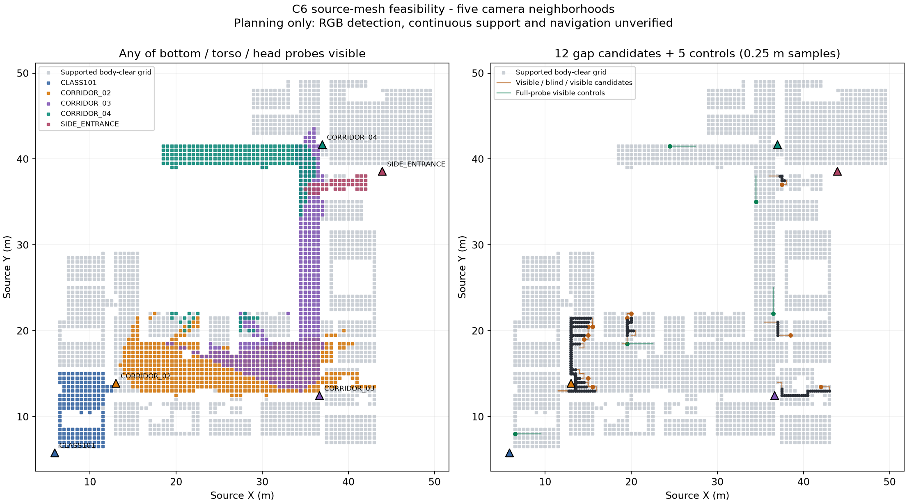

# C6 第一步：五攝影機規劃可行性（2026-10-16）

> 歷史規劃結果，釘選 `d486cdf`；12 條候選未獲渲染放行。後續[渲染前篩選](C6_PRESCREEN_20261016.md)取代此處的渲染選取與「均含轉彎」解讀；不得將格點方向變化當成盲區內轉彎。

範圍：[#19](https://github.com/Polalalabear/amidst/issues/19) 第一步，屬於
[CP1 #25](https://github.com/Polalalabear/amidst/issues/25)。只做來源網格視線與候選路線規劃，
未渲染、未產生新 run、未儲存 `.blend`。Model / effort：**gpt-6.1-sol / high**
（本次 session 的 `turn_context` 實際值）。分支 `codex/c6-multicamera-feasibility`，
base `claude/office-demo-visualization` @ `6fbd805e2d8e549226db1e8165dc8710d60c042d`。

## 初步判斷

**方案 A 有規劃可行性：12 條跨盲區候選（舊格點方向變化計數非零；非盲區內轉彎結論），其中 7 條兩端鏡頭集合不相交；
另有 5 條嚴格全探針可見對照。** 五台鏡頭均有可見採樣；目前沒有幾何規劃上的必要啟用
虛擬攝影機 B。這仍不是 RGB／K1／Demo READY。SIDE_ENTRANCE 僅有較窄的可見區和一條
候選端點，列為優先抽查項目。

搜尋 7,898 格點，3,011 個有支撐且身體外包盒未相交；5,341 條可連接邊。BVH 由 2,595
個實體物件、5,585,184 個三角形組成。原始 BFS 池 521 條、選 15 條；0.25 m 複查剔除
3 條（可見性連續性或最短盲區距離不足），保留 12 條。搜尋入口 116 個，非完備搜尋。

## 各搜尋窗覆蓋

表中數字是「有支撐且身體外包盒無來源相交」格點中，對應鏡頭至少一個探針可見的數量。
同一格點可被多台鏡頭看見；窗也互相重疊。「全盲」指五台全部三探針不可見。

| 搜尋窗 | 支撐格點 | CLASS101 | C02 | C03 | C04 | SIDE | 全盲 |
| --- | ---: | ---: | ---: | ---: | ---: | ---: | ---: |
| CLASS101 | 600 | 164 | 175 | 3 | 1 | 0 | 260 |
| CORRIDOR_02 | 1229 | 135 | 403 | 125 | 22 | 0 | 640 |
| CORRIDOR_03 | 1209 | 0 | 429 | 363 | 19 | 0 | 615 |
| CORRIDOR_04 | 828 | 0 | 0 | 187 | 211 | 41 | 453 |
| SIDE_ENTRANCE | 954 | 0 | 0 | 197 | 94 | 41 | 686 |

各窗自己鏡頭的「腳點可見且 incidence ≥0.25」格點依序為 **115、249、261、124、41**。
CLASS101、C02、C03、C04、SIDE 分別在 **3、11、3、3、1** 條保留盲區候選的端點提供規劃可見性。
這些是端點射線結果，不是觀測、接地 PASS 或跨鏡頭身分確認。

## 候選路線清單

ID 尾碼對應 JSON 的 `c6-visible_blind_visible-NN`。鏡頭欄是兩端任一探針可見的集合；
盲區欄是沿路線的距離區間（m），不是秒。完整折線座標、逐點射線、遮擋物與入射角在 JSON。

| ID | 起端 → 終端鏡頭 | 全長 m | 盲區距離 m | 轉彎數 |
| --- | --- | ---: | --- | ---: |
| 01 | CORRIDOR_02 → CLASS101 | 14.5 | 1.25–13.25 | 5 |
| 02 | CORRIDOR_04 → CORRIDOR_02 / CORRIDOR_03 | 5.5 | 1.50–4.00 | 5 |
| 03 | CORRIDOR_02 → CLASS101 | 5.5 | 1.25–4.25 | 2 |
| 04 | CORRIDOR_02 → CLASS101 | 5.5 | 1.50–4.25 | 4 |
| 05 | CORRIDOR_02 → CORRIDOR_03 | 4.5 | 1.50–3.00 | 2 |
| 07 | CORRIDOR_04 → CORRIDOR_02 | 4.5 | 1.25–3.25 | 4 |
| 10 | SIDE_ENTRANCE → CORRIDOR_03 / CORRIDOR_04 | 3.5 | 1.25–2.25 | 4 |
| 11 | CORRIDOR_02 → CORRIDOR_02 | 14.5 | 1.25–13.00 | 8 |
| 12 | CORRIDOR_02 → CORRIDOR_02 | 11.0 | 1.50–9.50 | 6 |
| 13 | CORRIDOR_02 → CORRIDOR_02 | 10.5 | 1.25–9.00 | 7 |
| 14 | CORRIDOR_02 → CORRIDOR_02 | 10.5 | 1.50–9.00 | 8 |
| 15 | CORRIDOR_02 → CORRIDOR_02 | 9.5 | 1.50–8.25 | 6 |

舊 turn_count 只表示格點方向變化；新盲區內計數顯示原 02、03 為 0，不能宣稱全部在盲區內轉彎。這是搜尋結果而非預先指定比例，
後續選渲染基準時應保留路型差異，不能把本清單視為獨立統計樣本。
ID 06、08、09 未通過加密複查，因此不重新編號或補成假資料。

對照 ID 是 `c6-fully_visible_control-01` 至 `05`，各 3.0 m、直線、13 個加密樣本皆通過
三探針可見與腳點入射角檢查；所屬鏡頭依序 C03、CLASS101、C04、C02、C03/C04。



左圖顏色表示至少一探針可見，重疊格點只顯示最上層顏色；數字以覆蓋表為準。
右圖橘線為 gap 候選、黑點為三探針全盲採樣、綠線為對照；灰格不是核准 walkable 區域。

來源 `school_v3.blend` SHA-256：
`cd46fa03f1875145a047e7e5f882aa97e7b2376de637677bf083bdc671e6e84e`；
size `468300506` bytes、mtime_ns `1791198236746106977` 前後相同。


## 方法與界線

- 僅測 `CLASS101`、`CORRIDOR_02/03/04`、`SIDE_ENTRANCE` 的五台既有來源攝影機。
  沒有新增／移動攝影機；未測 Office、Auditorium 的兩台鏡頭。
- 每個搜尋窗以攝影機光軸和宣告 1F 搜尋平面的交點為中心，XY 各 ±12 m；
  這是**攝影機周邊搜尋窗，不是房間／走廊語意邊界**。搜尋窗互相重疊，格點數不能相加，
  更不能換算為全區覆蓋率。`WALK_*`／`PORTAL_*`／`AREA_*` 不作輸入。
- 尺度 0.0247 m/BU；宣告的 1F 搜尋高度 0.4959475898742676 m 只用於搜尋窄帶
  （±0.08 m），實際支撐高度由實體三角網格向下射線取得；不解釋標註高度差。
- 目標規劃尺寸：高 1.70 m、半徑 0.25 m，逐設定檔記錄；離地 0.002 m。
  0.5 m 格點，以中心與四角檢查支撐（法線 |z| ≥ 0.95、高差 ≤ 0.01 m），
  用來源三角形和整個身體外包盒做精確相交檢查；相鄰格點的連線亦檢查連續掃掠盒。
  盒子包含圓柱，可能保守拒絕可通過路線。地板連續支撐仍是 UNKNOWN：格點角落和邊中點
  採樣不能排除更小的地板洞。
- BVH 使用 evaluated mesh instances，排除 annotation collections／prefixes／annotation_only
  與 `hide_render`；在來源儲存影格求值。這不是 C7 地圖，也不構成正式碰撞／通行性認證。
  材質透明、完整圓柱輪廓與像素偵測閾值都未模擬。
- 每個支撐點對五台鏡頭各測腳點、軀幹中點、頭頂：先檢查 FOV／clip，再射線測遮擋。
  任一探針可見才算「規劃可見」；五台的三探針都不可見才算「規劃盲區」。這不等同整個
  輪廓不可見，也不保證 RGB 元件會達到 28 px 的偵測門檻。
- 四鄰格點圖做確定性 BFS，最長 18 m；端點各保留至少兩格可見接近段，要求一段連續
  盲區。每入口最多收 16 個出口、入口最多約 256 個；用格點重疊率 ≤65% 選取不同路線。
  搜尋並不完備，未找到候選不能宣稱不可行。候選再以 0.25 m 間距重測；盲區採樣首尾
  距離至少 1 m。路線長度與盲區距離是規劃數字，尚未賦予速度／時間。
- 對照路線採更嚴格規則：全程三探針可見，腳點 incidence ≥0.25；先在格點要求有同一台
  鏡頭全程支援，再複查中點。優先選不同鏡頭和較遠位置，避免全落在同一角落。
- 產物標記 `SIMULATION_PLANNING_ONLY_NOT_INFERENCE_OR_NAVIGATION`、
  `inference_input_eligible: false`。未讀既有 GT／trajectory／renderer visibility／depth；
  不把這份規劃產物送入推論、K1 負證據或 C5 索引。

## 檔案與重現

- 設定：[c6_feasibility_v1.json](../../configs/c6_feasibility_v1.json)
- 規劃腳本：[plan_office_demo_feasibility.py](../../scripts/plan_office_demo_feasibility.py)
- 機器證據：[C6_FEASIBILITY_20261016.json](C6_FEASIBILITY_20261016.json)
- 繪圖：[plot_c6_feasibility.py](../../scripts/plot_c6_feasibility.py)
- 專用測試：[test_c6_feasibility.py](../../tests/unit/test_c6_feasibility.py)

輸出均拒絕覆寫。重現時指定新的輸出名稱：

```sh
/Applications/Blender.app/Contents/MacOS/Blender --background --disable-autoexec \
  --python-exit-code 1 blender/school_v3.blend \
  --python scripts/plan_office_demo_feasibility.py -- \
  --output /private/tmp/c6-feasibility-new.json

# 使用現有 Python environment；不建立 venv、不安裝依賴。
UV_CACHE_DIR=/private/tmp/amidst-c6-uv-cache uv run --no-project --offline \
  ../amidst-claude/.venv/bin/python scripts/plot_c6_feasibility.py \
  --input /private/tmp/c6-feasibility-new.json --output /private/tmp/c6-feasibility-new.png

UV_CACHE_DIR=/private/tmp/amidst-c6-uv-cache uv run --no-project --offline \
  ../amidst-claude/.venv/bin/python -m pytest tests/unit/test_c6_feasibility.py -q

git diff --check
```

## 驗證與續作

8 個專用測試通過：單一內部盲區規則、可見接近段、阻斷邊、盲區轉彎、對照路線逐點／逐邊
可見性、長度門檻、確定性與不修改輸入，以及更嚴格的對照視線和同鏡頭要求。
三個 Python 新檔的 Ruff check／format 與 `git diff --check` 通過；未跑全套測試。

已確認 #25 D4–D6 授權渲染與新代理尺寸／逐 run 半徑。本次依「完成第一步後先回報」停在
可行性報告；**不是撤回或重新要求渲染授權**。C6 第二步尚未完成，#19 保持開啟。下一個
已授權動作是先將原 Office 4.4→8.6 s 所屬路線以 1.70 m／0.25 m 目標產生獨立 run，之後
才處理基準路線與五條對照，每個 run 都要有自己的 run_id／hash、perception v2、品質旗標、
fixture 和場景預設。這些產物本次尚未建立，K1 READY／工作台驗收皆未驗證。

CP1 整體尚未核准；本 PR 不合併，未操作 main、K1 檔案、既有 run、RGB、GT 或來源資產。
C4a、C7、PR #32 修正和 C5 尚未開始。C4a 端點替代規則仍待確認；本次沒有採用 1.0 s 回溯。
本次 C6 規劃產物不依賴 K0 契約，沒有把未核准草稿視為已核准。

環境紀錄：受限環境下 Blender 啟動崩潰、uv 發生 macOS system-configuration panic；
改用允許的背景唯讀 Blender 與現有 Python environment 執行，沒有安裝套件。分支切換前的
唯一檔名衝突 `docs/history/LOCAL_STORAGE_CLEANUP_20261014.md` 已逐位元核對與 base 相同，
另保留一份於 LOCAL `/private/tmp/amidst-c6-preservation-20261016/`；其他未追蹤資料未 stage。
