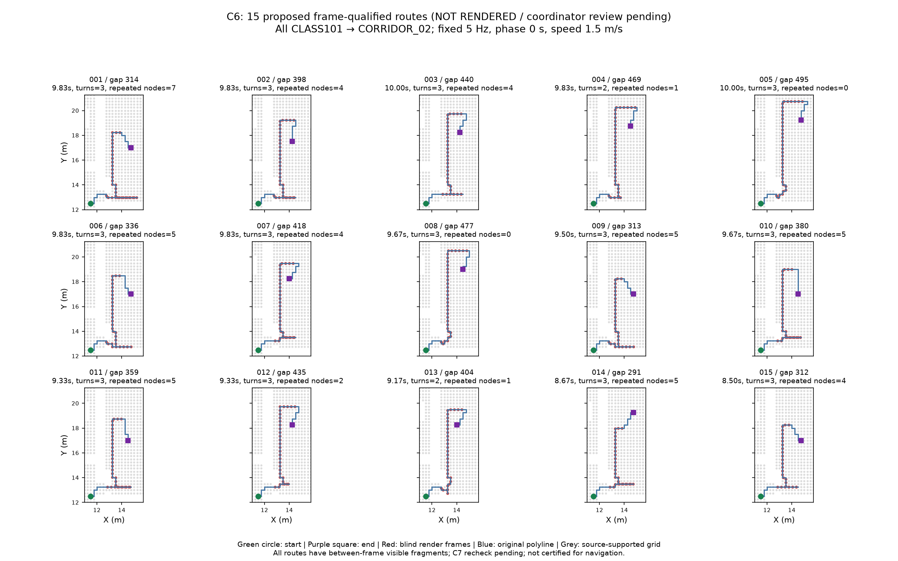

# C6 固定 5 Hz 渲染前篩選（2026-10-17）

Model / effort：**gpt-6.1-sol / high**（實際 session 值）。[PR #34](https://github.com/Polalalabear/amidst/pull/34)，CP1 未核准，不合併。

**已提出 15 條影格合格路線，全部跨鏡頭；仍未渲染，等待協調者確認清單。** 512 條凍結候選中，影格判定有 77 條合格（43 跨鏡頭）；較密的連續空間採樣診斷有 44 條合格（0 跨鏡頭）。入選 15 條全部帶影格間可見片段，不能稱為連續時間全盲。

限制：**15 條全部 CLASS101 → CORRIDOR_02，13 條重訪部分格點，僅 005／008 不重訪。** 它們來自決策前已固定的 waypoint 搜尋池，沒有為 5 Hz 改動起點、相位或速度；不是 15 條地理獨立樣本。跨鏡頭條件通過，但地理多樣性仍有限；請協調者連同路線圖審查，不能把本清單當成渲染放行。

[Office 1.70 m／r0.25 m 原路線新 run](OFFICE_PERSON_RERENDER_20261016.md)已另行完成 100 PNG、獨立 bundle／fixture／可選場景預設；v2 33 元件因 LOW_INCIDENCE 仍保持 MISSING。

## 已採用的使用者時間決策

使用者選定按**實際 5 Hz 影格**驗收單一盲區。每個影格時刻，五台任一腳／軀幹／頭探針可見就非盲；內部任一影格可見就剔除。C5 的 union 定義不變。影格間可見片段另列，不被抹去，也不當成影格時刻的負證據。

| 項目 | 篩選前固定值／驗收方式 |
| --- | --- |
| 路線池 | 原 `C6_PRESCREEN_20261017.json` 的 512 條 raw proposals，保留順序、完整折線及空間起點 |
| 時鐘 | 5 Hz；origin=0、phase=0、route_start=0 s；frame i 的 timestamp=i/5 |
| 每條實際排程 | 全部 1.5 m/s，完整路線 length/1.5 ≤10 s；最大 15 m |
| 末影格 | 最後一個不超過完整路線終點的整數影格；不補尾格、不逐條移時鐘 |
| 速度帶 | 1.0–2.0 m/s，CONFIGURED_NOT_GT；可見段下限=2 s×1.0=2 m |
| 可見段長度 | 用較密來源採樣的連續可見 prefix／suffix，量到完整物理路線終點；不是拿尾端不足 0.2 s 補造 RGB 影格 |
| 接地 | 兩端影格 bottom eligible 非空且 incidence≥0.25；盲區兩側連續接地合格影格跨度各≥1 s，按實際 1.5 m/s，不按速度帶上限 |
| 盲段 | 影格序列只有一個內部連續盲段；首末盲影格沿程差≥2.5 m |
| 轉彎 | 原始折線 RDP 0.4 m 化簡，只計首末盲影格沿程範圍內 >30°；化簡不改運動路徑 |
| 選取 | 最多15、至少10、跨鏡頭≥60%、重疊比例≤0.8；不用不合格路線補數 |
| 幾何診斷 | 來源採樣每0.025 s（0.0375 m），可見轉換二分括界≤0.0005 s |
| K1 | time_step_s=0.2，端點與負證據只能落在同一渲染時鐘上 |

[v6 設定](../../configs/c6_prescreen_v6.json)綁定 [凍結池](../../configs/c6_frozen_frame_pool_20261017.json) 的 SHA-256：
`efc81655a87da4974be5019c4f9beaddcd0dc20d0e34a6236d23ca681695b327`。此池在首次影格射線篩選前寫入，之後未改路線、速度、相位或起點。

## 兩種判定方式

| 同一512條路線 | 單路線合格 | 其中跨鏡頭 |
| --- | ---: | ---: |
| 固定5 Hz影格 | 77 | 43 |
| 連續空間採樣診斷（0.025 s） | 44 | 0 |

套用已固定的重疊／數量規則後提出15條，跨鏡頭15/15、影格間有可見片段15/15。取樣不能證明任意短片段都被找到，未採樣區間仍非連續全盲證明；片段起訖為有括界的估計值。舊0.125 m／上限速度接地規則得到45條同鏡頭的歷史結果，以及回饋搜尋selected=0，都保留在舊JSON；不是本次相同解析度的44條結果。

## 清單與 gap ID 對照

所有路線兩端接地合格，接近段為2.025 m，離開段2.0125–2.225 m；盲旁接地影格跨度每側1.2–1.4 s。新 `benchmark_id` 連續001–015，下表 raw gap 是凍結512條池的原ID尾碼，完整ID在JSON。原先12條粗格點候選已剔除，這些是新路線，沒有一對一繼承原12條ID。

| benchmark | raw gap | 全長m | 排程s | 盲段m | turns_in_blind | 重訪節點數 | 兩端接地 |
| --- | --- | ---: | ---: | ---: | ---: | ---: | --- |
| c6-benchmark-001 | 314 | 14.75 | 9.833 | 10.5 | 3 | 7 | 是 |
| c6-benchmark-002 | 398 | 14.75 | 9.833 | 10.5 | 3 | 4 | 是 |
| c6-benchmark-003 | 440 | 15.00 | 10.000 | 10.5 | 3 | 4 | 是 |
| c6-benchmark-004 | 469 | 14.75 | 9.833 | 10.5 | 2 | 1 | 是 |
| c6-benchmark-005 | 495 | 15.00 | 10.000 | 10.5 | 3 | 0 | 是 |
| c6-benchmark-006 | 336 | 14.75 | 9.833 | 10.2 | 3 | 5 | 是 |
| c6-benchmark-007 | 418 | 14.75 | 9.833 | 10.2 | 3 | 4 | 是 |
| c6-benchmark-008 | 477 | 14.50 | 9.667 | 10.2 | 3 | 0 | 是 |
| c6-benchmark-009 | 313 | 14.25 | 9.500 | 9.9 | 3 | 5 | 是 |
| c6-benchmark-010 | 380 | 14.50 | 9.667 | 9.9 | 3 | 5 | 是 |
| c6-benchmark-011 | 359 | 14.00 | 9.333 | 9.6 | 3 | 5 | 是 |
| c6-benchmark-012 | 435 | 14.00 | 9.333 | 9.6 | 3 | 2 | 是 |
| c6-benchmark-013 | 404 | 13.75 | 9.167 | 9.3 | 2 | 1 | 是 |
| c6-benchmark-014 | 291 | 13.00 | 8.667 | 8.7 | 3 | 5 | 是 |
| c6-benchmark-015 | 312 | 12.75 | 8.500 | 8.4 | 3 | 4 | 是 |

13條有3個、2條有2個盲區內轉彎；不沿用原12條「均含轉彎」的未限定計數。重訪節點如折返會明列，不冒充獨立統計樣本。

## 每條影格間可見片段

這15條各有1段，鏡頭皆為 **CAM_1F_CLASS101**；兩側實際影格都不可見。時間原點同渲染時鐘。長度=duration×固定1.5 m/s，最近影格差是可見片段邊界到最近影格的時間距離。JSON另保留左右轉換括界與包夾影格，不以四捨五入後的表格取代原值。

| benchmark | 起s | 訖s | duration s | 長度m | 包夾影格s | 最近影格s | 差ms |
| --- | ---: | ---: | ---: | ---: | --- | ---: | ---: |
| 001 | 5.002148 | 5.119727 | 0.117578 | 0.176367 | [5.0, 5.2] | 5.0 | 2.148 |
| 002 | 4.002148 | 4.119727 | 0.117578 | 0.176367 | [4.0, 4.2] | 4.0 | 2.148 |
| 003 | 3.668945 | 3.786133 | 0.117188 | 0.175781 | [3.6, 3.8] | 3.8 | 13.867 |
| 004 | 3.002148 | 3.119727 | 0.117578 | 0.176367 | [3.0, 3.2] | 3.0 | 2.148 |
| 005 | 2.668945 | 2.786133 | 0.117188 | 0.175781 | [2.6, 2.8] | 2.8 | 13.867 |
| 006 | 4.668945 | 4.786133 | 0.117188 | 0.175781 | [4.6, 4.8] | 4.8 | 13.867 |
| 007 | 3.668945 | 3.786133 | 0.117188 | 0.175781 | [3.6, 3.8] | 3.8 | 13.867 |
| 008 | 2.668945 | 2.786133 | 0.117188 | 0.175781 | [2.6, 2.8] | 2.8 | 13.867 |
| 009 | 4.668945 | 4.786133 | 0.117188 | 0.175781 | [4.6, 4.8] | 4.8 | 13.867 |
| 010 | 4.002148 | 4.119727 | 0.117578 | 0.176367 | [4.0, 4.2] | 4.0 | 2.148 |
| 011 | 4.002148 | 4.119727 | 0.117578 | 0.176367 | [4.0, 4.2] | 4.0 | 2.148 |
| 012 | 3.002148 | 3.119727 | 0.117578 | 0.176367 | [3.0, 3.2] | 3.0 | 2.148 |
| 013 | 3.002148 | 3.119727 | 0.117578 | 0.176367 | [3.0, 3.2] | 3.0 | 2.148 |
| 014 | 4.002148 | 4.119727 | 0.117578 | 0.176367 | [4.0, 4.2] | 4.0 | 2.148 |
| 015 | 3.668945 | 3.786133 | 0.117188 | 0.175781 | [3.6, 3.8] | 3.8 | 13.867 |

**最小時間餘裕約2.15 ms。** 這是來源幾何射線與固定時鐘的規劃結果，RGB／render精度／偵測器結果仍待真正新run檢查；不得改相位讓可見片段避開影格。

## 相鄰可見區、材質、狹窄邊與 C7

每條JSON都附相鄰可見區／潛在出口摘要：同一來源盲格點連通分量有22個可見邊界群（CLASS101 3群、CORRIDOR_02 19群），附exit_ref、bbox、camera_indices。這是採樣邊界，不是22個語意門口；所有出口都尚未實際排除，只有在C5完整評估及合法NO_DETECTION成立時才可能作負證據。

[材質讀取](C6_FIXED_FRAME_MATERIALS_20261017.json)涵蓋4個來源遮擋物：`Plane.010`、`Plane.011`、`group_0`、`group_0.003`。它們的slots皆alpha=1，未發現明確transparent／glass／transmission或linked-unknown；都有HASHED/DITHERED設定，保留渲染後RGB抽查標記。不是以材質名稱猜透明，也不是證明hit face與最終shader必然不透明。

| 路線 | 沿線材質物件 | 明確alpha／穿透 | RGB抽查 |
| --- | --- | --- | --- |
| 001 | Plane.010, Plane.011, group_0 | 未發現 | 待渲染 |
| 002 | Plane.010, Plane.011, group_0 | 未發現 | 待渲染 |
| 003 | Plane.010, Plane.011, group_0 | 未發現 | 待渲染 |
| 004 | Plane.010, Plane.011, group_0, group_0.003 | 未發現 | 待渲染 |
| 005 | group_0, group_0.003 | 未發現 | 待渲染 |
| 006 | Plane.010, Plane.011, group_0 | 未發現 | 待渲染 |
| 007 | Plane.010, Plane.011, group_0 | 未發現 | 待渲染 |
| 008 | group_0, group_0.003 | 未發現 | 待渲染 |
| 009 | Plane.010, Plane.011, group_0 | 未發現 | 待渲染 |
| 010 | Plane.010, Plane.011, group_0 | 未發現 | 待渲染 |
| 011 | Plane.010, Plane.011, group_0 | 未發現 | 待渲染 |
| 012 | Plane.010, Plane.011, group_0 | 未發現 | 待渲染 |
| 013 | Plane.011, group_0 | 未發現 | 待渲染 |
| 014 | Plane.010, Plane.011, group_0 | 未發現 | 待渲染 |
| 015 | Plane.010, Plane.011, group_0 | 未發現 | 待渲染 |

[選定路線狹窄邊抽查](C6_FIXED_FRAME_EDGES_20261017.json)：每條取兩個最近來源實體的邊，共30筆但只有**3條不同邊**；各72個半徑環支撐射線都通過。最近來源`group_0`，中心距離0.2687–0.3565 m；身體掃掠沿用相同source／frame／calibration／r0.25m的已驗證physical graph。門口／座椅語意仍UNKNOWN，不能把這些邊稱為已確認門口；歷史26條不同邊證據另保留。**C7於10/22到位後必須重核對這15條**，現階段不是導航／碰撞認證。

## K1 與 C5 交接

唯讀核對最新遠端 `claude/k1-hypothesis` commit `7c01522523d61c7c6453521b59478e6990ec241e`：Office `time_step_s=0.2`；engine內部時間為 `start.timestamp_s + i*0.2`。本次純檢查器會拒絕0.1 s步長或0.1 s偏移時鐘，選定路線所有影格／盲段前後端點都與0.2 s時鐘對齊。負證據只允許同格影格時刻。**K1未改檔、未跑推論**；現有遠端Office設定只涵蓋舊run且r0.1482、nominal1.3，新場景須另綁r0.25與相同clock/config，不能直接冒充已接妥。C6規劃射線輸出`inference_input_eligible=false`，不得送進K1當觀測或負證據。

[C5驗收紀錄](C5_VISIBILITY_ACCEPTANCE_20261016.md)已同步：任一探針可見就非盲，只在固定影格時刻套用本次路線單一盲區判定；來源已知影格間可見位置仍是可見，不改索引標籤。C5 index／API尚未實作。

## 驗證與未驗證

- 55個focused測試通過，含FOV內被擋／OUTSIDE_FOV／CLIPPED、任一探針可見、影格內可見島剔除、影格間可見島保留、固定末影格與K1錯步長／錯相位拒絕；原Office31觀測／七組canonical hashes回歸通過。
- 來源SHA-256／468300506 bytes／mtime_ns=1791198236746106977前後相同；未存blend，未修改舊RGB／GT／校正，未啟停服務，未跑全套測試。
- 基準與五條歷史全程可見controls都未渲染，沒有benchmark run_id／fixture；選定清單等待協調者確認，CP1仍未核准。
- 未驗證：RGB接地品質與短可見片段偵測、來源alpha的實際渲染效果、完整連續floor support、門口／座椅語意、C7地圖重核對、C4a區間、K1 READY、瀏覽器／Demo與研究指標。
- 原12條逐條剔除原因、透明材質9個物件與0/12兩端接地更正，見[歷史報告](C6_PRESCREEN_20261016.md)。Office新run不受這次基準等待確認影響。

## 產物

- [固定影格與全部512條結果／片段](C6_FIXED_FRAME_SCREEN_20261017.json)：15條完整影格射線／折線／連續ID，全部候選兩種判定與片段。
- [凍結候選池](../../configs/c6_frozen_frame_pool_20261017.json)、[設定v6](../../configs/c6_prescreen_v6.json)、[純時鐘規則](../../scripts/c6_frame_screen.py)、[來源射線篩選器](../../scripts/screen_c6_frames.py)。
- [選定材質](C6_FIXED_FRAME_MATERIALS_20261017.json)、[選定窄邊](C6_FIXED_FRAME_EDGES_20261017.json)。
- 歷史來源剖面：[512池父產物](C6_PRESCREEN_20261017.json)、[中點邊核對](C6_VISIBILITY_EDGE_AUDIT_20261017.json)、[連續解讀回饋搜尋](C6_SELECTED_ROUTES_20261017.json)。
- [Office新run收據](OFFICE_PERSON_RERENDER_20261016.json)。Actual output與精確指令／hashes同步貼在PR #34、#19及CP1 #25。
