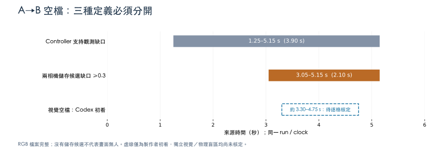
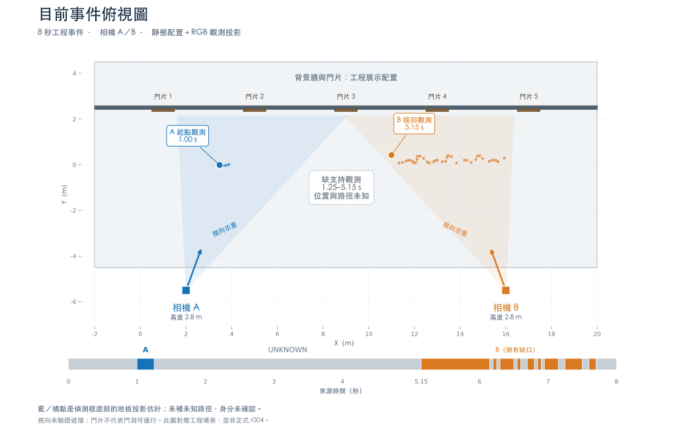

# A→B 約 3–5 秒空檔：Claude 獨立審查資料

公開 locator 約定：`$AMIDST_ARTIFACTS` 代表審查者自行指定、canonical 絕對路徑的 LOCAL 證據根目錄，`$AMIDST_SOURCE`／`$SOURCE` 代表按 composition 還原的工程，`$AMIDST_PYTHON`／`$AMIDST_PYTHON_ENV` 代表既有 Python executable／環境。這些是去識別化 locator，不宣稱其他機器已存在對應資料；先取得相同 hash 的 LOCAL 檔案並設定環境變數。GitHub 只有公開程式與精簡收據，完整 RGB、錄製、模型 wire 與原始命令紀錄仍為 PRIVATE／LOCAL。文中的歷史數據未因路徑去識別化而重跑。

本包只稽核 #210／Draft #211 的 **8 秒動態工程事件**。不改模型、追蹤器、播放器、門檻、正式 r004 或核定狀態。使用者看到的是人物離開 A 後、進入 B 前的空檔；這與整個影像區黑／白或缺圖是不同現象。

資料固定於 #211 `16bdba883ccef6c91de8e3e467795810901186f5`。本 PR 是該 head 上的審查增量，未合入 staging；#212／#214 的人審與符合性工作保持原狀。

## 先看這些實際數字

| 證據層 | 原始資料的結果 | 可以得出的結論 |
|---|---|---|
| RGB 來源 | A/B 各 160 張，20 fps，50,000 µs 格，共 320 張逐一符合 manifest SHA-256 | 這批來源沒有缺 RGB 檔；本次沒有重新量測瀏覽器載入／解碼 |
| RT-DETR 儲存候選，score ≥ 0.3 | A 最後一筆：frame 60、3.00 s、0.323097229；B 第一筆：frame 103、5.15 s、0.519696414 | 兩個候選時間戳相隔 2.15 s，身分尚未確認 |
| 兩相機都沒有儲存 person 的取樣 | frame 61–102，即 [3.05, 5.15) s；42 個時間格、84 個相機影格，均已 INFERRED | 儲存候選缺口的取樣窗長 2.10 s；不是「影像完全無人」的證明，score < 0.3 未儲存，不能填成 0 |
| query_min_score = 0.5 | A 最後一筆合格：frame 49、2.45 s、0.597016275；B 第一筆：5.15 s | 與儲存門檻 0.3、連接門檻 0.4 分開解讀，不改門檻 |
| RULE_ONLY 支持觀測 | A 的 ON_CAMERA 為 [1.00, 1.25) s；之後 GAP [1.25, 5.15) s，共 3.90 s；B 在 5.15 s 接回 | controller 的 GAP 比畫面盲區早，不能把這 3.90 s 全算成幾何盲區 |
| 接回決策的兩個時間 | decision_time = 4.20 s；查詢 B 的 [4.20, 5.40) s，共 24 格；entry/source_time = 5.15 s | 離線查詢看向未來 1.20 s 的窗，接回點比決策時間晚 0.95 s；不能冒稱即時延遲或在 4.20 s 已看見 B |

精確浮點數、每個 frame 的 RGB hash、score、bbox、ON_CAMERA/GAP 與 shown camera 都在 [audit.json](../history/q1q5_ab_gap_20261025/audit.json) 及 [frames.csv](../history/q1q5_ab_gap_20261025/frames.csv)。CSV 的空 score 是「未儲存 person ≥ 0.3」，不是已知 score=0；`visual_presence=UNREVIEWED` 不由模型結果填寫。



## 視覺邊界：這裡需要 Claude 檢查

Codex 本次唯讀查看指定 RGB 的初步筆記如下。這些是製作者的視覺初看，**不是獨立人工標準答案**；`visual_blind_interval_us`、`physical_blind_interval_us`、correctness 保持 null。

| 相機／影格 | 時間 | 初看內容 |
|---|---|---|
| A / 49 | 2.45 s | 人物可見，person score ≥ 0.5，但 controller 已是 GAP |
| A / 60 | 3.00 s | 右邊界仍有部分人物；儲存 person score 約 0.323 |
| A / 61–65 | 3.05–3.25 s | 逐格檢查邊界；四肢會短暫離開後再入畫，不能以第一次消失當最終離開。frame 65 仍見極小的足部邊緣 |
| A / 66 | 3.30 s | 初看未見人物；需要同時確認 B 與後續各格 |
| B / 94 | 4.70 s | 初看未見人物 |
| B / 95 | 4.75 s | 左邊界開始見足部，尚無儲存 person ≥ 0.3 |
| B / 98、100、102 | 4.90、5.00、5.10 s | 已能看見部分人物，尚無儲存 person ≥ 0.3 |
| B / 103 | 5.15 s | 首筆 person ≥ 0.3、亦達 query 0.5，RULE_ONLY 切至 B |

因此使用者的「約 3–5 秒」有影像依據；**精確的兩鏡頭全不可見區間仍待逐格審查**。請勿把初看約 3.30–4.75 秒當成凍結結果，也勿把 5.15 秒當成 B 第一個可見像素。完整邊界窗為 2.75–5.25 秒，兩相機同步比對，不以單一鏡頭或抽樣圖定義結論。

## 相機與空間資料

- scene=`ENGINEERING_DYNAMIC_SCENE`，revision=`rSYN`，run=`ENGINEERING_DYNAMIC_RUN_20261025`，clock=`ENGINEERING_DYNAMIC_CLOCK`。
- A 世界座標約 `(2.0, -5.5, 2.8)` m；B 約 `(16.0, -5.5, 2.8)` m；相機中心相距 14 m。兩鏡頭均 45 mm／36 mm sensor width、960×540；完整 matrix_world 在 audit.json。
- [topdown-static.json](../history/q1q5_ab_gap_20261025/topdown-static.json) 是前一輪唯讀靜態匯出的尺寸／校正收據：METRIC、scale=1、AUTO sensor fit、shift=0、pixel aspect=1。地板 x=[−2,20]、y=[−4.5,4.5]、頂面 z=0；牆約 y=2.5，5 個門片中心 x=1,5,9,13,17。沒有讀 actor／動畫或儲存、渲染來源。
- [topdown-projections.json](../history/q1q5_ab_gap_20261025/topdown-projections.json) 保留前一輪影像框底部到 z=0 地板的投影估計。不是人物真實足點、真實軌跡或已確認身分；跨缺口未連線。
- 下圖視向扇形是示意，沒有計算遮擋或證明完整可見範圍。門片不是核定門洞；圖中「缺支持觀測」指 controller GAP。



**現有圖的限制必須一起審：**本工程 camera graph 的 `T_A_B.relation=BLIND_GAP` 與 `APPROVED_WALKABLE` 是 `SYNTHETIC_ENGINEERING_ONLY` 設定。A、B exit ROI 均覆蓋整張 `[0,0]–[960,540]`，entry zones 為空；`nominal_path_length_m`、visible area、ranking area 均為 null。這不是從 RGB 獨立量得的盲區，也沒有正式幾何／可通行核准。圖、ROI 原文隨 audit.json 保留供核對，**本 PR 不更改它們**。

## Claude 審查步驟與回收物

1. 先比對 input-pins.json、CSV／JSON 中的 source/run/clock/hash。不要以工作台目前游標、舊 6 秒靜態事件或正式 r004 替代本事件。
2. 先獨立看原 RGB：兩鏡頭 frame 55–105（2.75–5.25 s），每格 50 ms。frame 60–66 的四肢出入、B 90–103 的第一個邊界像素要逐格放大確認。請另存 `claude-visual-review.csv`，欄位：`camera_id,frame_index,timestamp_us,rgb_sha256,visibility,reviewer,notes`；visibility 只選 `VISIBLE_PARTIAL`／`VISIBLE_FULL`／`NOT_VISIBLE`／`UNCERTAIN`，不能由 detector score 代填。
3. 再對照 frames.csv 與 audit.json，分列視覺不可見、儲存候選缺口、query 門檻缺口、link/controller GAP。檢查 A 仍可見且有 ≥0.5 候選時 controller 已 GAP 的行為；不在這個審查 PR 偷改產品。
4. 檢查 full-image exit ROI、合成 BLIND_GAP 轉移、B 的候選證據窗及兩個時間欄位；標示哪些是工程假設、哪些是真正觀測，是否需要另開產品／契約 issue。
5. 對照靜態相機與投影收據，確認沒有 GT／actor 路線支持的假連線或身分聲明。未知路徑、未知遮擋、未知物理可行性保持未知。
6. 回收：GitHub review（精確 head）、逐格 CSV、問題／不確定項目清單、可支持與不可支持的時間區間及其定義。**本 PR 不含預填的獨立答案。**不要改原 RGB、錄製或舊審查包。

## 離線重現與 LOCAL 證據

公開 PR 只有 code/tests/docs/精簡數值與 SVG；原 RGB、完整錄製與 LOCAL 對照圖不會上傳。具相同 LOCAL bundle 的 Claude 可直接重現：

```sh
: "${AMIDST_ARTIFACTS:?set the LOCAL artifact root first}"
AMIDST_AB_GAP_BUNDLE="$AMIDST_ARTIFACTS/q1q5-dynamic-baseline-v1_20261025"
mkdir -p "$AMIDST_ARTIFACTS/local-work"
uv run --no-sync python scripts/audit_q1q5_ab_gap.py \
  --bundle "$AMIDST_AB_GAP_BUNDLE" \
  --pins docs/history/q1q5_ab_gap_20261025/input-pins.json \
  --pins-sha256 716bdb65c739454e814c8cae3923dfd0001e7c3deba823824b3a8345262b7bec \
  --output "$AMIDST_ARTIFACTS/local-work/amidst-ab-gap-CLAUDE-NEW"
cmp "$AMIDST_ARTIFACTS/local-work/amidst-ab-gap-CLAUDE-NEW/audit.json" docs/history/q1q5_ab_gap_20261025/audit.json
cmp "$AMIDST_ARTIFACTS/local-work/amidst-ab-gap-CLAUDE-NEW/frames.csv" docs/history/q1q5_ab_gap_20261025/frames.csv
```

使用既有環境、不安裝或下載；output 必須不存在且不在來源 bundle 裡。擷取器只打開 12 個白名單安全 JSON／JSONL 與 manifest 列出的 RGB（只 hash，不做新推論），不打開 producer、actor、GT、私有劇本或動畫。每份 JSON／JSONL pin 與 RGB 逐一核對，要求兩相機完整 160 格及 controller timeline 覆蓋。

LOCAL 審查包：`$AMIDST_ARTIFACTS/ab-gap-review-20261025/`。內有同步與邊界 contact sheets、原 RGB locator/hash 清單、程式／公開收據與本輪檢查紀錄；不修改原動態 bundle。只拿到 GitHub 的審查者可核對數值、schema、程式與圖，但**沒有原 RGB 就無法完成獨立視覺核定**。

本次沒有新模型呼叫、Blender render、瀏覽器 FPS／latency 測量或正式 correctness 評分。身份 `UNCONFIRMED`、物理可行性 `UNKNOWN`；正式 r004 凍結及 #145 的 gates 不變。所有既有測試與 browser 數字仍屬 #211 歷史 checkpoint，不混稱本次重跑。
