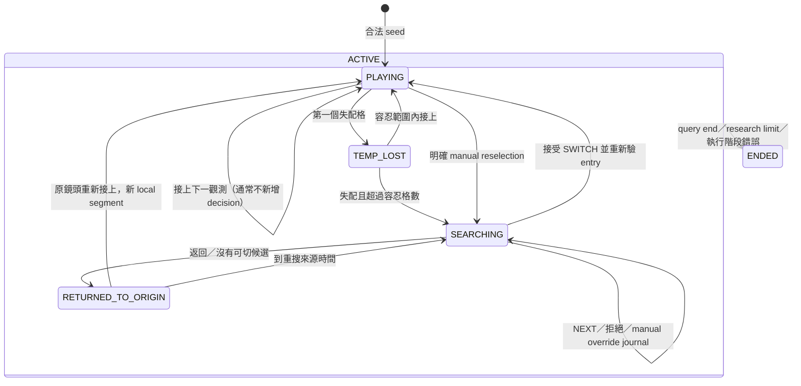

# Q5 As-Is Statechart 與驗證邊界

2026-10-24；第二階段 A。這是現況描述與測試依據，**不新增產品狀態、不核准契約差異**。
第一階段報告：[歷史審查紀錄](Q5_STATECHART_STAGE1_REVIEW.md)；本輪使用者已核准
A → 檢查 → B → 檢查 → C，不包含產品修正、TLA+、CI 或正式切鏡策略。

## 固定來源與範圍

目前 checkout 是 `60fa8ef64988435530b09fb258d79130e83977af`，不是以下 Draft 的整合樹。
測試讀取 Git objects，在 repo 外建立程式／合成 fixture 組合；不切分支、不改 Draft。

| 代號 | 既有來源 | 固定 commit |
|---|---|---|
| L | `src/amidst/q1q5/linker.py` | staging `a958dd4043ebcd5ef2d9fdb362d15f8c4ce3941f` |
| C | `src/amidst/q1q5/q5_controller.py` | #169 `798f73711e302a2e49fd495e96958ed254720e6f` |
| A | `src/amidst/q1q5/q5_agent.py`、`agent_tools.py` | #172 `1bb4135965fb53643e9fbbaf8e41fd77e8ffb9c8` |
| H | `src/amidst/q1q5/api.py` | #174 `d9125b68bdea82769a6c3b20317083d701fb2f1a` |
| D | `docs/contracts/Q1_Q2_FIRST_DEMO_V1.md` | staging `a958dd4043ebcd5ef2d9fdb362d15f8c4ce3941f` |

原始碼連結：[L](https://github.com/Polalalabear/amidst/blob/a958dd4043ebcd5ef2d9fdb362d15f8c4ce3941f/src/amidst/q1q5/linker.py)、
[C](https://github.com/Polalalabear/amidst/blob/798f73711e302a2e49fd495e96958ed254720e6f/src/amidst/q1q5/q5_controller.py)、
[A](https://github.com/Polalalabear/amidst/blob/1bb4135965fb53643e9fbbaf8e41fd77e8ffb9c8/src/amidst/q1q5/q5_agent.py)、
[tools](https://github.com/Polalalabear/amidst/blob/1bb4135965fb53643e9fbbaf8e41fd77e8ffb9c8/src/amidst/q1q5/agent_tools.py)、
[H](https://github.com/Polalalabear/amidst/blob/d9125b68bdea82769a6c3b20317083d701fb2f1a/src/amidst/q1q5/api.py)、
[D](https://github.com/Polalalabear/amidst/blob/a958dd4043ebcd5ef2d9fdb362d15f8c4ce3941f/docs/contracts/Q1_Q2_FIRST_DEMO_V1.md)。

## 現有行為圖

ACTIVE 是文件的分組，沒有輸出這個狀態；不是已實作的階層式 statechart engine。
manual reselection 也可從 TEMP_LOST／RETURNED_TO_ORIGIN／SEARCHING 開新搜尋，再回 PLAYING。
準備階段缺依賴可直接回 UNKNOWN／PARTIAL／NO_SEED，沒有活躍 session，不要求偽造 ENDED。
`RETURNED_TO_ORIGIN` 的暫失畫面仍在目前來源時間；不倒回最後一張觀測。

## 狀態、轉移、Guard 與副作用

以下行號只對應上表固定 commit。`journal` 指 decision journal，local link log 與 timeline 另記。

| ID | 實際轉移／事件 | Guard／副作用 | 程式位置 | 既有測試（tests/q1q5/） |
|---|---|---|---|---|
| T01 | START → PLAYING | pinned scope／grid／參數、合法 seed；observe 與新 linker | C `_prepare` L121、`_execute` L504–508 | test_q5_controller.py `test_index_ticks_continue_same_camera_without_agent_or_evidence_calls` |
| T02 | PLAYING → PLAYING | IoU、中心距離、class／score／color 過濾；一格至多一框；通常不新增 decision | L `step` L217–286；C L540–542 | test_linker.py `test_geometry_score_class_and_color_filters_do_not_create_boxes` |
| T03 | PLAYING → TEMP_LOST | 無唯一合法匹配；GAP.position=null，不補框 | C L543–546；L L271–278 | test_linker.py `test_gap_boundary_and_no_resurrection` |
| T04 | TEMP_LOST → PLAYING | 先判 LINKED；恰於 max_gap_us 接上仍同段 | L L259–270；C L540–542 | test_linker.py `test_linked_exactly_at_gap_limit_stays_in_segment` |
| T05 | TEMP_LOST → SEARCHING | 失配且 gap_samples > max_gap_samples；記 decision_time、snapshot；local linker 到此終止 | L L274–278；C `_search` L407–413 | test_q5_controller.py `test_disappearance_search_guard_and_forward_gap_switch` |
| T06 | SEARCHING → SEARCHING | 接受 NEXT 先取當前 rank evidence、非空合法 observation 引用；被拒不前進 | tools L67–94；A L246–273 | test_agent_tools.py `test_next_advances_only_after_valid_submission`、`test_illegal_submissions_do_not_advance_or_cut` |
| T07 | SEARCHING → PLAYING，action=SWITCH | candidate／evidence 未被改、已取證、MATCH_STRONG、entry 合法且不早於 decision；換新 linker、綁 timeline | C `_commit_selection` L421–440 | test_q5_controller.py `test_bad_evidence_ends_session_without_unverified_cut`；test_q5_agent.py `test_agent_fetches_then_proposes_and_controller_guards_real_entry` |
| T08 | SEARCHING → RETURNED_TO_ORIGIN | 沒有可切候選／明確 RETURN；記缺口，不能宣告所有鏡頭無人 | C L441–445；A L175–179、269–271 | test_q5_agent.py `test_no_transition_candidates_is_normal_return_without_false_agent_limit`、`test_agent_can_decline_even_strong_candidate_and_exhaustion_is_not_failure` |
| T09 | RETURNED_TO_ORIGIN → PLAYING | 原鏡頭通過幾何／條件／歧義檢查；新 segment，不復活舊 linker | C `_return_probe` L480–502、L528–532 | test_q5_controller.py `test_below_guard_never_cuts_and_can_reacquire_origin_at_current_time` |
| T10 | RETURNED_TO_ORIGIN → SEARCHING | 仍失配且 timestamp-returned_at >= research_interval_us | C L533–548 | test_q5_controller.py `test_session_research_limit_bounds_new_searches_without_fake_negative` |
| T11 | ACTIVE → SEARCHING → PLAYING，USER | seed 在原 query／條件範圍、時間不倒退；不退還 session counters；超 research limit 進 ENDED | C `request_manual_seed` L447–458、`_apply_manual` L460–478 | test_q5_controller.py `test_manual_selection_keeps_journal_and_session_counters_with_threaded_tick_gate`、`test_manual_changes_cannot_refund_session_search_limit` |
| T12 | ACTIVE → ENDED | query/run end、research limit、執行階段錯誤；保留先前決定 | C L408–409、550、557–562、595–600 | test_q5_controller.py `test_session_research_limit_bounds_new_searches_without_fake_negative`、`test_evidence_port_fault_never_becomes_no_person_or_missing_observation` |

零容忍時同一格先記 TEMP_LOST 再 SEARCHING；NOT_SAMPLED 不計缺格。
整數來源微秒採半開區間。Agent 總牆鐘含模型／取證等待；D71 的 fallback_budget_ms
只進 stats，不截斷 RULE。session Agent 額度用盡轉規則，research 額度才限制 session。
已接受 manual override 後，晚到自動提案不得執行（C L414–419；A L223–224）。

## 實作、契約與缺口分開

| 項目 | As-Is VERIFIED | 文件預期／待定 | 本輪處理 |
|---|---|---|---|
| SWITCHING | C L435 直接記 SEARCHING→PLAYING／SWITCH，沒有 SWITCHING journal | D §8.6 列 SEARCHING→SWITCHING→PLAYING，瞬時狀態也要記錄 | 差異 `SWITCHING_NOT_RECORDED`；不偽造 microstep，不視為正式相容。測試以 strict xfail 保留期望 |
| 空 evidence NEXT，#183 | tools L89–90 要非空 observation 引用，空候選被拒，cursor 不動 | 依序查完候選的意圖在此不能完成；現有非空引用契約本身有缺口 | 保留原拒絕證據及進度 xfail；不改 SWITCH guard／NEXT envelope |
| 同 session 並行 publication | H L305–308 在 bundle/save 前先清 _active，相同請求可重跑 | 既有 idempotence 測試只驗順序重試 | barrier 重現；at-most-once 期望 strict xfail；部署並行可達性 UNKNOWN |
| 使用者停止 | C 沒有 stop/cancel method；H POST_ROUTES 沒有 q2_stop_session | D §8.6 使用者停止→ENDED；取消優先序／晚到結果尚未落地 | 明確 UNSUPPORTED；測試要求缺少能力而 xfail，不以 manual seed 冒充停止 |
| 準備錯誤 | 部分 integrity faults 直接 raise；缺依賴可空 timeline UNKNOWN | 不等於 active session 的 ENDED 轉移 | 驗證器不要求尚未啟動的工作有終止紀錄 |

`MATCH_STRONG` 是條件證據，非身份確認。frame_state、target_presence、controller state、
job RUNNING/COMPLETE/FAILED、identity／physical verdict 是不同維度；不把 job COMPLETE
當領域成功。hash、布林 gt_read 或合法 journal 也不單獨證明完整 GT 隔離。

## 第二階段檢查方式

新增 checker 僅在 tests/q1q5；產品不得 import。As-Is 可接受的壓縮 SWITCH 另報已知缺口，
contract profile 不將它當成正式合規。合法／拒絕／無法檢查分開，缺 evidence context 不算 PASS。
既有已知問題的期望測試使用 `xfail(strict=True, raises=AssertionError)`，不靜默 skip；
XPASS 會令測試失敗，提示先重審來源版本與契約。

本文件與測試只使用合成資料；不改前置審查、真 RGB／GT、參數、Baseline 或 Draft。
各子階段實際命令、結果與 hashes 記於 `Q5_STATECHART_STAGE2_RESULTS.md`。
