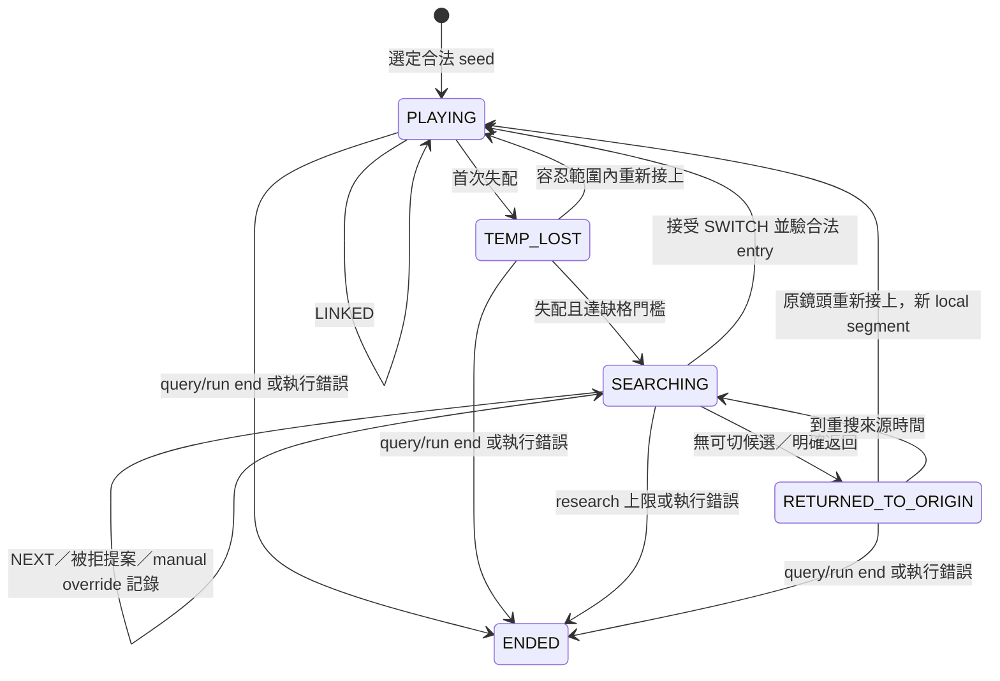

# Q5 Statechart／形式化驗證：第一階段審查報告與實作計畫

日期：2026-10-24（Asia/Taipei）。狀態：**第一階段完成，第二階段等待使用者核准**。

本檔保存第一階段歷史 checkpoint；第二階段核准與結果見 [第二階段總結](Q5_STATECHART_STAGE2_RESULTS.md)。
本機來源報告保留，GitHub 版僅轉換連結與增加本段。

## 1. 結論與審查邊界

建議導入，但先做「既有行為的 Statechart＋獨立 trace invariants＋合成狀態序列測試」，不先換狀態機框架、不先重構 controller，也不先加入 TLA+／CI。這能直接改善狀態語意、切鏡授權、重複事件、終止與重播的可檢查性；不能證明追到同一個人、真實遮擋／可通行性或模型正確率。

本次以專案架構與 **Q5 端到端相依路徑**為盤點主軸：來源／索引、clock、靜態圖與候選、local linker、Q4 evidence、RULE_ONLY controller、Agent typed tools／fallback／replay、HTTP session lifecycle、前端狀態消費、獨立評估與 Demo／Baseline 邊界。這不是全 repository 每個無關模組的逐行安全稽核，也不涵蓋所有其他 worktree 的執行狀態。未讀大型媒體、Blender 或 GT，不把文件中的歷史 PASS 當本次重跑。

- **VERIFIED**：本次讀取的程式與固定 Git 版本、GitHub 即時 PR／issue 狀態、本次合成測試與機械重現。
- **REPORTED**：既有量測／審查文件記錄，這次沒有重跑其推論或人工驗收。
- **INFERENCE**：由程式結構推得的風險與方法適用性，會明列假設。
- **UNKNOWN／MISSING**：尚未核准、未提供、未執行，或不在本次可確認範圍。

只新增 LOCAL 審查報告、暫存程式快照、重現腳本及測試證據。未修改 repository 程式／測試／設定／文件，未切 branch、建立 worktree、commit、push、發 GitHub 訊息、啟動產品服務、渲染、推論或下載依賴。

## 2. 實際版本：不能只看目前 checkout

| 層級 | 本次確認版本 | 實際意義 |
|---|---|---|
| 目前 checkout | `codex/controlled-scene-real-v2-2a` @ `60fa8ef64988435530b09fb258d79130e83977af` | 有既有未提交修改與未追蹤 `src/amidst/q1q5/`、`tests/q1q5/`；不是最新 Q5 整合樹 |
| mainline/q1q5 本機 remote ref | `f915fb048e41f8bdbadf9c985263f00ec59df619` | 保留其本身版本邊界 |
| staging | `a958dd4043ebcd5ef2d9fdb362d15f8c4ce3941f` | GitHub API 與本機 ref 一致；部分基礎模組與評估器已合入 |
| RULE controller／PR #169 | `798f73711e302a2e49fd495e96958ed254720e6f` | OPEN／Draft，未合入 staging |
| Agent／PR #172 | `1bb4135965fb53643e9fbbaf8e41fd77e8ffb9c8` | OPEN／Draft，未合入 staging |
| HTTP／PR #174 | `d9125b68bdea82769a6c3b20317083d701fb2f1a` | OPEN／Draft，未合入 staging |
| 事件比較／PR #185 | `9a56bf8f11d4bff1cb6de60843451bce400ee831` | OPEN／Draft，工程比較原型 |
| 前置審查／PR #187 | `a36622f4809a5209d442d8d1f7a6fd23a70171f3` | OPEN／Draft；#117 又有新版 v2 工作認領，不能改動其檔案 |
| 獨立 conformance kit #127 | `994d34c8340855dbf0e28d0273851049df5e6c7d` | OPEN／Draft；契約版本對齊仍由 #145 處理 |

本次建立 342 個既有程式／合成測試／設定檔的**暫存審查組合**，記錄每檔來源 commit 與 SHA-256；不是整合提交、不是新的 Baseline，也沒有將 Draft 合併至任何分支。

證據：COMPOSITION.json（LOCAL `/private/tmp/amidst-q5-stage1-20261024-at4sp876/COMPOSITION.json`；未上傳）、GitHub PR 快照（LOCAL `/private/tmp/amidst-q5-stage1-20261024-at4sp876/github-pr-state.json`；未上傳）。

## 3. 架構與實作盤點

專案總體設計分為 observation/perception、geometry／graph、候選重建、Agent arbitration、workbench 呈現與獨立 evaluation。但 [SYSTEM_DESIGN.md](../../docs/specs/SYSTEM_DESIGN.md#L1) 明示：完整產品架構保留了尚未落地的功能，不能由 schema 推定實作。Q5 應採較新的 Q1–Q5 契約與實際分支程式逐項核對。

| 模組／能力 | 實作狀態 | 本次依據與限制 |
|---|---|---|
| 既有 Office Demo：投影、camera-local motion、Top-K 跨鏡頭候選、selected-target 過濾 | **已實作**；本次純合成回歸通過 | [blender_association.py](../../src/amidst/workbench/blender_association.py#L50)、[blender_motion.py](../../src/amidst/workbench/blender_motion.py#L131)、[target_reconstruction.py](../../src/amidst/workbench/target_reconstruction.py#L68)。這是候選重建，不等於 Q5 自動切鏡或身分確認 |
| Q 線 store／clock／離線 RT-DETR 索引／HSV | **基礎程式已實作並合 staging** | `src/amidst/q1q5/{store,clock_mapping,detection_index,hsv_color}.py`。索引 producer 存在不等於正式 r004 index 已物化；本次不執行 detector |
| 單鏡頭 selected-seed linker | **已實作並合 staging** | [linker.py 固定版](https://github.com/Polalalabear/amidst/blob/a958dd4043ebcd5ef2d9fdb362d15f8c4ce3941f/src/amidst/q1q5/linker.py#L143)。PLAYING／TEMP_LOST／SEARCHING、整數格、歧義不硬接、SEARCHING 後不能復活同段；不是跨鏡頭 ReID |
| 靜態圖驗證／D28 候選排序 | **程式已實作並合 staging；實際圖核准未完成** | [graphs.py](https://github.com/Polalalabear/amidst/blob/a958dd4043ebcd5ef2d9fdb362d15f8c4ce3941f/src/amidst/q1q5/graphs.py#L139)、[candidates.py](https://github.com/Polalalabear/amidst/blob/a958dd4043ebcd5ef2d9fdb362d15f8c4ce3941f/src/amidst/q1q5/candidates.py#L21)。TOPOLOGICAL_ONLY 排除；排序前限 run cameras；截斷明示 |
| Q4 candidate evidence | **已寫程式、PR #154 Draft** | [q4_evidence.py](https://github.com/Polalalabear/amidst/blob/e6eb30bae0641af3522b0ab45cb9d12c6b9cc4e1/src/amidst/q1q5/q4_evidence.py#L57)。覆蓋、presence、entry observation 分開；缺 row 是 integrity error，不冒充 MISSING |
| RULE_ONLY Q2／Q5 controller | **已寫程式、PR #169 Draft** | [q5_controller.py](https://github.com/Polalalabear/amidst/blob/798f73711e302a2e49fd495e96958ed254720e6f/src/amidst/q1q5/q5_controller.py#L91)。已有查找、暫失、候選取證、切鏡、返回／重搜、manual seed、journal、限制與 hash |
| Agent sequential／typed tools／整段 fallback／recorded replay | **已寫程式、PR #172 Draft** | [q5_agent.py](https://github.com/Polalalabear/amidst/blob/1bb4135965fb53643e9fbbaf8e41fd77e8ffb9c8/src/amidst/q1q5/q5_agent.py#L73)、[agent_tools.py](https://github.com/Polalalabear/amidst/blob/1bb4135965fb53643e9fbbaf8e41fd77e8ffb9c8/src/amidst/q1q5/agent_tools.py#L15)。模型只提案；controller 仍獨立驗切鏡 guard；有未知 digest、契約與進度缺口 |
| HTTP Q API、非同步 start／poll、錄製 | **已寫程式、PR #174 Draft；正式 registry 接線未驗收** | [api.py](https://github.com/Polalalabear/amidst/blob/d9125b68bdea82769a6c3b20317083d701fb2f1a/src/amidst/q1q5/api.py#L113)。registry 缺時 NOT_READY；外層 job COMPLETE 不代表內層 Q5 正確／完整 |
| Q 前端狀態／timeline／審核 | **各 T 階段已有 Draft；正式共用入口整合與瀏覽器驗收未完成** | PR #175／176／177／180；例如 [q2-session-model.mjs](https://github.com/Polalalabear/amidst/blob/ce3f369d92eb41308e1dcdaeeac7cc9116d437c8/frontend/workbench-v2/q2-session-model.mjs)。主 UI 規則仍是 frontend/workbench；不能把 workbench-v2 原型當已完成遷移 |
| FOUND／LOST 比較 | **已寫工程 adapter、PR #185 Draft** | [event_modes.py](https://github.com/Polalalabear/amidst/blob/9a56bf8f11d4bff1cb6de60843451bce400ee831/src/amidst/q1q5/event_modes.py#L26)。從 frozen response 推導事件，不能授權切鏡；LOST 門檻 EXPERIMENT_ONLY_NOT_APPROVED |
| Q5 frozen-output evaluator | **已寫並合 staging；正式評分未執行** | [q5_switch_eval.py](https://github.com/Polalalabear/amidst/blob/498df4129ff1f4f57c5ce7aeaf477373b707dace/src/amidst/evaluation/q5_switch_eval.py#L55)、[評估契約](https://github.com/Polalalabear/amidst/blob/498df4129ff1f4f57c5ce7aeaf477373b707dace/docs/evaluation/Q5_SWITCH_EVAL_V1.md)。先驗 frozen bytes，再讀 evaluation-only script；它不重新證明 guard 或 identity |
| 專用 Statechart／TLA+ | **本次檢視的 Q5 路徑中未找到** | 有散落的狀態字串、guard、schema、測試；沒有已完成的 Q5 `.tla`／`.scxml` 模型或 model-checking 驗收。不是「完全沒有 invariants」 |
| r004 正式兩模式 Baseline／人物追蹤正確率 | **MISSING／未驗收** | #117／#115／#118、契約與人工答案仍是依賴；不得以本次 350 個合成測試替代 |

Q 線實際資料流是：安全 RGB → **另行授權的離線索引產製** → pinned index/store → seed → LocalLinker → SEARCHING → static candidate snapshot → Q4 evidence → RULE／Agent proposal → controller 再驗 guard → timeline／journals → UI。GT／劇本只在預測凍結後進獨立 evaluator。Q5 runtime 不應接回舊 PG／Agent 初始化鏈。

## 4. 現有狀態圖：按程式觀察，不把契約期望冒充現況



此圖是觀察摘要，不是新增產品邏輯。manual reselection 可由活躍狀態先記 SEARCHING 再進 PLAYING；有 session 累計限制，不能由手動事件洗掉。準備階段依賴缺漏可以回 UNKNOWN／PARTIAL 而不開始 session，不應強迫這類回應偽造 ENDED journal。

重要區分：

1. LocalLinker 的 SEARCHING 是該 local segment 的終止，controller 的 SEARCHING 是 session 的搜尋階段；不能把兩者當同一個可復活物件。
2. `target_presence`、frame_state、身份／物理 verdict、job status 是不同維度，不能全部塞入單一追蹤 enum。
3. 來源微秒與牆鐘預算不同。**D71 已決：fallback_budget_ms 只作 stats，不截斷 RULE_ONLY；session Agent 額度用盡轉規則，不結束規則 session。**不能沿用舊 #86／kit 解讀，導入錯誤 invariant。
4. Statechart 可用階層 Active 包含 PLAYING／TEMP_LOST／SEARCHING／RETURNED_TO_ORIGIN，SEARCHING 再描述取證與提案的子階段。只有採用 run-to-completion 等明確事件語意才有助處理優先序；圖本身不會自動提供這些保證。[W3C SCXML 語意](https://www.w3.org/TR/scxml/)

## 5. 邏輯缺口與風險

| 發現 | 證據與判斷 | 風險／建議 |
|---|---|---|
| 空證據無法合法 NEXT | **VERIFIED**：本次以最新 Agent／tools 重現。NO_PERSON_DETECTED＋best_observations=[]，NEXT 空引用被拒；下一候選取證被 ILLEGAL_ORDER 拒；RULE 可前進。對應 [#183](https://github.com/Polalalabear/amidst/issues/183)、agent_tools.py L84–93 | 契約功能缺口，會破壞正常輪詢進度；不是 kit 錯誤。需先核定 evidence-hash citation 或明確轉規則語意；不得放寬 SWITCH |
| 契約列 SWITCHING，journal 沒有 | **VERIFIED**：固定 #169 程式 L435 與本次輸出直接 SEARCHING→PLAYING，SWITCHING record=0；staging 契約 §8.6 仍列瞬時狀態 | 審查／trace 語意不一致。先決定是 journal microstep 還是可接受的抽象壓縮；不能直接新增記錄破壞原 hashes／評分 |
| 同步 API 重複請求競態 | **VERIFIED，限同一 QAPI 物件的多執行緒呼叫**：api.py L305–308 先在 finally 移除 _active，再 bundle／save。本次 barrier 重現同 session 執行 controller **2 次**、回傳 **2 份**相同 output；現有測試只有先後重試 | 可能重跑 Agent／重複花預算。部署是否允許 HTTP 並行是 **UNKNOWN**；不是宣稱目前單執行緒 Demo 已觸發。後續另核准生命週期修正；最小階段先建立已知反例 |
| user stop 尚無完整 Q 線實作路徑 | **靜態 VERIFIED**：#169 無 stop/cancel 方法；#174 POST_ROUTES／call 沒有 Q5 stop。契約仍列使用者停止→ENDED；手動 seed 不等於停止 | 定義取消優先序、晚到結果處理、journal 原因後才接線；不能拿舊 local_agent.stop 當 Q5 已實作 |
| 集中狀態／trace 合法性缺口 | **VERIFIED 結構**：_emit 會驗時間與組 journal，但無中央合法轉移表；流程與 guard 分散在 _execute／_search／_commit_selection／AgentTools | 適合先做獨立驗證器與關係表。狀態圖與程式可能漂移，必須綁定測試與版本 |
| conformance 仍未對齊 | **VERIFIED 狀態／REPORTED 測試數字**：[#145](https://github.com/Polalalabear/amidst/issues/145)、[#170](https://github.com/Polalalabear/amidst/issues/170) OPEN；D69 links/counters、digest-null、正常耗盡後來源旗標等與舊 kit 有差異 | focused PASS 不能宣告符合正式契約。測試包由其 owner 獨立更新；本輪不改 #127/#135 |
| 實際 metadata 不足 | **REPORTED**：[R004_GRAPH_CHECK.md](https://github.com/Polalalabear/amidst/blob/a36622f4809a5209d442d8d1f7a6fd23a70171f3/docs/engineering/R004_GRAPH_CHECK.md)。舊包 0 合法自動切鏡路徑、8 台入口空、9 轉移缺反向、17 relation UNKNOWN；#117 新 v2 仍進行中 | 不用舊包斷言新版資料一定相同；但目前沒有完成的新核准收據。TLA+ 無法補出正確靜態事實 |
| client timeout 不代表 server 已停止 | **REPORTED／INFERENCE**：#174 報告保留 server 取消完成時間 UNKNOWN；同步 evidence port 也無強制中止保證 | 不能無條件宣稱 SEARCHING 最終一定退出或資源已釋放。liveness 必須寫明 port 返回／scheduler 前進假設 |
| 真模型／效能未達既定用途 | **REPORTED**：#186 OPEN；Qwen 原預算 timeout、長診斷合法 RETURN 並非有效 SWITCH；RT／LLM contention 與完整 UI FPS 需分開 | 形式化控制邏輯不能替代模型品質／容量驗證；不提高 timeout 或改 detector 來完成本輪 |

重現結果：audit-probes.json（LOCAL `/private/tmp/amidst-q5-stage1-20261024-at4sp876/audit-probes.json`；未上傳）、空候選重現（LOCAL `/private/tmp/amidst-q5-stage1-20261024-at4sp876/empty-candidate-current.json`；未上傳）。這些是 LOCAL 審查腳本，不是新增產品測試或第二階段實作。

## 6. 哪些工作現在可做，哪些資料才是前提

| 工作 | 前置審查完成前是否可做 | 必要依賴／應延後的部分 |
|---|---|---|
| 現況 Statechart、事件／guard／副作用／來源行號對照 | **可；仍須第二階段核准後才寫入 repo** | 不需 GT、真 RGB 或 Baseline；未決語意標 PROPOSED，不自行定案 |
| LocalLinker 整數格、缺格邊界、歧義、拒錯不改狀態 invariants | **可** | 用明確 SYNTHETIC 核准參數；不能把合成值寫成正式門檻 |
| Controller journal／entry／snapshot／timeline 的獨立 invariant checker | **可** | 固定目前可觀察行為與已決契約；SWITCHING 等爭議不得擅加強 runtime 規則 |
| 重複事件、stale refs、manual-vs-late-result、假時鐘序列測試 | **可** | 既有 pytest／mock／threading.Event；不啟動真模型；已知缺陷須顯示 FAIL/KNOWN_GAP，不改成 PASS |
| 正式合法轉移／候選覆蓋／入口 ROI／可見區等 | **需 metadata／G4 與獨立收據** | 不需要先偷讀人物 GT；需要合法靜態證據、版本與用途核定 |
| 正式 STRONG／WEAK、錯配、切鏡策略品質 | **需新 HSV 核定、正式 RGB/index、獨立人工答案及凍結 Baseline** | 特定指標需核定評估劇本／GT adapter；GT 留在 evaluation，不能用來選 runtime 目標或調本次參數 |
| 新 LOST 時限／滯回／cooldown／切鏡優先策略 | **現在只規劃** | 先定語意與量測口徑，再用正式 Baseline 評估。不得用任意常數或套舊研究速度門檻 |
| TLA+ 模型與 model checking／CI | **本次及建議最小第二階段均不加入** | 抽象協議本身不必等 GT；但要先解契約、事件優先序與 refinement mapping。使用者要求第三階段再評估正式導入 |
| 既有 Demo／研究 Baseline 更換、重跑產製或參數調整 | **不在本輪範圍** | 另行授權與 checkpoint；不得以形式化導入為由修改 |

## 7. 第二階段建議：最小且可分段驗收

以下全為 **PROPOSED／未實作**。建議只核准 S2-A～S2-C；每段交付實際產出後停止，確認再開始下一段。

| 順序 | 預計產出與檔案 | 驗收 |
|---|---|---|
| S2-A：凍結描述 | `docs/engineering/Q5_STATECHART.md`；一張現況圖、狀態／事件表、guard／動作／來源對照、已知反例、Source vs wall clocks、模式與 job status 分離 | 每條列出的轉移都有固定 source symbol／行號與至少一項既有測試；契約差異逐項標出；無 runtime/schema/hash 改變 |
| S2-B：獨立 invariants | `tests/q1q5/q5_invariant_helpers.py`、`tests/q1q5/test_q5_invariants.py`（名稱可在確認 owner 後調整） | 僅測試／離線檢查既有輸出；不由產品 import。每條 invariant 至少一個合法樣本與一個單點破壞樣本；拒錯理由可定位 |
| S2-C：序列與回歸 | `tests/q1q5/test_q5_state_sequences.py`，必要時補現有 linker/controller/tools focused tests | 正常、無效、衝突、重複、邊界全覆蓋；fixed mechanical vectors 前後 output／decisions／links hash 100% 相同；既有 scoped tests 0 FAIL |
| 另案 S2-D：缺陷修正 | 重複請求鎖／結果保存、user stop 或 SWITCHING journal 等 | **不包含在預設最小核准範圍**；先確認契約、runtime／UI owner、版本與預期改變。每項獨立核准／測試；不能悄悄混入 A～C |

無需新增 runtime statechart 套件、Hypothesis、Java 或 npm 依賴。先沿用 Python 3.12、pytest、標準函式庫和既有 Node test runner。可用 Mermaid 畫圖；不必嵌入新的前端框架。若要讓檢查器進 production，是後續獨立變更，須使用明確例外處理而非可被 Python -O 關閉的 assert。

最小階段不改 controller 決策、排名、參數、公開 schema、模型、索引產製、前端或 Baseline。若 invariant 發現既有違例，回報原始反例與當前結果；不先重構再讓測試通過。

## 8. 建議 invariants 與測試矩陣

| ID | 應驗證的性質 | 正常／邊界／破壞案例 |
|---|---|---|
| I1 來源一致 | observation／frame／candidate／evidence／session 的 run、clock、index、graph、parameters refs 一致且 hash 有可信 pin | 換一個 run／clock／index／snapshot hash、保留同名 camera；一律不能授權 SWITCH |
| I2 時間前進 | 整數微秒；entry 不早於 decision；ON_CAMERA/GAP 半開、非重疊、在 query 內 | end-1/end/end+1 us、負值、bool、NaN／Inf、回溯時間、跨 stride；拒錯不更新 tracker |
| I3 缺格語意 | INFERRED[]、NOT_INFERRED、MISSING、NOT_SAMPLED 各自保留；0 evaluated 不得成為完整負證據 | 0／1 格、缺 row、缺格混合、NOT_SAMPLED 不計 gap；缺 row 應 integrity error |
| I4 局部連接 | 每 grid cell 最多一框；歧義不硬接；SEARCHING 後舊段不復活 | 200000／400000／600000 us 失配；600000 us 恰接上仍同段；零容忍；同框同分；重複 frame 拒絕 |
| I5 切鏡證據 | accepted SWITCH 必須在原 snapshot 合法候選、已取證、達既有 guard、有合法 entry，timeline 綁同 decision／entry | 弱／未知／空 entry、外來 observation、未 fetch、改 bbox、改 camera、expired decision；不得切鏡 |
| I6 候選順序 | 不跳 rank、不超 top-k、不重排；RETURN／NEXT／SWITCH 的合法引用分開 | 重複 fetch、重複 NEXT、SWITCH 後再 NEXT、舊 snapshot；#183 空 evidence 保留明確已知反例 |
| I7 計數／fallback | research 與 Agent session 計數不減、不被 manual／retry 重置；fallback 後不自動再呼叫模型 | max-1／max／max+1；總額恰等於 budget；provider timeout／unavailable／無效輸出；Agent 用盡後規則繼續 |
| I8 事件衝突／終止 | 接受 manual 後晚到自動提案不得 commit；已結束 instance 不復活；相同工作不應重複執行 | threading.Event 控制晚到順序；同步 publication race 保留反例；STOP 等待另案契約與實作 |
| I9 證據誠實 | GAP.position=null；不造觀測；identity UNCONFIRMED；UNKNOWN 不等於負證據；GT／private locators 被邊界拒絕 | poison fields／locators、把 MISSING 改正常、偽造確認身份；檢查 input allowlist 與輸出。單靠 gt_read=false 不算證明 GT 隔離 |
| I10 重播／評估隔離 | 相同固定輸入輸出與 journals hash 相同；replay 零 provider；評分器先 freeze 再讀 script | 改一個 trace tick／prompt／digest／scope；假鐘改延遲不得改 RULE 結果；壞 output pin 時不得開劇本 |

量測驗收：

- 已決轉移表中的每條 arc 至少一個可執行測試；每個切鏡 guard 至少一個拒絕案例，**100% 已列項覆蓋**，不宣稱等於整個程式 100% branch coverage。
- 可先對 local linker 的有限合成事件域枚舉長度 0–6 的序列；明列事件集合與總數，所有可接受 trace 0 invariant violations。這只涵蓋該有限域，不是無界形式證明。
- 重複／亂序／衝突事件，不得出現未授權 SWITCH、倒退來源時間或未記錄副作用；已知反例另列，不以默認 xfail 冒充驗收通過。
- 固定 regression vectors 的 response、decisions bytes、links bytes 前後相同率 **100%**；錄製重播 provider calls **0**。
- 現有 Q5 focused 與 Demo focused 都 **0 FAIL／0 ERROR**；新增項數與測試時間另記。此標準不代表全 repo 或真資料 Baseline 驗收。
- 不設尚未量測的「追蹤準確率 95%」「N ms 必達」等目標。正式品質門檻第三階段先凍結再評估。

## 9. 第三階段規劃：TLA+ 的使用條件與限制

**本階段只規劃，沒有新增 .tla／.cfg、執行 TLC、下載 Java 或設 CI。**

適合 TLA+ 的範圍是 Q5 的控制協議：current state、session/generation、candidate cursor、fetched evidence、proposal、accepted action、manual override／stop、budget counters、fallback ownership、結果保存。將 detector 輸出與 evidence 當有限、非決定性的環境輸入；不在模型內形式化神經網路、像素、完整幾何或人物身分。

預期可檢查的 safety：未授權永不切鏡；舊 snapshot／晚到結果不得 commit；manual 不洗 session 預算；終止不復活；同 session 最多一次執行／保存；fallback 不再回 Agent。預期 liveness：在有限候選、clock/tick 能前進、port 最終返回且公平處理事件的假設下，SEARCHING 最終切換／返回／結束；不能保證一定追到目標。

導入順序：先解 #183／#145／#170、SWITCHING 抽象與 cancel 優先序 → 固定有限事件／狀態與假設 → 建立模型 action 到 Python symbols／journal 的 mapping → 用 2 台 camera、0–2 候選、小計數界的模型找反例 → 反例轉 pytest → 再擴展 top-k=3 與 session budgets → 最後評估 CI。模型每次必須附 constants、tool/JRE 版本、狀態數／轉移數、完整或截斷狀態、counterexample、執行時間／記憶體與檔案 hashes。

只有明確存在無法由小型序列測試充分涵蓋的交錯問題、模型有程式對照、且 CI 資源可接受時才加入。TLC 是有限系統的 explicit-state model checker，檢查的是指定模型；不自動證明 Python 實作、外部 metadata 或模型辨識正確。[TLC 官方文件](https://docs.tlapl.us/using:tlc:start)、[官方工具原始碼](https://github.com/tlaplus/tlaplus)。

跨平台：第二階段零新依賴，macOS 可使用既有 uv／pytest；Windows 沿既有 Python 3.12／uv，但本次未在 Windows 執行。第三階段如加入 TLC，才固定與所選 release 相符的 Java runtime／tla2tools.jar（官方目前列 Java 11）、checksum 與兩平台命令；處理 shell quoting、path、timezone 資料與 CRLF，CI 作 development-only gate，不進 Demo 啟動器。未實測前不宣稱跨平台已通過。

前置資料完成後的正式驗收，還需：metadata／ROI 用途核准、新 HSV／parameter set 核准、正式 RGB/index、凍結 RULE_ONLY Baseline、獨立人工答案／評估劇本與必要 GT adapter。先報切鏡數／有效事件分母、錯切／漏切、無觀測與未評估、entry 延遲、連續觀測覆蓋、來源到畫面端到端延遲與 p50/p95；各指標規則、容忍窗與通過門檻須事先核准。evaluator 不能回填 runtime，也不能把合法切鏡當同一人確認。

## 10. 本次實際執行與結果

使用既有 Python 環境，不安裝依賴；PYTHONDONTWRITEBYTECODE=1、pytest cache 關閉，所有測試輸出在 LOCAL /private/tmp。

| 檢查 | 實際結果 | 限制 |
|---|---|---|
| Q5 focused 第一次 | **260 PASS／5 FAIL／0 ERROR／0 SKIP，2.803 s** | 審查快照漏帶既有 contracts、HTTP service 接線、provider 更新與 evaluator CLI；非據此判定產品缺陷。原失敗 XML 保留 |
| 補齊精確相依來源後，同組重跑 | **265 PASS／0 FAIL／0 ERROR／0 SKIP，2.644 s** | 暫存組合，不是 staging 已整合驗收；沒有修改原始程式來通測試 |
| 目前 checkout Demo 純合成回歸 | **85 PASS／0 FAIL／0 ERROR／0 SKIP，1.208 s** | association／motion／target；排除 2 個真來源 HTTP tests，不讀真媒體 |
| 機械重現 | #183 空證據進度缺口、缺 SWITCHING 記錄、同步同 session 雙重執行均已重現 | 不啟 HTTP server 或真模型；並行部署可達性 UNKNOWN |
| 審查快照 hashes | **342／342 相符，0 mismatches** | 只驗本次程式快照，不重新雜湊大型原資產 |
| git diff --check | **PASS** | 沒有新增 repo diff |
| repository status | before／after **相同**；HEAD `60fa8ef...` 不變 | 不把 status 相同當所有原資產 bytes 重新驗證 |

首次 uv 在 sandbox 內的 system-configuration panic（exit 101）屬執行工具限制；改以允許的離線既有環境後執行成功，沒有改產品／依賴。

Q5 指令（cwd=/private/tmp/amidst-q5-stage1-20261024-at4sp876/snapshot）：

```sh
PYTHONDONTWRITEBYTECODE=1 \
PYTHONPATH=/private/tmp/amidst-q5-stage1-20261024-at4sp876/snapshot/src \
uv --no-cache run --no-project --offline \
  --python /Users/polalabear/Developer/amidst-claude/.venv/bin/python \
  python -m pytest \
  tests/q1q5/test_linker.py tests/q1q5/test_q5_controller.py \
  tests/q1q5/test_q5_agent.py tests/q1q5/test_agent_tools.py \
  tests/q1q5/test_q4_evidence.py tests/q1q5/test_candidates.py \
  tests/q1q5/test_api.py tests/q1q5/test_event_modes.py \
  tests/unit/test_q5_switch_eval.py -q -p no:cacheprovider \
  --basetemp=/private/tmp/amidst-q5-stage1-20261024-at4sp876/pytest-q5-v2 \
  --junitxml=/private/tmp/amidst-q5-stage1-20261024-at4sp876/q5-focused-v2.xml
```

Demo 指令（cwd=/Users/polalabear/Developer/amidst）：

```sh
PYTHONDONTWRITEBYTECODE=1 PYTHONPATH=/Users/polalabear/Developer/amidst/src \
uv --no-cache run --no-project --offline \
  --python /Users/polalabear/Developer/amidst-claude/.venv/bin/python \
  python -m pytest tests/workbench/test_blender_association.py \
  tests/workbench/test_blender_motion.py tests/workbench/test_target_reconstruction.py \
  -k 'not real_source_http and not real_http' -q -p no:cacheprovider \
  --basetemp=/private/tmp/amidst-q5-stage1-20261024-at4sp876/pytest-demo \
  --junitxml=/private/tmp/amidst-q5-stage1-20261024-at4sp876/demo-focused.xml
```

證據：TEST_RESULTS.json（LOCAL `/private/tmp/amidst-q5-stage1-20261024-at4sp876/TEST_RESULTS.json`；未上傳）、Q5 最終 XML（LOCAL `/private/tmp/amidst-q5-stage1-20261024-at4sp876/q5-focused-v2.xml`；未上傳）、Q5 首次 XML（LOCAL `/private/tmp/amidst-q5-stage1-20261024-at4sp876/q5-focused.xml`；未上傳）、Demo XML（LOCAL `/private/tmp/amidst-q5-stage1-20261024-at4sp876/demo-focused.xml`；未上傳）、並行重現腳本（LOCAL `/private/tmp/amidst-q5-stage1-20261024-at4sp876/probe_audit.py`；未上傳）、空候選重現腳本（LOCAL `/private/tmp/amidst-q5-stage1-20261024-at4sp876/probe_empty_candidate_current.py`；未上傳）。

未執行：全 repository suite、實際 RGB／GT／正式劇本、detector／Ollama、完整 Demo v1／Baseline rerun、瀏覽器、Windows、TLC／形式證明、CI。舊研究 Baseline 與新 r004 RULE_ONLY Baseline 是不同證據，不互相代替。

## 11. 建議決策與停止點

建議核准第二階段 **S2-A 現況 Statechart → 審核 → S2-B 獨立 invariants → 審核 → S2-C 序列測試與 focused 回歸 → 審核**。先確認實際 feature branch 與檔案 owner，重用現有 checkout，不在這個落後且 dirty 的 checkout 直接混入新實作。

#183／SWITCHING／stop／同步結果保存屬需明確決定的缺口；可以先記錄與驗證，不包含未經核准的修正。正式資料、策略調整、TLA+ 與 CI 留第三階段。前置審查 v2、正式 RGB／index 和 Baseline 依現有負責工作繼續，本任務不接管、不改其產物。

**目前停在第一階段。請審核上述範圍與順序；核准前不開始第二階段。**
