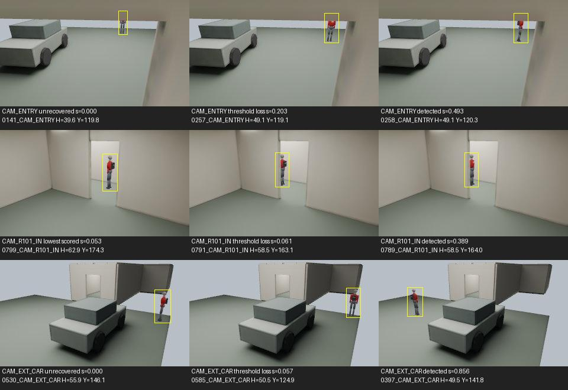

# CX-L1 偵測診斷（#552，2026-11-17）

先在 [issue 貼修正前診斷](https://github.com/Polalalabear/amidst/issues/552#issuecomment-6934964613)，再實作；下半部補最終驗證。基準程式為 `main@31a69177`，人物、場景、相機保持 N6 原始素材；沒有修改 Blender、場景燈光或相機擺位。模型為既有本機 RT-DETR R18；沒有外部模型呼叫或 API key 讀取。GT 只在錄製／評分／診斷圖使用，不傳入偵測器。

## 固定樣本與觀察

歷史評分輸入：`local/evidence/live-mode-n6-20261115/glb_n6scene_320x180_r1.rows.json`。合格條件保持原 sweep：射線可見、投影框在畫面內比例（四捨五入到兩位）≥0.6、框高（四捨五入到一位）≥16 px；命中為 IoU≥0.3。共 1,328 個合格樣本。門檻比較是同批既有偵測，不是重新推論。

| 鏡頭 | n | ≥0.35 命中率 | ≥0.05 命中率 | 框高範圍 px | 框內亮度中位數 /255 | ≥0.05 誤檢/影格 |
| --- | ---: | ---: | ---: | ---: | ---: | ---: |
| CAM_ENTRY | 236 | 19.1% | 72.5% | 31.6–117.2 | 119.8 | 0.636 |
| CAM_R101_IN | 68 | 47.1% | 98.5% | 58.5–117.7 | 137.2 | 0.676 |
| CAM_EXT_CAR | 300 | 67.3% | 97.0% | 27.8–98.1 | 147.3 | 0.283 |

亮度為新錄製 RGB 的投影框內像素 `0.2126R+0.7152G+0.0722B` 中位數，再對樣本取中位數，包含背景，不能當人體照度。圖中分數來自歷史 sweep，相機／位置／朝向逐筆對應；新錄製會另行推論，不能以歷史分數冒稱新 RGB 的結果。



圖欄依序為低分／門檻造成的漏檢／原門檻可見；`lowest scored` 表示沒有分數低於 0.05 的對應樣本。黃色是評分用投影框，不是偵測框。逐張索引、位置、朝向、分數、亮度在 `live_detection_20261117/diagnosis_frame_stats.json`。

## 原因分解

- **門檻：已量出主要損失。** CAM_ENTRY 同一偵測結果從 0.35 放寬到 0.05 增加 53.4 個百分點；R101_IN +51.5、EXT_CAR +29.7。但誤檢由三台均為 0 增加到表中數字，不能只報召回率。
- **人物大小：不是三台共同主因。** R101_IN 全部框高≥58 px 仍漏掉過半。EXT_CAR 高16–32 px 的40個樣本在0.35命中95%，高80–180 px的32個樣本僅15.6%；CAM_ENTRY 高32–48 px的124個樣本命中9.7%，高48–80 px的60個樣本40.0%。距離／角度／背景混雜，未證明尺寸本身造成差異。
- **太暗／逆光：尚無獨立因果證據。** 三台投影框亮度中位數不低，樣本圖也有明亮背景下的低分。烘焙背景、人物姿態與朝向可能影響模型；亮度1.5倍的固定RGB對照才能進一步判定。不能以框亮度證明沒有局部陰影或逆光。
- **遮擋：部分可見性仍 UNKNOWN。** 歷史 sweep 的射線可見不等於人體每個部位都可見，投影框也不是人體遮罩。圖中 R101_IN 在門框附近，EXT_CAR 有車體與牆邊；尚未量化像素級遮擋比例，不能宣稱已隔離其效應。
- **解析度／形變：待固定RGB比較。** 來源320×180目前直接拉伸到640×640，改來源640×360仍會拉伸；正在比較原輸入、保長寬比letterbox與較高來源解析度。先前延遲報告已說明模型forward尺寸固定，提高來源解析度不代表提高模型尺寸。

## 重現與 LOCAL

腳本 `scripts/live_mode/record_detection_bench.mjs` 從不變的 N6 素材錄製同一格點／朝向，RGB 單獨保存，標籤寫入 `evaluation_labels.json`。`scripts/live_mode/detection_bench.py` 僅讀 RGB 做推論，全部完成後才開標籤計分。`scripts/live_mode/detection_diagnosis.py` 產生以上精簡診斷圖與亮度代理量。

輸出用 `$AMIDST_ARTIFACTS/cx552-20261117/`；本次為獨立 clone 的 `local/evidence/cx552-20261117/`。原始 RGB 不提交 GitHub。完整 SHA、檔數與大小見下方收據。

```bash
# SHARED_LOCAL 指向現有唯讀的 local；使用現有 Python / Node 依賴。
PYTHONPATH=src:$SHARED_LOCAL/data/q1q5-dynamic-baseline-v1_20261025/runtime-deps uv run --no-project --python "$PYTHON" python -m amidst.live_mode.server --port 8797 --device mps --models "$SHARED_LOCAL/data/demo-owned-v1/models/rtdetr" --assets "$SHARED_LOCAL/data/live-assets-20261115" --cameras "$SHARED_LOCAL/data/r004-build-v2-20261021/safe_static/cameras.json"
LIVE_BASE=http://127.0.0.1:8797 node scripts/live_mode/record_detection_bench.mjs "$AMIDST_ARTIFACTS/cx552-20261117/recording"
PYTHONPATH=src:$SHARED_LOCAL/data/q1q5-dynamic-baseline-v1_20261025/runtime-deps uv run --no-project --python "$PYTHON" python scripts/live_mode/detection_bench.py --recording "$AMIDST_ARTIFACTS/cx552-20261117/recording" --out "$AMIDST_ARTIFACTS/cx552-20261117/diagnosis" --models "$SHARED_LOCAL/data/demo-owned-v1/models/rtdetr" --variant stretch
```

## 固定錄製對照與最終設定

新錄製的固定 RGB 用同一 `detect_sweep.mjs` 指標計分：**先從未經顯示門檻過濾的偵測結果選 IoU 最大框，再檢查分數**；IoU／分數按原工具儲存為兩／三位小數。不能改成「任一合格框命中」。本次一度用了後者作暫報，已在 [issue 更正](https://github.com/Polalalabear/amidst/issues/552#issuecomment-6935387235)，以這份最終資料為準；新增反例測試避免變更指標。原始設定在新固定錄製上完整重現 **918/1328=69.1265%**，八台逐台值也與歷史一致。

先保持門檻0.35，只變一項輸入：

| RGB 前處理 | ENTRY n236 | R101_IN n68 | EXT_CAR n300 |
| --- | ---: | ---: | ---: |
| 原320×180，直接拉伸 | 19.1% | 47.1% | 67.3% |
| 320×180，letterbox保持比例 | 28.4% | 58.8% | 66.7% |
| 原320×180亮度×1.5，直接拉伸 | 21.2% | 36.8% | 72.0% |
| 640×360來源，直接拉伸 | 9.7% | 16.2% | 72.3% |

亮度×1.5只是影像增益代理實驗，不是重新烘焙的曝光實驗；640組是同一場景/姿態另取較高解析度，320組才是逐像素相同的固定錄製。結果不支持用曝光或來源解析度作共同修法，未證明它們永遠無效。沒有動原始素材或鏡頭擺位。

最終：`letterbox`輸入640×640、RGB padding=(114,114,114)、框先去padding並還原到原RGB座標才做HSV／投影。`--min-score 0.15`，只有ENTRY放寬為0.05（`--camera-min-score CAM_ENTRY=0.05`）；避免其他七台也放到0.05。設定透過`/config`回報。原始工程索引的官方adapter不改。

| 鏡頭 | 原設定命中/n | 原設定 | 最終命中/n | 最終 | 變化（百分點） |
| --- | ---: | ---: | ---: | ---: | ---: |
| CAM_ENTRY | 45/236 | 19.1% | 173/236 | 73.3% | +54.2 |
| CAM_R101_IN | 32/68 | 47.1% | 57/68 | 83.8% | +36.8 |
| CAM_EXT_CAR | 202/300 | 67.3% | 258/300 | 86.0% | +18.7 |
| CAM_EXT_CLEAR | 238/284 | 83.8% | 264/284 | 93.0% | +9.2 |
| CAM_BRANCH | 33/36 | 91.7% | 36/36 | 100% | +8.3 |
| CAM_W1 | 103/116 | 88.8% | 113/116 | 97.4% | +8.6 |
| CAM_W2 | 198/208 | 95.2% | 203/208 | 97.6% | +2.4 |
| CAM_WIDE | 67/80 | 83.8% | 76/80 | 95.0% | +11.3 |
| ALL | 918/1328 | 69.1% | 1180/1328 | 88.9% | +19.7 |

三台均≥70%，整體與其他五台不退步。代價：原sweep定義的誤檢（IoU<0.1）由0增加到95/1328=0.07154/影格，其中紅色誤檢13/1328=0.00979/影格；八張空場景誤檢0。部分重複框既不命中也不計為誤檢（IoU在0.1–0.3），保持既有定義，不能把上述數字當完整精確率。

## 追蹤與限制

指定既有38段重播（`gate4_off=--mode off --gate-m 4`）保持：A4路線0.38（n15）、A4八鏡頭0.47（n4）、B4路線0.92（n15）、B4八鏡頭0.73（n4）、ALL0.64（n38）。這只驗證追蹤程式未改，不代表舊偵測紀錄已包含新增的低分框。

因此另錄A4/B4各一段，把相機JPEG封包固定，再用最終偵測器重跑相同RGB，送入同一gate4_off評分；GT不在HTTP封包內，偵測結束後才讀評分紀錄：

| 同批RGB重播 | 跟對（原→新） | 跟錯（原→新） | 失聯（原→新） |
| --- | ---: | ---: | ---: |
| A4（95個可見tick） | 0.737→0.705 | 0.126→0.253 | 0.137→0.042 |
| B4（60個可見tick） | 0.883→0.967 | 0.033→0.017 | 0.083→0.017 |

**A4這一段跟錯增加、跟對下降3.2個百分點**，雖然仍高於issue要求0.38且失聯減少。不能宣稱追蹤全面改善。兩段只作配對工程檢查，不代表分布、獨立重複或人工操作效果；A4/B4與固定格點用於設定選擇，有過擬合風險。沒有改people/tracker/advisor/system，亦未擴張身分或物理安全驗收。更完整的多人物追蹤取捨留給Claude審查，8785與pin不變。

延遲與LOCAL完整hash見下方最終收據；檢查指令與使用方式見 `docs/operations/LIVE_DETECTION_HANDOFF_20261117.md`。

## 延遲、測試與LOCAL收據

相同硬體、MPS、3鏡頭×2fps、320×180、B4、advisor off，各50秒，扣前4個tick暖機；延遲定義沿用`measure/latency.mjs`的擷取到B畫面顯示。

| 設定／次數 | p50 ms | p95 ms | 顯示tick | 丟tick | load1平均 |
| --- | ---: | ---: | ---: | ---: | ---: |
| 原設定 r1 | 246.1 | 269.3 | 98 | 2 | 4.75 |
| 原設定 r2 | 245.8 | 265.0 | 101 | 0 | 3.33 |
| 最終 r1（有效重試） | 230.4 | 262.8 | 99 | 2 | 2.32 |
| 最終 r2 | 232.5 | 256.3 | 101 | 0 | 3.45 |

兩次最終p50都低於原報告約240ms×1.2=288ms，沒有延遲超額。非獨占GPU、只有兩次，不把小幅變快歸因於設定。第一次候選量測因`detached Frame`中斷、沒有可用資料，保留失敗log並另名重試，不算成功樣本。

指定 `PYTHONPATH=src:<runtime-deps> uv run --offline --no-project --python "$PYTHON" python -m pytest tests/live_mode -q`：45 passed。test-first新前處理測試最初因helper尚未實作而collection失敗，修正後通過；新增座標還原、padding排除、奇數尺寸、舊指標反例及逐鏡頭門檻隔離檢查。`git diff --check`通過。沒有跑全套、Blender、付費呼叫或API key讀取。8797測試服務完成後已停止，8785未改。

`live_detection_20261117/acceptance.json`為已提交的精簡驗收收據（含來源asset/weight/catalog SHA）；LOCAL完整檔案清單為 `$AMIDST_ARTIFACTS/cx552-20261117/ARTIFACTS_MANIFEST.json`，SHA-256 **073e569e2d71a0ebbf92580de52684589ae8e7882b20a6401f004769fa90591a**。

| LOCAL子目錄（相對上述根） | 檔數 | bytes |
| --- | ---: | ---: |
| recording（含MANIFEST） | 2058 | 16816049 |
| diagnosis | 10 | 3259613 |
| routes（原RGB封包與逐tick結果） | 181 | 3780546 |
| replay | 43 | 4266079 |
| paired_replay | 9 | 688637 |
| latency | 4 | 42353 |

固定錄製`recording/MANIFEST.json`本身SHA-256：`17429512cb75e3fa9e975220895dea77dcdbd0774590b7b17c89c6970dee06cf`；其內2,057個內容檔案16,486,517 bytes。可依交接指令與同一來源重建新錄製、偵測和重播；時鐘／延遲不能承諾重建為同值。沒有刪除或複製原始來源。
