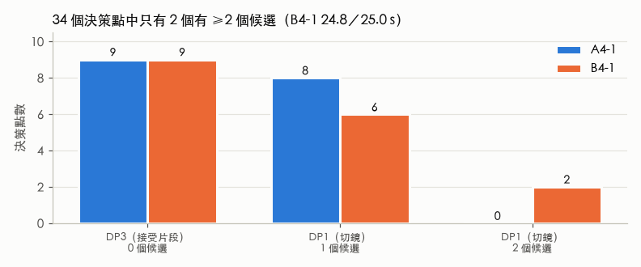
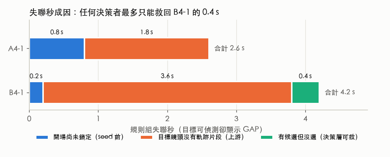
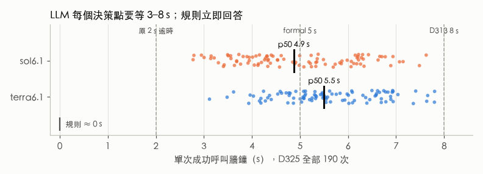

# 規則 vs LLM：預錄三事件與 LIVE 的結果和原因（2026-11-20）

Issue [#636](https://github.com/Polalalabear/amidst/issues/636)。研究紀錄，不是正式研究驗收，也不是辨識、身分或實體安全的驗收；身分一律**未確認**。

- Model / effort：Claude Opus 5.5 / medium。
- **沒有付費**：沒有呼叫 OpenAI 或任何 LLM、沒有起 gateway。只用既有文件的數字，加上對 LOCAL 證據的離線重算。
- 基準：`origin/main` `bc28f33b`（含 #632、#634、#635）。`~/amidst` 與 LOCAL 證據只讀。
- GT 只用於評分與描述場景（D325 的評分器同樣如此），沒有進入任何推論、排序或提示詞。
- 標「抄自」的數字照原文件抄，沒有重算；標「本文重算」的數字由 [`rule_vs_llm_20261120/analyze_recorded.py`](rule_vs_llm_20261120/analyze_recorded.py) 從 LOCAL 證據算出，輸出在 [`recorded_stats.json`](rule_vs_llm_20261120/recorded_stats.json)。

## 結論

1. **預錄 A4-1、B4-1 上，LLM 和規則量不出差別，原因是題目給不出「需要判斷」的時刻，不是模型能力。** 34 個決策點裡 32 個只有 0 或 1 個候選；剩下 2 個（B4-1 24.8／25.0 s）的兩個候選是同一個紅衣人在 W1、W2 兩台重疊鏡頭裡的影像，選哪一個都對。規則錯人秒本來就是 0（抄自 D325）。來源：§1.2b、D325。
2. **規則已經接近這兩段的上限：剩下的失聯秒幾乎都不是決策造成的。** A4-1 的 2.6 s、B4-1 的 4.2 s 失聯中，0.8／0.2 s 在開場還沒鎖定，1.8／3.6 s 是目標鏡頭上沒有軌跡片段（決策層根本沒被叫到），**任何決策者最多只能救回 B4-1 的 0.4 s**（跟對率 0.906 → 0.916 的上限），A4-1 是 0 s。來源：§1.2c（本文重算）。
3. **8785 畫面上開 Agent 也等於規則；B-05 根本沒有決策點。** 8785 Agent 路徑的候選在核定閘門全部歸 0（`GRAPH_NOT_APPROVED`；A4-1 16 筆、B4-1 118 筆），繞過閘門後 22 條轉移也沒有一條有可通行授權。B-05 走 `q_core_track`，沒有 decider 注入點，也沒有 GT。來源：#635 `AGENT_ZERO_CANDIDATES_629.md`、D325 §6。
4. **LIVE 的結果分兩層：模型「單題判斷」明顯比規則好，但「接回追蹤後」沒有讓跟對率變好。** 36 題裁決看圖正確率 0.81–0.92（規則只答 13 題）；但接進追蹤後，就算用一定答對的替身，B4 跟對率 0.52 → 0.53、A4 0.50 → 0.50。瓶頸是追蹤器在失聯後接不回人、以及等答案的 3.5 s 內場面已經變了。A4「加裁決反而變差」（0.38 → 0.26）是評估用替身把旁人當成目標，改替身容許距離後 0/38 段變差。來源：§2.1。
5. **要區分規則和 LLM，需要「多個不同人物同時是合格候選」或「目標不在候選裡」的場景，這正是 #597 難題集的設計。** 難題集的結果目前**沒有任何數據**：要等 PR #608 合併，加上使用者核准付費金額（9 段 × K=3，ApiGuard dry-run 最壞 USD 2.90、典型 USD 1.32）。本文不預測結果。來源：§2.2、`LIVE_HARDSET_COMPARE_V1.md` §4。

## 1. 預錄三事件（A4-1、B4-1、B-05）

### 1.1 D325 結果摘要（抄自 `RECORDED_RULE_VS_LLM_D325_20261118.md` §4、§5、§7）

比較的是 `cross_camera_demo.associate()` 的 DP1（選候選／ABSTAIN）、DP3（接受片段）加上 LLM 覆核，不是 8785 畫面上的 Agent 開關。

| 事件 | 組 | K | 跟對率 | 失聯秒 | 錯人秒 | LLM≠規則 | 退回規則 | 單次呼叫 p50／p95 ms | 整段牆鐘 s |
|---|---|---:|---|---|---:|---:|---:|---|---:|
| A4-1 | 規則 | 1 | 0.970 | 2.6 | 0.0 | — | — | — | 0.0 |
| A4-1 | terra6.1 | 3 | 0.970 | 2.6 | 0.0 | 0 | 6 | 5341／7360 | 104 |
| A4-1 | sol6.1 | 3 | 0.970 | 2.6 | 0.0 | 0 | 6 | 5527／6936 | 116 |
| B4-1 | 規則 | 1 | 0.906 | 4.2 | 0.0 | — | — | — | 0.0 |
| B4-1 | terra6.1 | 3 | 0.906 | 4.2 | 0.0 | 0 | 0 | 5545／7409 | 97 |
| B4-1 | sol6.1 | 3 | 0.905 [0.901–0.906] | 4.3 [4.2–4.4] | 0.0 | 1 | 2 | 4264／6661 | 82 |

唯一的差別：sol6.1 在 B4-1 第 2 次於 25.2 s 把 DP1 改成 ABSTAIN，0.2 s 由「對」變「失聯」，**略差**。D325 總花費 USD 0.4115。

### 1.2 為什麼沒有差別：逐條原因和數字

#### a. 場景簡單

| 項目 | A4-1 | B4-1 | 來源 |
|---|---|---|---|
| 事件長度 | 50 s（250 tick） | 42 s（210 tick） | 本文重算（tick＝0.2 s） |
| 鏡頭數（評分用） | 4 | 5 | D325 `score.py` |
| 劇本人物 | 1 個目標（紅）＋1 個藍衣干擾者 | 同左 | 情境卡 v1 §1（「藍衣干擾者的時刻只用來安排場景」） |
| 計分事件 | 3（SWITCH 2、NO_SWITCH 1） | 3（SWITCH 2、NO_SWITCH 1） | 情境卡 v1 總表（D92） |
| 規則切鏡次數 | 8 | 7 | D325 `tables.md` §4 |
| 目標在所有鏡頭都看不到的最長時間 | 1.0 s | 0.4 s | 本文重算 |
| 最長連續失聯（可偵測卻沒顯示） | 1.4 s | 3.2 s | 本文重算 |
| 有非目標人物偵測的 tick | 237／250 | 210／210 | 本文重算（score≥0.3、框中心不在 GT 目標身體框內） |
| 進入決策點的候選顏色 | 8 個全是紅色 | 10 個全是紅色 | 本文重算（請求的 `colors`；A4-1 37.4 s 的重複請求只算一次） |

- 畫面上幾乎每個 tick 都有別的人物偵測，但**沒有任何一個非紅色的人進到候選名單**；藍衣干擾者只出現在目前軌跡的顏色摘要（A4-1 3 次、B4-1 3 次）。紅／藍的顏色區分在上游就把干擾者排除了，決策點看不到「相似的人」。
- 情境卡刻意把 SWITCH 空檔設計在 ≤ 5.2 s、RETURN 暫失 < 1.8 s（D79），沒有長時間失聯（v1 §1.7 明寫不設 LOST 尾巴）。
- 目前沒有可靠的「同時入鏡人數」：偵測框數（每格最多 5 個）包含靜態疑似物件（見 `R004_STATIC_QUESTIONABLE_OBJECTS_20261029.md`），不等於人數，本文不用它當人數。

#### b. 決策點候選數分布

逐決策點（LLM 請求裡 `rule_eligible=True` 的候選數；terra6.1 第 1 次的請求，各模型各次相同的決策點）：

| 決策點 | 0 個候選 | 1 個候選 | 2 個候選 | 合計 |
|---|---:|---:|---:|---:|
| A4-1 DP3（接受片段） | 9 | — | — | 9 |
| A4-1 DP1（切鏡） | 0 | 8 | 0 | 8 |
| B4-1 DP3 | 9 | — | — | 9 |
| B4-1 DP1 | 0 | 6 | **2** | 8 |
| **合計** | 18 | 14 | **2** | 34 |



- DP3 只問「接不接受這段」，沒有其他候選；DP1 只有 1 個候選時，題目只剩「選它或 ABSTAIN」。
- **更正 D325 §1 第 2 條**：D325 寫「34 個決策點規則都只有 0 或 1 個合格候選」。逐請求重算是 32 個；B4-1 24.8 s、25.0 s（請求 `as_of` 25.0、25.2 s）兩個 DP1 各有 2 個合格候選：CAM_W1 與 CAM_W2，兩個都是紅色、都有圖上的邊、間隔 3.2／3.4 s、偵測分數中位數 0.31–0.34、各只有 1–2 個觀測。規則因 `AMBIGUOUS_HANDOFF` 回 ABSTAIN，terra6.1、sol6.1 6 次也全部 ABSTAIN（D325 `tables.md` §3）。
- 這兩個「兩候選」並不是兩個不同的人：評分器顯示那兩個 tick 目標同時在 W1、W2 可偵測（W1／W2 是重疊鏡頭，也就是情境卡 D92 讓 B4-d 不計分的原因）。所以選 W1 或 W2 都會算對，ABSTAIN 才是唯一會失分的答案。
- 34 個決策點中，**沒有任何一個需要在兩個不同的人之間做選擇**。

#### c. 規則已達上限：失聯秒的成因

每個失聯 tick（目標可偵測卻顯示 GAP 或還沒有顯示）分成三類（本文重算，用規則組回應的 `sightings` 判斷）：

| 成因 | A4-1 | B4-1 | 決策者救得回來嗎 |
|---|---:|---:|---|
| 開場還沒鎖定（第一次顯示之前） | 0.8 s | 0.2 s | 不能：查詢 seed 還沒出現 |
| 目標可偵測的鏡頭上沒有任何軌跡片段 | 1.8 s | 3.6 s | 不能：沒有候選，決策點不會被叫到 |
| 有候選但沒選 | 0.0 s | 0.4 s | 能（上限） |
| **合計（＝D325 失聯秒）** | **2.6 s** | **4.2 s** | |



- A4-1 的 1.8 s 都在 3.0–5.0 s：EXT_CLEAR 的軌跡片段在 3.2 s 斷掉，下一個片段 5.0 s 才出現（1 個觀測、分數 0.37），中間偵測得到目標但沒有連成片段。
- B4-1 的 3.6 s 主要在 22.0–24.8 s：目標 22.2 s 起在 CAM_W2 可偵測，但 W2 的候選片段 `first_seen` 是 24.8 s，前面 2.6 s 沒有片段；這段時間沒有任何 DP1。
- B4-1 那 0.4 s 正是 §1.2b 的兩個「兩候選」決策點。完美決策者在 24.8 s 選 W1 或 W2，跟對率上限是 (184＋2)／203 ＝ 0.916（規則 0.906）。
- 錯人秒：規則 0.0 s，兩個事件、兩個模型 K=3 全部 0.0 s（抄自 D325）。沒有「規則錯人、LLM 糾正」的空間。
- 限制：跟對率的分母是「偵測得到」的 tick（D325 §8），偵測漏掉的時間本來就不算失聯；所以這裡的「上限」是在現有偵測之下的上限。

#### d. 8785 Agent 開關為什麼也等於規則（抄自 `AGENT_ZERO_CANDIDATES_629.md`，PR #635）

| 層 | A4-1 | B4-1 |
|---|---:|---:|
| L1 scope 內相機的 person 觀測 | 125 | 121 |
| L2 bbox 底邊落在出口區 | 8 | 59 |
| L3 與出口區相符的轉移 | 16 | 118 |
| L4 通過核定閘門的候選 | **0**（16 筆全為 `GRAPH_NOT_APPROVED`） | **0**（118 筆） |

- 閘門條件：`tracking_scope_v3_1.json` 的 `G4_approved=False`，`camera_graph_v3_1`、`region_graph_v3_1` 都是 `DRAFT`。這是 fail-closed 的設計。
- 繞過閘門也還是 0：22 條轉移裡 20 條 `TOPOLOGICAL_ONLY`、2 條（W1↔W2）`UNKNOWN`，可通行的 0 條。
- 所以 8785 上開 Agent，Agent 一個候選也拿不到，輸出等於規則。這是圖未核定造成的結構限制，要靠人工 G4 決定，不是改程式。
- 補充：D325 的請求裡 `topology.graph_status` 也是 `GRAPH_NOT_APPROVED`（本文重算）。D325 走的是離線 `associate()` 路徑，不經過這道閘門，所以還有候選。

#### e. B-05 沒有決策點（抄自 D325 §6、#635）

- B-05 是合成 P1 事件，走 `q_core_track`，**沒有 decider 注入點**；LLM 組不適用。
- 沒有 B-05 的 GT 檔，評分 **UNKNOWN**。規則輸出是 LOCAL `raw/RULE_B-05_q_core_track.json`（狀態 LOST，A／B 兩台 20 段）。

#### f. LLM 的代價

| 項目 | terra6.1 | sol6.1 | 來源 |
|---|---|---|---|
| 呼叫次數（兩事件 × K=3） | 105 | 112 | 本文重算（與 D325 §5 合計一致） |
| OK／INVALID_RESPONSE／PROVIDER_TIMEOUT | 96／6／3 | 94／8／10 | 本文重算 |
| 退回規則（決策點×K＝102） | 6（5.9%） | 8（7.8%） | D325 §5 |
| 成功呼叫牆鐘 p50／p95（兩事件合併） | 5.5／7.4 s | 4.9／6.9 s | 本文重算 |
| 整段重放牆鐘 | 97–104 s | 82–116 s | D325 §4（規則 0.0 s） |
| 花費（K=3，兩事件） | USD 0.1375 | USD 0.2739 | D325 §4 |



- 退回全部是 `INVALID_RESPONSE`：A4-1 9.2 s、37.2 s 兩個 DP1 兩個模型各 3 次都退回；事後診斷確認其中一次是 `reason_codes` 5 個、超過上限 4 個（D325 §5、附錄 A）。另一次無法重現（UNKNOWN）。兩個決策點的候選都 `graph_edge=False`。
- 逾時：原本 2 s／5 s 的設定下大部分呼叫會逾時（p50 已經 4.9–5.5 s），要 D313 的 8 s 才行。逾時重試後都成功，沒有造成退回。
- 在「答案和規則相同」的情況下，這些代價換不到任何分數。

### 1.3 預錄部分的結論：這是題目和架構的限制

在 A4-1、B4-1、B-05 上量不出差別，**不能拿來證明 LLM 沒用，也不能證明 LLM 有用**。原因是：

- 題目沒有「兩個不同的人都像目標」的決策點（§1.2a、b）；
- 剩下的失聯在決策層之前就發生了（§1.2c）；
- 8785 的 Agent 路徑因圖未核定而拿不到候選（§1.2d）；B-05 沒有決策點（§1.2e）。

要讓規則和 LLM 分得出來，預錄場景至少要有：

1. **決策點上有 ≥ 2 個不同人物的合格候選**，而且外觀相近（同色或近色，例如紅與橘紅），規則的「最近／分數最高」會選錯；
2. **「目標不在候選裡」的決策點**（正確答案是 ABSTAIN／都不是），但旁邊有 ≥ 2 個同色的人；
3. **比 D79 範圍更長的失聯**（目標看不到 ≥ 15 s、重新出現的位置離最後位置 ≥ 8 m），讓規則的近距離接回失效；
4. **上游有片段可選**：目標鏡頭上要有軌跡片段，否則決策點不會被叫到（本次 18／34 失聯 tick 屬於這種）；
5. **8785 路徑需要圖的核定與 edge-path 授權**（G4，人工決定），否則候選是 0；
6. **夠多的決策點**：本次 2 個事件 × 17 個決策點、K=3，就算有差別也只能逐案描述。

## 2. LIVE 模式

LIVE 的場景和預錄不同：N6 人物、v2.3 四人劇本，**有兩個紅衣人**，追蹤器每秒約 2 輪。所以 LIVE 的裁決時刻真的會出現「兩個紅衣人選哪個」。

### 2.1 已有的量測和數字

| 量測 | 做了什麼 | 主要數字 | 來源 |
|---|---|---|---|
| ① 單題裁決（2026-11-16） | 36 題（2–3 個候選），題目來自 LIVE 實際裁決時刻；OpenAI 3 個模型、Colab Qwen 2 個 | 看圖：sol6.1、astra6 33／36（0.92），terra6.1 29／36（0.81）；只給文字特徵 0.58–0.69；規則只答 13 題對 10 題（另外 23 題正在失聯，沒答案）；OpenAI 看圖延遲 p50 2.4–2.9 s、p90 約 4.9 s；Qwen 看圖 0.56–0.58；花費 USD 0.88 | `LIVE_MODE_ADJUDICATION_20261116.md` §1、§3 |
| ② 接上追蹤的實跑，第 1 輪 | sol6.1，A4／B4 × 關閉／`review`／`lead` × 3 次 | B4 `review` 0.54 → 0.81（**後來撤回**） | `LIVE_MODE_ADVISOR_20261116.md` §1 |
| ③ 實跑第 2 輪（≥ 2 候選才問） | 同上；27 次呼叫，USD 0.07 | 22 題答對 22 題，但跟對率：B4 關閉 0.55、`review` 0.48、`lead` 0.31；A4 0.49、0.34、0.31 | 同上 §0.1 |
| ④ 不花錢的重播（替身一定答對） | 36 次執行的偵測重餵，替身 3.5 s 後回正確答案 | B4 關閉 0.52、`review`＋`reseed` 0.53；A4 0.50、0.50；B4 37 題中 35 題答案沒有被採用 | 同上 §0.3 |
| ⑤ A4 回歸診斷 | 4 m gate 下 `review` 讓 A4 變差的原因（重播，0 USD） | A4 路線鏡頭 0.38 → 0.26；替身改成 1.0 m 後 0.38 → 0.38，38 段中變差 0 段（原本 5 段） | `LIVE_MODE_A4_REGRESSION_20261116.md` |

**為什麼單題答得準，接上後卻沒變好**（③、④）：

1. **等答案的時間場面已經變了。** 發問到答案回來約 3.5 s；B4 的例子是發問時兩人相距 1.6 m、正要交錯，答案「2 號」回來時 2 號的編號已經跑到另一個人身上（之後改成「靠近過的人不採用」，結果 B4 37 題中 35 題被擋）。
2. **真正決定跟對率的是失聯後能不能接回。** 規則只在目標回到上次位置 3 m 內才接回；目標重新出現時畫面裡通常只有他一個人，不符合「≥ 2 候選才問」的條件，所以裁決根本沒被叫到。第 1 輪的 0.81 是湊巧（只用規則時 6 次中 2 次接得回、4 次接不回）。

**A4 加裁決為什麼反而變差**（⑤）：評估用替身把「離真實位置 1.5 m 內最近的候選」當正確答案。A4 有一個 NPC 和目標並行、相距 1.28–1.42 m；目標不在候選名單時（候選由上一輪估計 ± 4 m 決定，規則已落後目標 3.5 m），替身把 NPC 當目標、追蹤器照做，之後一直跟錯。48 次提問裡有 9 次是這種情況。替身改成 1.0 m 後不再變差，但 A4 也**沒有變好**（0.38＝0.38）。

這留下一個**真實的產品風險**：目標不在候選裡時，真的模型只看到兩個紅衣人，可能硬挑一個。①、③ 的「答對」有沒有包含這類題目，沒有查過（⑤「還沒解決」第 3 點）。

### 2.2 難題集（#597）怎麼製造差異

`LIVE_HARDSET_V1.md`：18 段（15 段難題，含 5 段備選；3 段基準），78 個事件，全部由腳本操作者產生（D331）。

| 組 | 製造什麼 | 規則可能的弱點 |
|---|---|---|
| H1 長時間失聯後再出現 | 目標看不到 ≥ 15 s，重新出現的位置離最後位置 ≥ 8 m，重新出現時附近可能有紅衣人 | 規則只在 3 m 內接回（§2.1） |
| H2 和相似人物交錯 | 和 A（同紅衣）或 B（橘紅）≤ 1 m 交錯後分開 | 最近的人不一定是目標，交錯時編號容易對調 |
| H3 不照路線走 | 折返回原鏡頭、繞遠超過 D79 的 5.2 s | 候選窗與轉移假設失效 |
| H4 跳過相鄰鏡頭 | 新鏡頭不是 graph v3 的目的鏡頭；轉角兩台重疊、沒有轉移 | 圖上沒有邊就沒有候選 |
| H5 目標不在候選 | 目標躲起來，旁邊有 2 個紅衣人；正確答案是「都不是」 | 規則或 LLM 硬選一個人 |
| 基準 BA4、BB4、BR5 | 簡單情況 | 確認 LLM 不比規則差 |

**#624 評分器量什麼**（`LIVE_HARDSET_COMPARE_V1.md` §3；`scripts/live_hardset_compare.py`）：跟對率（ON_TARGET 秒 ÷ 目標 GT 可見秒，**分母和 D325 不同，兩份數字不能並排**）、失聯秒、錯人秒、身分交換（連續 ≥ 2 tick 錯人）、看不到期間跟著別人的秒數（H5 的重點）、重新找回秒數、切鏡點在 W＝2／5／10 s 內接對／接錯／沒接上、逐裁決點表（規則／terra／sol 的答案與正確答案、之後 10 s 跟對）、逐類型「較好／相同／較差」（跟對率差 ≥ 0.05，或至少一個切鏡點變成接對且沒有另一個變差；定義先寫在程式裡）、重播一致性（演員位置差 > 0.05 m 判 `NOT_COMPARED`）。目前 B log 沒有候選名單，「目標可見但不在名單」分不出來（UNKNOWN，等 #608 的收據契約）。

### 2.3 已知和待實跑

| 問題 | 狀態 | 依據 |
|---|---|---|
| 模型能不能在兩個紅衣人之間選對（單題） | **已有數據**：看圖 0.81–0.92 | ① |
| 接上追蹤後跟對率會不會變好 | **已有數據（簡單路線）**：沒有變好，`review`＋`reseed` 不比規則差 | ③、④ |
| 加裁決讓 A4 變差的原因 | **已有數據**：評估替身造成；修正後 0/38 段變差 | ⑤ |
| 目標不在候選時，真的模型會不會硬選 | **沒有數據** | ⑤ 第 3 點；要靠 H5 實跑 |
| H1–H5 各類型上 LLM 比規則較好／相同／較差 | **沒有數據** | 要等難題集實跑 |
| 以「偵測得到」為分母的次要指標 | **UNKNOWN** | 等 #608 的偵測收據 |

難題集實跑的前提：

1. PR [#608](https://github.com/Polalalabear/amidst/pull/608)（LIVE relock R1，固定重播）合併；截至 2026-11-20 仍是 OPEN。
2. 使用者在對話裡核准付費金額：9 段（H1、H4、H5）× K=3，ApiGuard dry-run 最壞 USD 2.90、典型 USD 1.32（15 段全部：最壞 USD 4.77）。伺服器 ApiGuard 預設日上限 200 次，每個模型 312 次會超過，要使用者核准較高的上限或分批（`LIVE_HARDSET_COMPARE_V1.md` §4）。

本文**不預測**難題集的結果。

## 3. 限制

- 預錄部分只有 2 個可評分事件、K=3，沒有統計顯著性；B-05 沒有 LLM 組也沒有 GT。
- 「失聯成因」用規則組回應的 `sightings` 判斷有沒有軌跡片段；片段為什麼沒形成（偵測分數、追蹤器參數、遮擋）沒有再往下拆，標 UNKNOWN。
- 「非目標人物偵測」是框中心不在 GT 目標身體框內的偵測，可能包含靜態誤偵測，不等於人數。
- LIVE 的數字來自不同日期、不同場景版本（N6、v2.3 四人）和不同分母，和預錄數字不能直接比大小。
- LIVE ③、④ 每種設定 3 次，機器不是空閒的；④ 的替身一定答對，是上限不是模型表現。

## 4. 證據

### 4.1 本 PR 提交的檔案（`docs/evaluation/rule_vs_llm_20261120/`，SHA-256 見該資料夾 `SHA256SUMS.txt`）

| 檔案 | 內容 |
|---|---|
| `analyze_recorded.py` | 離線重算（場景統計、候選數、失聯成因、延遲）；只讀 LOCAL，匯入 D325 的 `score.py` |
| `charts.py` | 產生三張圖（matplotlib） |
| `recorded_stats.json` | `analyze_recorded.py` 的輸出 |
| `decision_point_candidates.png`、`lost_seconds_by_cause.png`、`llm_latency.png` | 圖（各 < 50 KB） |

重現（在 `~/amidst` 根目錄執行，只讀；matplotlib 用 repo 的 `.venv`）：

```bash
python3 docs/evaluation/rule_vs_llm_20261120/analyze_recorded.py <out>/recorded_stats.json
.venv/bin/python docs/evaluation/rule_vs_llm_20261120/charts.py <out>/recorded_stats.json <out>
```

`analyze_recorded.py` 在本 session 跑了兩次，輸出相同。

### 4.2 讀取的 LOCAL 證據（不進版控，只讀）

| 路徑 | SHA-256 | 用途 |
|---|---|---|
| `local/evidence/eval-recorded-llm-20261118/SHA256SUMS` | `49c2d7903b24278f066b07d9d354f475b328840c98ab6283f0b344da818f1252` | D325 證據清單；本 session `shasum -a 256 -c` 28 檔全部 OK |
| `local/evidence/eval-recorded-llm-20261118/REPORT.md` | `2f6bd7c61c16aa158515e612c03b06c2eb98c38c6c16a6ef91c520c9e6013b31` | D325 報告 |
| `local/evidence/eval-recorded-llm-20261118/tables.md` | `9da1910487f28fbb6a22f037a805dacfd41b4b76ab57a621e06a41b1dd0eab1c` | 逐決策點、逐切鏡點 |
| `local/evidence/eval-recorded-llm-20261118/raw/RULE_A4-1_k0.json` | `f6b20a90f2fd6886471bf60c9ad4c3e9ad01efca0480baf0f44ffa1266d443a4` | 規則組 tick、sightings |
| `local/evidence/eval-recorded-llm-20261118/raw/RULE_B4-1_k0.json` | `e2973d172cc2ce776cfb8ecbfde5ddbc451a081647ce84f83f09c4cad9ca06f2` | 同上 |
| `local/evidence/eval-recorded-llm-20261118/raw/terra6.1_A4-1_k0.json` | `b9325f1fec53f3a77e214bfe8d666e7ec862f498df9f6047118d59a803240754` | 決策點請求（候選數、顏色） |
| `local/evidence/eval-recorded-llm-20261118/raw/terra6.1_B4-1_k0.json` | `b15eb25a0b8fe689d607803784bd8fd353a329ba27f0b5a37c4c7c5f256de953` | 同上 |
| `local/evidence/eval-recorded-llm-20261118/raw/*6.1_*_k*.json`（12 檔） | 各檔雜湊列在 `SHA256SUMS`（SHA-256 `49c2d7903b24278f066b07d9d354f475b328840c98ab6283f0b344da818f1252`） | 延遲、呼叫結果 |
| `local/evidence/eval-recorded-llm-20261118/scripts/score.py` | `f9179228ed96d4696320e07ed35578e56887a9bce5735884260d7f5f02081ed6` | D325 評分器（匯入用） |
| `local/data/r004-cx7r-20261104-01a19f8b/A4-1/gt_private/frame_journal.jsonl` | `c7e4c6f1bf642ee4d0fa69a1f6d17d2523ec0fe624bb533fcddc677c183e8024` | GT，只用於評分與場景描述 |
| `local/data/r004-cx7r-20261104-01a19f8b/B4-1/gt_private/frame_journal.jsonl` | `940529c149ff88a475582e8232bfede75996083c61a88745237a675d061d5be3` | 同上 |
| `local/data/demo-owned-v1/data/indexes/A4-1/detection_index.json` | `b6f708fb743c346ab2b07a21a5293e08b1f595ea3328b00011550827ab1acf67` | 偵測索引 |
| `local/data/demo-owned-v1/data/indexes/B4-1/detection_index.json` | `f92e22f1f55cfb772149fe86279eaa9b6b8f14d71d4ca6a423cf9109b2570379` | 同上 |
| `local/evidence/live-mode-adjudication-20261116/SHA256SUMS.txt` | `6bf1016d917ebce82d845da978eb9a5953b3e00c9406e49832e638c13c655ed0` | LIVE ① 的證據清單（本文只引用文件數字） |
| `local/evidence/live-mode-advisor-20261116/sol/SHA256SUMS.txt` | `1188612377b7bf69d3df74dc2c8cce899c1532546ac96ab0acd27119b1459232` | LIVE ②–④ 的證據清單（同上） |

### 4.3 引用的文件

- `docs/evaluation/RECORDED_RULE_VS_LLM_D325_20261118.md`（D325）
- `docs/evaluation/AGENT_ZERO_CANDIDATES_629.md`（#629，PR #635，merge `bc28f33b`）
- `docs/evaluation/R004_A4B4_SCENARIO_CARDS_V1.md`（D89、D92）
- `docs/evaluation/LIVE_MODE_ADJUDICATION_20261116.md`、`LIVE_MODE_ADVISOR_20261116.md`、`LIVE_MODE_A4_REGRESSION_20261116.md`
- `docs/evaluation/LIVE_HARDSET_V1.md`、`LIVE_HARDSET_COMPARE_V1.md`（#597、#624）
