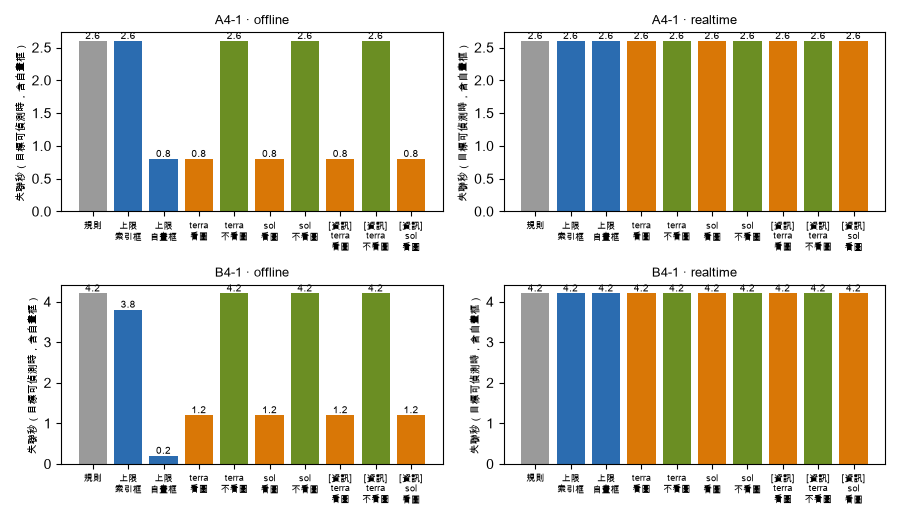

# 看圖＋圖預測 Agent：A4-1／B4-1 失聯段先導實驗（2026-11-20）

Issue [#640](https://github.com/Polalalabear/amidst/issues/640)；報告素材 [#479](https://github.com/Polalalabear/amidst/issues/479)。研究紀錄，**不是**辨識、身分或實體安全的正式驗收；身分一律未確認，「對」只表示顯示的框落在 GT 目標身體框上。

- Model / effort（本文與程式）：Claude Sonnet 5.5 / high。受測 Agent：OpenAI terra（`gpt-6.1-terra`）、sol（`gpt-6.1-sol`），K=3。
- 基準：`origin/main` `bc28f33b`。GT 只在評分端（見 §3）。
- **時間點說明**：本實驗在 D340（放寬 Agent 模式，寫入 DEVELOPMENT_RULES 的 PR #642）合併之前進行，屬使用者在對話中授權的研究實驗（OpenAI 額度 USD 50 內，D339）；對應 #642 的 H2／H4／H5 **先導**實驗。A4-1、B4-1 是簡單場景（各一個目標、失聯 2.6／4.2 s），**結論只談機制可行性和上限，不能推論「複雜情況下 Agent 較好或較差」**。

## 1. 結論（先看這裡）

1. **Agent 真的讀到圖，而且圖是關鍵：離線可等待時，看圖 Agent 把規則的失聯秒大幅縮短，不給圖的同文字控制組完全沒有效果。** 把 Agent 自己畫的框和索引框分開看，「含自畫框」的失聯秒：A4-1 規則 2.6 s → 看圖 0.8 s（terra、sol 相同）；B4-1 4.2 s → 1.2 s；不給圖 2.6／4.2 s（零改善，120 次呼叫裡 119–120 次回答「不在」）。上限（完美 Agent 畫出 GT 框）：A4-1 0.8 s、B4-1 0.2 s，所以看圖 Agent 在 A4-1 達到上限、B4-1 達到上限的約 75%（3.0／4.0 s）。
2. **增益幾乎都來自「Agent 自己畫框」，不是從共用偵測索引挑框。** 索引框上限（完美 Agent 只能選索引裡的人物框）只有 A4-1 0 s、B4-1 0.4 s：失聯段裡目標多半只被 RT-DETR 標成別的類別（`sports ball`、`fire hydrant`、`toothbrush`、`parking meter` 等，框落在人身上），人物類別的偵測不存在，規則和任何「只選索引人物框」的決策者都救不回來。看圖 Agent 直接畫出人的框才救得回來。這些自畫框單獨計分，不混進主表的跟對率。
3. **模擬即時（答案要等 API 延遲後才生效）完全沒有增益。** 單次呼叫延遲 p50 約 3.2–4.0 s、p95 約 6.5–8.0 s，和失聯段本身（1–4 s）一樣長；答案到達時目標已走遠，自畫框只能顯示一個 tick 且已過期。完美 Agent 加 2 s 延遲同樣是 0 增益。要在即時模式受益，需要更快的呼叫或自畫框的連續追蹤（本實驗沒做，列在 §8）。
4. **沒有看到錯接：** 錯接次數 0、錯人秒 0；自畫框錯的 tick：A4-1 terra 約 0.27 s、sol 0 s；B4-1 terra 約 0.6–0.7 s、sol 約 1.0 s（顯示的框不在目標身上，K=3 平均）。這是需要在複雜場景檢驗的風險，這裡的 n 太小，不能下結論。
5. **「閘門只當資訊」（Agent 可選任何鏡頭、規則低分時也被叫來驗證）沒有讓結果變差：** 低分驗證點上，看圖 Agent 與規則同樣正確（Agent 在 39／42 個驗證 tick 的 K 平均中幾乎全對，只有 sol 在 B4-1 約 1 個、A4-1 約 0.7 個 tick 錯；terra B4-1 約 0.3 個）。不給圖的控制組在驗證點上幾乎都回答「不在」，反而推翻了規則本來正確的框（規則對、Agent 錯：A4-1 約 38.7、B4-1 42 個 tick）。這同時說明：**不給圖就不能信任純文字 Agent 的覆核**（本控制組的提示偏保守，見 §8）。
6. **辨識對照（Agent 看圖 vs RT-DETR＋規則）：** 在失聯 tick，規則顯示不出東西（recall 0，這是定義上的結果，因為觸發條件就是規則沒顯示），看圖 Agent recall 0.91–1.0（B4-1 gap：terra 0.908、sol 0.955；A4-1 gap：兩者 1.0），precision 1.0（0 個 FP）；按目標偵測分數分層，目標沒有人物框的 tick（`no_person_box`）Agent recall 0.96–1.0，規則 0.65–0.72。
7. **成本：** 本實驗總花費 **USD 6.61**（ApiGuard 帳本，caller=`vision_agent`，1551 列，含 6 次被護欄擋下的試跑列；額度 USD 50，停止線 45）。

## 2. 設計（Agent 看什麼、做什麼）

- **觸發（兩組）：**
  - **閘門照擋（gate）**：規則顯示不是 ON_CAMERA（GAP／LOST，且已首次鎖定）的每個 tick 叫一次；候選鏡頭 = 最後顯示的鏡頭＋ DRAFT 圖的鄰居（圖是硬性範圍）。A4-1 14 個、B4-1 25 個 tick。
  - **閘門只當資訊（info）**：上述 tick 再加「規則 ON_CAMERA 但選中框分數 < 0.45」的 tick（每隔一個取一個，A4-1 39、B4-1 42 個驗證 tick）；候選鏡頭 = 事件所有鏡頭，圖只是資訊（提示明寫可選沒有邊的鏡頭）；規則的框以綠框給 Agent 當資訊，不硬性採用。
  - 未涵蓋：規則 ABSTAIN（`AMBIGUOUS_HANDOFF`）時刻只在 B4-1 24.8／25.0 s 出現，已落在 gap tick 內；沒有另外單獨觸發。
- **每次請求實際送出**（記錄在 LOCAL `answers_*.json` 的 `images`、`prompt_tokens`）：
  - 文字：最後已知鏡頭與時間、種子外觀（種子 = 規則第一個鎖定的觀測：系統顏色標籤；A4-1 為 blue＋red、B4-1 為 red）、鏡頭圖鄰居（標明 `DRAFT (camera_graph_v3_1, not approved)`）、候選鏡頭當下的人物偵測清單（id、框、分數、系統顏色標籤）。
  - 圖片（看圖組）：種子裁切圖、最後已知畫面（規則框畫綠色）、每個候選鏡頭當下的 960×540 影格（偵測框畫成編號框）。
  - **API 真的讀到圖的證據：** gate 組每次 4–7 張圖（平均 prompt 2887 tokens，範圍 2293–4178），info 組每次 6–7 張圖（平均 3918 tokens，範圍 3562–4228）；同樣文字、不給圖的控制組每次 0 張圖、平均 410／446 tokens。看圖回答裡的理由引用了圖才看得到的細節（例如「紅色上衣、深色背包、灰色褲子」），文字裡沒有這些。
- **輸出：** `{present, camera_id, detection_id | box_xyxy | null, confidence, reason}`；`present=false` 表示不在。
- **與規則共用偵測索引：** Agent 的 detection_id（或框 IoU ≥ 0.3）對到索引人物偵測時算 SNAP，之後沿索引用 IoU ≥ 0.3 連續追蹤顯示；對不到的算 `OWN_BOX`（Agent 自畫的框），只顯示一個 tick，和主指標**分開計分**（`own_box_*`、「含自畫框」欄）。
- **評分：** 沿用 D325 評分器（`src/amidst/evaluation/gt_scoring_r004.py`，路徑改用 `amidst.paths`，其餘為原樣複製）。主指標：跟對率、失聯秒、錯人＋盲區誤鎖秒；另加「提早接回秒」（規則重新接回前，Agent 第一次顯示正確的秒數）與「錯接次數」（Agent 連續顯示的第一個 tick 不在目標上的次數）。自畫框正確 = 與 GT 身體框 IoU ≥ 0.3 或框中心在身體框內。
- **兩種時間模式：** `offline`（答案在呼叫 tick 立即生效、不計延遲）、`realtime`（答案在該呼叫實測延遲後才生效；期間沿索引往前追；一次只有一個在途呼叫）。同一組答案表（每個 tick 一次呼叫，請求只依該 tick）兩種模式共用，延遲用該次呼叫的實測值。
- **上限（完美 Agent）：** 索引框（只能挑索引人物框）與自畫框（畫出 GT 身體框），各分全鏡頭與圖鄰居。上限用 GT，只存在於評分端。
- **控制組：** 同觸發點、同文字（含偵測清單與顏色標籤），不給圖。

## 3. GT 隔離

- 請求建立路徑（`Event.context`、`build_images`、`build_content`、`one_call`、`va.request_text`）只用：規則顯示、偵測索引、種子觀測、DRAFT 圖、影格像素；沒有讀 `gt`、`rule_rows` 或任何 GT 欄位。觸發 tick 由規則顯示和偵測分數決定。
- GT 僅出現在 `Event.body_of`（評分用，傳給 `overlay`／`recognition`）與 `oracle_agent`（上限，不是 Agent）。`src/amidst/evaluation/vision_agent.py` 本身不 import GT，單元測試用合成資料。
- **疑點（供審查）：** 觸發名單中的 `verify` tick 用「規則選中框分數 < 0.45」決定，是系統分數，不是 GT。種子取自規則，**種子本身是否真是目標未確認**（A4-1 種子的顏色標籤同時有 blue 和 red，可能含干擾者）。無其他發現。
- 「目標可偵測」（正例定義）沿用 D325：索引裡任何類別、分數 ≥ 0.3 的框中心落在 GT 投影身體框內；所以失聯 tick 的「正例」可能只有 `sports ball` 之類的誤分類框。

## 4. 主結果（offline，K 次平均；括號為範圍）

| 事件 | 組 | 跟對率 | 失聯秒 | 錯人＋盲區誤鎖秒 | 含自畫框失聯秒 | 提早接回秒 | 錯接次數 | 自畫框錯秒 |
|---|---|---:|---:|---:|---:|---:|---:|---:|
| A4-1 | 規則 | 0.970 | 2.6 | 0.0 | 2.6 | 0 | 0 | 0 |
| A4-1 | 上限·索引框 | 0.970 | 2.6 | 0.0 | 2.6 | 0 | 0 | 0 |
| A4-1 | 上限·自畫框（全鏡頭／圖鄰居） | 0.970 | 2.6 | 0.0 | 0.8／1.2 | 2.0／1.8 | 0 | 0 |
| A4-1 | gate terra 看圖 | 0.970 | 2.6 | 0.0 | 0.8 | 2.0 | 0 | 0.27 [0.2–0.4] |
| A4-1 | gate sol 看圖 | 0.970 | 2.6 | 0.0 | 0.8 | 2.0 | 0 | 0 |
| A4-1 | gate terra／sol 不看圖 | 0.970 | 2.6 | 0.0 | 2.6 | 0 | 0 | 0 |
| A4-1 | info terra 看圖 | 0.970 | 2.6 | 0.0 | 0.8 | 2.0 | 0 | 0 |
| A4-1 | info sol 看圖 | 0.970 | 2.6 | 0.0 | 0.8 | 2.0 | 0 | 0 |
| A4-1 | info terra 不看圖 | 0.970 | 2.6 | 0.0 | 2.6 | 0 | 0 | 0 |
| B4-1 | 規則 | 0.906 | 4.2 | 0.0 | 4.2 | 0 | 0 | 0 |
| B4-1 | 上限·索引框 | 0.916 | 3.8 | 0.0 | 3.8 | 0.4 | 0 | 0 |
| B4-1 | 上限·自畫框（全鏡頭／圖鄰居） | 0.916 | 3.8 | 0.0 | 0.2／0.2 | 4.4 | 0 | 0 |
| B4-1 | gate terra 看圖 | 0.916 | 3.8 | 0.0 | 1.2 | 3.0 | 0 | 0.6 |
| B4-1 | gate sol 看圖 | 0.916 | 3.8 | 0.0 | 1.2 | 3.0 | 0 | 1.0 |
| B4-1 | gate terra／sol 不看圖 | 0.906 | 4.2 | 0.0 | 4.2 | 0 | 0 | 0 |
| B4-1 | info terra 看圖 | 0.916 | 3.8 | 0.0 | 1.2 | 3.0 | 0 | 0.73 [0.6–0.8] |
| B4-1 | info sol 看圖 | 0.916 | 3.8 | 0.0 | 1.2 | 3.0 | 0 | 1.0 |
| B4-1 | info terra 不看圖 | 0.906 | 4.2 | 0.0 | 4.2 | 0 | 0 | 0 |

- 表中 K=3 的各列在三次之間沒有差異（除標了範圍者）。「含自畫框」的失聯秒 = 規則 MISSED tick 中，Agent 自畫框落在目標上的部分扣掉後的秒數。主指標「失聯秒」「跟對率」只計索引框（SNAP），所以 Agent 組的跟對率只和 B4-1 上限·索引框的 0.4 s 對得上。
- 注意：D325 評分器的「跟對率」在部分 tick 因「偵測閃爍時沿用」可超過分母，因此「含自畫框跟對率」會 > 1（見 LOCAL `tables.md`），本文改用失聯秒說明。
- 圖：　橘＝看圖、綠＝不看圖、藍＝上限、灰＝規則；右欄（realtime）全部等於規則。

## 5. 模擬即時（realtime）

所有 Agent 組（gate、info、terra、sol、看圖、不看圖）與完美 Agent（延遲 2 s、4 s）在兩個事件上都等於規則（A4-1 2.6 s、B4-1 4.2 s）；只有完美自畫框上限在 B4-1 延遲 2 s 時多出約 0.2 s 的自畫錯顯示。原因見結論 3。呼叫延遲與用量：

| 組 | 呼叫數 | 成功解析 | present=false | 解析／傳輸錯誤 | 延遲 p50／p95 s | prompt／completion tokens 平均 | 估計花費 USD |
|---|---:|---:|---:|---:|---|---|---:|
| gate terra 看圖 | 117 | 117 | 18 | 0 | 3.95／7.75 | 2887／138 | 0.418 |
| gate terra 不看圖 | 117 | 117 | 117 | 0 | 2.89／4.26 | 410／87 | 0.099 |
| gate sol 看圖 | 117 | 117 | 12 | 0 | 3.81／7.97 | 2887／111 | 0.805 |
| gate sol 不看圖 | 117 | 117 | 117 | 0 | 2.68／3.61 | 410／60 | 0.166 |
| info terra 看圖 | 360 | 360 | 17 | 0 | 3.45／6.55 | 3918／108 | 1.605 |
| info terra 不看圖 | 360 | 360 | 359 | 0 | 2.86／4.57 | 446／97 | 0.336 |
| info sol 看圖 | 360 | 360 | 17 | 0 | 3.19／7.07 | 3918／98 | 3.174 |

延遲是 4 個並行請求下的牆鐘（不是單線程）；0 次解析失敗、0 次傳輸錯誤、無退回（和 D325 的 6–12% 退回不同：這裡提示只要求單一 JSON、沒有 reason_codes 上限）。

## 6. 辨識對照：看圖 Agent vs RT-DETR＋規則（info 組，K=3 平均）

評分單位是 tick（gap = 規則失聯、verify = 規則顯示但低分）。正例 = 目標可偵測（D325 定義）；Agent 預測對 = 框在目標上；規則預測 = 規則當時顯示的框。完整表（含 sol、gate 組）在 LOCAL `tables.md`。

| 事件 | 範圍 | tick | Agent TP／FP／FN（terra 看圖） | Agent P／R | 規則 TP／FP／FN | 規則 P／R |
|---|---|---:|---|---|---|---|
| A4-1 | gap | 14 | 14／0／0 | 1.0／1.0 | 0／0／9 | —／0.0 |
| A4-1 | verify（分數<0.45） | 39 | 39／0／0 | 1.0／1.0 | 39／0／0 | 1.0／1.0 |
| B4-1 | gap | 25 | 19.7／0／2.0 | 1.0／0.908 | 0／0／20 | —／0.0 |
| B4-1 | verify（分數<0.45） | 42 | 41.7／0／0.3 | 1.0／0.992 | 42／0／0 | 1.0／1.0 |
| A4-1 | 目標無人物框的 tick | 32 | 32／0／0 | 1.0／1.0 | 23／0／9 | 1.0／0.719 |
| B4-1 | 目標無人物框的 tick | 51 | 49／0／2.0 | 1.0／0.961 | 33／0／18 | 1.0／0.647 |

- sol 看圖：A4-1 gap 14／0／0、verify 38.3／0／0.7；B4-1 gap 21／0／1、verify 41／0／1。不給圖（terra）：幾乎所有 tick 回答「不在」，recall 0–0.01。
- 「Agent 對、規則錯」的 tick（terra 看圖，gap 範圍）：A4-1 14、B4-1 19.7；「規則對、Agent 錯」：A4-1 0、B4-1 0.33（verify）。分數分層只有 `score<0.45` 和「無人物框」兩層有足夠 tick；`score>=0.45` 層 A4-1 只有 1 個 tick，不報。
- **解讀限制：** gap tick 規則 recall 0 是觸發條件造成的；verify tick 的規則 100% 正確是因為這兩個事件規則本來就沒有錯人（D325：錯人秒 0）。所以這裡看不出「Agent 在規則錯的時候糾正」，只看得出「Agent 在規則沒東西時能補」。

## 7. 與 D325 的對照

D325 的 LLM 是 `associate()` 的文字覆核者（看不到畫面，只有代號與軌跡摘要），結果與規則相同（跟對率、失聯秒、錯人秒全同）。本實驗的不給圖控制組和 D325 一致：沒有增益。差別來自「給圖＋允許自畫框」，不是模型換了。

## 8. 限制與待補

- n 很小：2 個事件、gate 組 14＋25 個決策 tick，K=3；失聯段只有 1–4 s；兩個事件規則本來就沒有錯人。結論只談機制可行性和上限。
- 圖是 DRAFT（`camera_graph_v3_1`，`GRAPH_NOT_APPROVED`）；A4-1 中 EXT_CAR → EXT_CLEAR 沒有邊，gate 組在 2.8 s 的候選因此只有 EXT_CAR、W1（不含 EXT_CLEAR）；完美自畫框上限也顯示圖鄰居比全鏡頭多 0.4 s 失聯（1.2 vs 0.8 s），即 DRAFT 圖本身會漏掉一部分可走的路。
- 「目標在不在」的正例由「任何類別的偵測框落在 GT 身體框」定義，不是影片真實可見率；遮擋沒有建模。
- 自畫框只算一個 tick，沒有連續追蹤；realtime 模式因此無法受益。待補：用自畫框當種子重新跑偵測／追蹤，或降低呼叫延遲（縮圖、較小模型），再評估 realtime。
- 不給圖控制組的提示要求「只看文字決定」，模型幾乎全回答「不在」；它是「分離看圖的貢獻」的控制，不是最佳化過的純文字 Agent。
- 低分驗證點只取每隔一個 tick；規則 ABSTAIN、圖上無邊、`GRAPH_NOT_APPROVED` 的情境在這兩個事件裡很少出現。
- **待 D340（#642）後補跑：** ① 複雜場景（難題集 #597：多個相似人物、目標不在候選裡）的規則 vs 看圖 Agent；② 自畫框連續追蹤與 realtime；③ 規則 ABSTAIN 時刻的單獨觸發；④ 更多重複次數與更多事件；⑤ 提示最佳化的純文字控制組。

## 9. 重現

```bash
# repo venv（需要 Pillow、matplotlib）；LOCAL 資料需在 ~/amidst/local（clone 會透過 alternates 找到）
AMIDST_API_USAGE_DIR=<pinned folder>/local/evidence/api-usage   # 腳本預設已指向
python scripts/run_vision_agent.py dry-run --k 3                # 估價，不連網
python scripts/run_vision_agent.py oracle                       # 完美 Agent 上限
python scripts/run_vision_agent.py call --group gate --model terra --arm vision --k 3   # 付費，經 ApiGuard
python scripts/run_vision_agent.py call --group info --model sol --arm vision --k 3     # 付費
python scripts/run_vision_agent.py score && python scripts/vision_agent_report.py
python -m pytest tests/evaluation/test_vision_agent.py
```

模型回答不保證逐字相同，付費部分不能逐位元組重建；`oracle`、`score`、`vision_agent_report` 可由 LOCAL 答案表重算。

## 10. LOCAL 證據

目錄：`local/evidence/vision-agent-20261120/`（LOCAL，不進版控；約 2.0 MB、27 檔；`SHA256SUMS` 的 SHA-256 `79f82d6f7e2b3e270e46d8ab9ebeb6ee9be19a2b418cd6bc816e18340ca4e38b`，列出其餘 26 檔）。

| 檔案 | 內容 | SHA-256（前 12 碼；全碼見 `SHA256SUMS`） |
|---|---|---|
| `answers_{terra,sol}_{vision,text}_k{0,1,2}.json`（12 檔） | gate 組每次呼叫的原始回答、延遲、tokens、圖片數與雜湊 | 見 `SHA256SUMS` |
| `info_answers_{terra_vision,terra_text,sol_vision}_k{0,1,2}.json`（9 檔） | info 組同上 | 見 `SHA256SUMS` |
| `oracle.json` | 完美 Agent 上限 | `232f0679fd17` |
| `scores.json`、`recognition.json` | 兩種時間模式的指標、辨識對照 | `1c0050ab8c84`、`d4564177b7a9` |
| `tables.md` | 完整表格 | `19f70eeee4a7` |
| `fig_summary.png` | 圖（已複製進 `vision_agent_20261120/`） | `d88b4e66c3cc` |

付費帳本：`local/evidence/api-usage/usage.jsonl`，caller=`vision_agent`（持續追加，SHA-256 不適用）。
