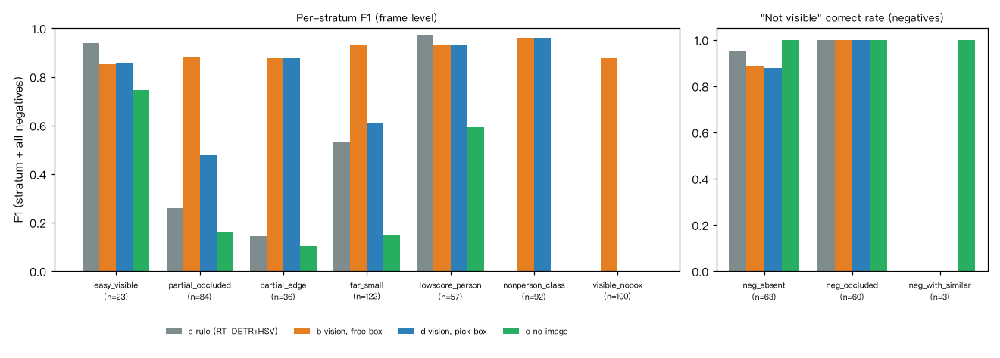

# W1 逐格評估：Agent 看圖 vs RT-DETR＋HSV 規則（H5、H2）

Issue [#644](https://github.com/Polalalabear/amidst/issues/644)；預先登記 [`W1_FRAME_EVAL_PREREG_20261120.md`](W1_FRAME_EVAL_PREREG_20261120.md)（實驗前提交，`3acac739`）；報告素材 [#479](https://github.com/Polalalabear/amidst/issues/479)。研究紀錄，不是辨識、身分或實體安全的正式驗收；身分一律未確認，「對」只表示答案的框落在 GT 目標身體框上。

- Model / effort（本文與程式）：Claude Sonnet 5.5 / high。受測 Agent：OpenAI terra（`gpt-6.1-terra`，K=3）、sol（`gpt-6.1-sol`，只跑 (b)、K=1）。
- 資料：r004 A4-1、B4-1（只有這兩個事件有 GT）；422 格，分層抽樣；GT 只在評分端。

## 1. 結論（先看這裡）

1. **H5 成立（有條件）：在規則看不到或看不準的層，看圖 Agent 的 recall 大幅較高，precision 幾乎不降；在規則本來就對的層沒有優勢。** 預先登記的成立條件（至少兩個在場格 ≥ 50 的困難層，(b) 對 (a) 的 recall 成對差 95% 區間 > 0，且 precision 下降 ≤ 0.05）在 5 個困難層中有 4 層滿足 recall 部分（`partial_occluded` +0.73 [0.58, 0.85]、`far_small` +0.57 [0.36, 0.72]、`nonperson_class` +1.00、`visible_nobox` +0.89 [0.82, 0.94]）；precision 下降 ≤ 0.05 在這 4 層也都滿足（差 +0.06、−0.02、+0.93、+0.87，皆為加上全部負樣本後的整體 precision）。第 5 個困難層 `lowscore_person` 不成立（規則 recall 已 1.00，Agent 0.98；precision −0.06）。整體（分層樣本）：F1 0.52 → 0.96，成對差 +0.43 [0.32, 0.56]；recall +0.60 [0.49, 0.71]；precision −0.02 [−0.04, +0.01]。
   - **要誠實讀的地方：** `nonperson_class` 和 `visible_nobox` 兩層是依「規則失敗」定義的（目標上沒有人物框），規則在這兩層 recall 為 0 是**定義上的結果**；有資訊的是 Agent 在這兩層的 recall（1.00、0.89）和錯框率（0、7%）。**不依賴規則失敗定義的兩層（`partial_occluded`、`far_small`）單獨就滿足條件**，所以 H5 的結論不是靠這個定義撐起來的。
   - **不成立或無法判斷的層：** `lowscore_person`（n=57）沒有優勢；`easy_visible`（n=23 < 50，無法判斷；點估計規則較好：F1 0.94 對 0.85）；`partial_edge`（n=36 < 50，無法判斷；點估計 recall 0.08 → 0.96）。
2. **H2 部分成立：看圖是 Agent 找到「規則漏掉或誤分類的人」的原因，但代價是在目標只在畫面邊緣的格子偶爾答「在」。** (b) 對 (c)（同一文字、不給圖）：recall 差在 `partial_occluded` +0.80 [0.71, 0.90]、`nonperson_class` +1.00、`visible_nobox` +0.89 [0.82, 0.94]，區間皆 > 0，所以「看圖」是必要條件（不給圖的 Agent 在偵測框漏掉或誤分類的層 recall 為 0，整體 recall 0.15，**低於規則的 0.36**，沒有任何優勢）。**但預先登記的另一半條件沒有完全過：** 「目標不在畫面」層（`neg_absent`，n=63）的「不在」答對率 (b) 0.89 對 (c) 1.00，差 −0.11 [−0.20, −0.03]，區間完全在 −0.05 之下，嚴格來說未達「不變差」；「目標在牆後」層（`neg_occluded`，n=60）四組都是 1.00（60/60），差 0。(b) 在 `neg_absent` 的 7 個誤報格全是 T 緊貼鏡頭、身體只有 12–41% 在畫面邊緣的格子（Agent 選了畫面邊緣的人物框；規則在 `neg_absent` 也有 3 格誤報，未逐格核對類型），不是遠處的無中生有；這些邊界格的 GT 標籤本身就在 50% 門檻附近，見 §6。
3. **增益來自兩件事，而且可以分開：** (d)（看圖但只能選既有框）對 (b)：整體 F1 0.77 對 0.96。(d) 在「T 上有別類框」層 recall 1.00（把 sports ball 之類的框重新判斷成人）、`lowscore_person` 0.99，但在 `visible_nobox`（沒有任何框）recall 0、錯框率 100%（只能硬選別人），在 `partial_occluded`、`far_small` 只有 0.38、0.48。所以：**「重新判斷既有框」能救回誤分類的框（`nonperson_class`），但 `visible_nobox`、大部分 `partial_occluded`、`far_small` 的增益要靠 Agent 自己畫框**（(b) 在 `visible_nobox` 93% 的答案是自畫框）。
4. **自畫框的品質有限：** 自畫框層的平均 IoU 只有 0.42–0.49（有框配對的層 0.60–0.68），「對」的判準（框中心落在 GT 身體框內，或 IoU ≥ 0.3）是寬鬆的；要引用「框對了」時請連 IoU 一起引用。
5. **sol 與 terra 沒有可觀察的差異：** (b) sol F1 0.960 [0.939, 0.978]、terra 0.955 [0.933, 0.974]。
6. **成本與延遲：** 本實驗 USD 6.4（ApiGuard 帳本 caller=`frame_eval`；(b) 1266 次 USD 1.98、(c) USD 1.23、(d) USD 1.92、sol 422 次 USD 1.27）。單次延遲 p50 2.6–3.0 s、p95 4.4–5.3 s（4–6 條並行下的牆鐘）。`cached_tokens` 在所有呼叫都是 0：系統提示加場景上下文約 520 tokens，低於快取門檻，固定前綴快取沒有生效；要用快取，場景上下文必須夠大（W2）。

## 2. 設計

- **單位：** (事件、鏡頭、tick) 一格，逐格獨立呼叫。每格給 Agent：系統提示＋該事件固定的場景上下文（鏡頭清單、DRAFT 圖鄰居、種子顏色）、參考裁切圖（規則第一次鎖定的觀測；已核對種子框都落在 GT 目標身上）、當格畫面（偵測框畫成編號框）、所有偵測（分數 ≥ 0.3，任何類別）的 id／類別／框／分數／HSV 顏色。回答 `{present, detection_id|null, box_xyxy|null, confidence, reason}`。
- **四組：** (a) 規則＝`q4_evidence.py` 判法（person、score ≥ 0.3、HSV 紅色 STRONG／WEAK，顯示最佳框；不看顏色的版本結果相同，因為此資料裡幾乎只有目標穿紅色）；(b) 看圖，可選框 id、自畫框或「不在」；(c) 同文字不給圖；(d) 看圖，只能選既有 id 或「不在」。
- **GT 隔離：** 請求建立路徑（`build_messages`、`frame_image`、`seed_crop`、`frame_eval.request_text`）只用偵測索引、種子觀測、DRAFT 圖和影格像素，不碰 GT、標籤、分層。GT 只在 `frame_labels`（分層）與 `score_frame`（評分）。
- **目標「可見」的標籤（評分端）：** GT 身體框落在畫面內 ≥ 50% **且**框內紅衣像素 ≥ 15。只用幾何不夠：抽樣檢視發現多數「在視錐內但偵測不到」的格子其實是 T 在牆後（約 763 格），這類格不是正樣本，而是負樣本 `neg_occluded`（正確答案是「看不到」）。
- **分層（可重疊）：** `easy_visible`、`partial_occluded`（紅衣像素佔身體框 < 4.5%）、`partial_edge`（身體框被畫面邊緣切掉）、`far_small`（身體框高度在可見格下三分位，≤ 112 px）、`lowscore_person`（T 的人物框分數 0.3–0.5）、`nonperson_class`、`visible_nobox`、負樣本 `neg_absent`、`neg_occluded`、`neg_with_similar`。每層以隨機種子 644 抽至多 60 格，同鏡頭兩格間隔 ≥ 0.4 s。可抽數：easy 42、partial_occluded 121、partial_edge 55、far_small 267、lowscore 82、nonperson 316、visible_nobox 187、neg_absent 548、neg_occluded 763。
- **計分：** TP（框中心在 GT 身體框內，或 IoU ≥ 0.3）、FP_wrong_box（有人但框錯＝錯人）、FP_absent（T 不可見卻答「在」）、FN、TN。recall = TP／T 可見格；precision = TP／答「在」的格。**層內 precision／F1 是該層加上全部負樣本（123 格）算的；整體數字是分層樣本的，不是母體比例。** K=3 的結果取每格三次的平均（不是多數決，與預先登記的差別，見 §6）。
- **統計：** 成對差用 5 秒區塊（事件×鏡頭×時間）的 cluster bootstrap，2000 次，95% 百分位區間。

## 3. 結果（terra，K=3 平均；sol K=1）

層內 recall／F1（F1 含全部負樣本）。(a) 規則、(b) 看圖自畫框、(c) 不給圖、(d) 只選既有框、(b-sol)。

| 層 | n | (a) R／F1 | (b) R／F1 | (c) R／F1 | (d) R／F1 | (b-sol) R／F1 |
|---|---:|---|---|---|---|---|
| easy_visible | 23 | 1.00／0.94 | 0.97／0.85 | 0.59／0.75 | 1.00／0.86 | 1.00／0.84 |
| partial_occluded | 84 | 0.15／0.26 | 0.89／0.88 | 0.09／0.16 | 0.38／0.48 | 0.94／0.90 |
| partial_edge | 36 | 0.08／0.14 | 0.96／0.88 | 0.06／0.11 | 0.97／0.88 | 0.97／0.86 |
| far_small | 122 | 0.37／0.53 | 0.94／0.93 | 0.08／0.15 | 0.48／0.61 | 0.97／0.94 |
| lowscore_person | 57 | 1.00／0.97 | 0.98／0.93 | 0.42／0.59 | 0.99／0.93 | 1.00／0.93 |
| nonperson_class | 92 | 0／0 | 1.00／0.96 | 0／0 | 1.00／0.96 | 1.00／0.95 |
| visible_nobox | 100 | 0／0 | 0.89／0.88 | 0／0 | 0／0 | 0.92／0.88 |

「不在」答對率（TN 率）：

| 負樣本層 | n | (a) | (b) | (c) | (d) | (b-sol) |
|---|---:|---:|---:|---:|---:|---:|
| neg_absent（T 在畫面外） | 63 | 0.95 | 0.89 | 1.00 | 0.88 | 0.86 |
| neg_occluded（T 在牆後） | 60 | 1.00 | 1.00 | 1.00 | 1.00 | 1.00 |
| neg_with_similar | 3 | 0 | 0 | 1.00 | 0 | 0 |

整體（422 格，分層樣本；括號為 95% 區間）：

| 組 | precision | recall | F1 | 錯框率（答「在」且 T 可見時框錯） |
|---|---|---|---|---:|
| (a) 規則 | 0.973 [0.93, 1.00] | 0.358 [0.24, 0.47] | 0.523 [0.39, 0.64] | 0.00 |
| (b) 看圖自畫框 | 0.955 [0.93, 0.98] | 0.955 [0.93, 0.98] | 0.955 [0.93, 0.97] | 0.02 |
| (c) 不給圖 | 1.000 | 0.153 [0.07, 0.25] | 0.265 [0.13, 0.40] | 0.00 |
| (d) 只選既有框 | 0.910 [0.84, 0.96] | 0.664 [0.54, 0.77] | 0.768 [0.67, 0.85] | 0.06 |
| (b-sol) | 0.948 [0.92, 0.97] | 0.973 [0.96, 0.99] | 0.960 [0.94, 0.98] | 0.02 |

整體成對差（B − A，95% 區間）：(b)−(a) F1 +0.432 [0.322, 0.564]、recall +0.598 [0.487, 0.712]、precision −0.017 [−0.039, +0.010]；(b)−(c) F1 +0.690 [0.558, 0.822]；(b)−(d) F1 +0.187 [0.113, 0.281]；(c)−(a) F1 −0.258 [−0.379, −0.159]。完整的層內成對 recall／precision／TN 差與區間見 LOCAL `w1_scores.json`。

　左：各層 F1；右：負樣本「不在」答對率；灰＝(a) 規則、橘＝(b)、藍＝(d)、綠＝(c)。

## 4. 判讀（依預先登記）

| 假設 | 條件 | 觀察 | 判讀 |
|---|---|---|---|
| H5 | ≥ 2 個在場格 ≥ 50 的困難層，(b)−(a) recall 差區間 > 0 且 precision 降 ≤ 0.05 | 4／5 層滿足（含不依賴規則失敗定義的 `partial_occluded`、`far_small`）；`lowscore_person` 不滿足 | **成立**，限於規則漏掉、誤分類、目標遠或被擋的層 |
| H5 推翻條件 | 困難層區間都含 0，或 precision 降 > 0.05 | 沒有發生 | 未被推翻 |
| H2 | (b)−(c) 在遮擋／沒框層區間 > 0，且「不在」答對率不變差（≥ −0.05） | recall 差全 > 0；`neg_occluded` 差 0；`neg_absent` 差 −0.11 [−0.20, −0.03] | **部分成立**：看圖是找回目標的原因；「已離開」一項在 `neg_absent` 未過 |
| H2 改寫條件 | (c) 接近 (b) | (c) recall 0.15 對 0.96 | 未觸發；不給圖的 Agent 沒有優勢 |
| 停損（§6 of #642） | E1 在困難層推翻 H5 | 沒有 | 不觸發，E2 照原計畫 |

只在離線成立：本評估是逐格、離線、可以等待 2.6–5 s 的設定；即時模式的延遲限制見 `VISION_AGENT_RECORDED_20261120.md`，沒有在本實驗重測。

## 5. (d) 與 (b) 的分解

| 層 | (d) 只選既有框 R | (b) 看圖自畫框 R | (b) 自畫框佔答案比例 | 解讀 |
|---|---:|---:|---:|---|
| nonperson_class | 1.00 | 1.00 | 0 | 重新判斷既有框就夠 |
| lowscore_person | 0.99 | 0.98 | 0 | 同上，但規則本來就對 |
| partial_occluded | 0.38（錯框率 0.22） | 0.89 | 0.56 | 約一半增益靠自畫框 |
| far_small | 0.48 | 0.94 | 0.48 | 同上 |
| visible_nobox | 0（錯框率 1.00） | 0.89 | 0.93 | 沒有框時只選既有框會硬選別人 |

## 6. 限制（引用前請讀）

- **範圍：** 預錄、渲染合成場景、兩個事件、單一目標（紅衣）、一個偵測器（RT-DETR R18）。不能外推到真實影像、其他服裝或多目標複雜場景。
- **樣本：** 分層抽樣，整體數字不是母體比例；層內相鄰影格相關，已用 5 秒區塊 bootstrap 部分處理，區間仍可能偏窄。`easy_visible`（23）和 `partial_edge`（36）在場格 < 50，依預先登記「無法判斷」，表中數字只是點估計。`neg_with_similar` 只有 3 格，不能下結論。
- **標籤：** 「可見」用 GT 身體框＋紅衣像素代理，不是場景幾何或深度；遮擋比例是紅衣像素佔比的代理。身體框是固定尺寸圓柱的投影，邊界格（T 緊貼鏡頭、12–50% 在畫面內）的標籤本身不確定，`neg_absent` 的 7 個 (b) 誤報全是這種格。標籤與規則的 HSV 都用紅色，兩者有部分耦合（標籤只用於分層與評分）。
- **做不到的層：** 索引分數下限 0.3，沒有 0.05–0.3 的框，原計畫的「RT-DETR 低分 0.05–0.3」層沒有測；「相似人物同框」在索引裡只有 3 格負樣本、0 格正樣本。
- **「對」的判準寬鬆：** 框中心在身體框內或 IoU ≥ 0.3；自畫框平均 IoU 0.42–0.49。
- **與預先登記的差異：** (1) K=3 用逐格三次平均而不是多數決（預先登記寫多數決）；未另算多數決版本。(2) 同鏡頭取樣間隔 0.4 s（預先登記規劃 ≥ 1 s，會讓 `easy_visible`、`partial_edge` 更少）；每層上限 60。(3) 費用估價 USD 11，原 issue 估 3–6，實際 6.4。
- **執行紀錄：** (b) 組 k1、k2 各有約一半的呼叫被 ApiGuard 速率限制（每分鐘 120）擋下，未送出也未計費，已調高上限並只補跑被擋的格子；已付費的 c、d 組答案原樣保留。

## 7. 重現

```bash
# repo venv（Pillow、matplotlib、numpy）；LOCAL 資料需在 ~/amidst/local（clone 透過 alternates 找到）
python scripts/run_frame_eval.py frames                  # GT 分層表與抽樣，不連網
python scripts/run_frame_eval.py dry-run --k 3 --models terra --arms vision_free,text,vision_pick
python scripts/run_frame_eval.py call --model terra --arm vision_free --k 3 --fill   # 付費，經 ApiGuard（caller=frame_eval）
python scripts/run_frame_eval.py call --model terra --arm text --k 3
python scripts/run_frame_eval.py call --model terra --arm vision_pick --k 3
python scripts/run_frame_eval.py call --model sol --arm vision_free --k 1
python scripts/run_frame_eval.py score                   # 指標、成對 bootstrap、圖（可由 LOCAL 答案表離線重算）
python -m pytest tests/evaluation/test_frame_eval.py
```

模型回答不保證逐字相同，付費部分不能逐位元組重建；`frames`、`score` 可由 LOCAL 檔重算（bootstrap 種子固定）。

## 8. LOCAL 證據

目錄 `local/evidence/w1-frame-eval-20261120/`（LOCAL，不進版控；約 3.2 MB、17 檔；`SHA256SUMS` 的 SHA-256 `8d267964cc2b2216c8cb4d0c7b25e8579207bc2df2afdc43f74e3a3f36a1b68b`，列出其餘 16 檔）。可由 `frames` 重建（`sample.json`、`frames_all_labels.json`、`seeds.json`、`red_px.json`）；答案表為付費結果，不可重建。

| 檔案 | 內容 | SHA-256（前 12 碼） |
|---|---|---|
| `answers_terra_{vision_free,text,vision_pick}_k{0,1,2}.json`（9 檔）、`answers_sol_vision_free_k0.json` | 每次呼叫的原始回答、延遲、tokens、`cached_tokens` | `23079252ff6b`（vision_free k0）、`5c2d451dca7e`、`8342568cc685`、`9488dc20fcda`（text k0）、`e9c3ec5ec257`、`53fda1eb0620`、`29f58be5ca8d`（pick k0）、`0d934475bbd8`、`e65617d8f342`、`e78c272e3511`（sol） |
| `sample.json` | 抽樣的 422 格與各層抽樣名單 | `78c1c71cd965` |
| `frames_all_labels.json` | 兩事件全部 2,050 格的 GT 標籤與分層 | `a647cadac736` |
| `w1_scores.json` | 全部指標、層內成對差與區間、誤報分析 | `66fef2b9e624` |
| `fig_f1_by_stratum.png` | 圖（已複製進 `w1_frame_eval_20261120/`） | `44c83391ba9c` |

付費帳本：`local/evidence/api-usage/usage.jsonl`，caller=`frame_eval`（約 USD 6.4）。
