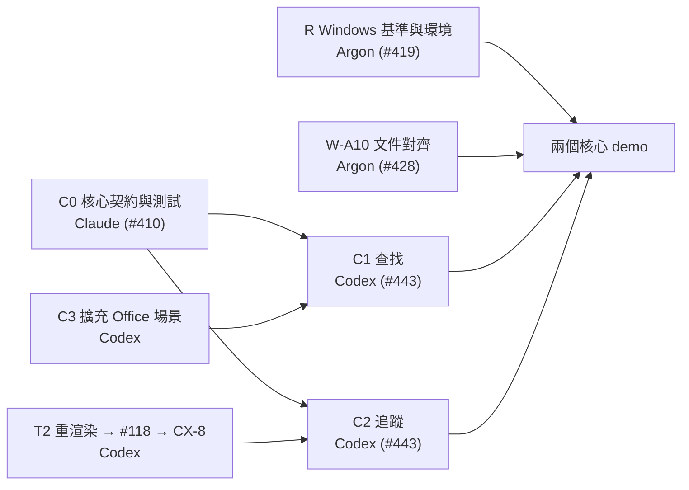

# ROADMAP：兩個核心的大任務

返回 [README](README.md)。決策背景見 [DECISIONS.md](DECISIONS.md)。

依 [D126](https://github.com/Polalalabear/amidst/issues/93#issuecomment-6621356045)，只留支撐兩個核心的工作。任務組織沿用 [#279 協調留言（2026-11-04）](https://github.com/Polalalabear/amidst/issues/279#issuecomment-6620849868) 的原則：每個大任務由同一個執行者從頭做到尾，用測試和檢查器分階段自己驗證，只在固定節點找使用者；合併一律等使用者授權。

日期：D126 與 #279 都沒有排定各任務的完成日期，下表不寫日期（**待補**）。

編號：T2 沿用 #279 的大任務編號；C0～C3、R、W 是本文件為了說明而加的編號，不是 #93／#279 的正式編號。

## 1. 大任務與 test gate

| # | 大任務 | 執行者 | 內部 test gate（自己驗證） | 狀態 |
| --- | --- | --- | --- | --- |
| C0 | **核心契約與驗收測試**：case1／case2 的欄位、驗證、輸出與測試 | Claude（session core-contract-tests） | 契約 PROPOSED；測試可在無 GT 的 SYNTHETIC fixture 上跑；Codex 確認後生效 | **已提出**：PR [#410](https://github.com/Polalalabear/amidst/pull/410)（head `b1a619d`）提供完整規格與前後端驗收測試 |
| C1 | **case1 查找**：時間＋地點（`covered_regions` 且為 `MANUAL_ON_STATIC_FRAME`）＋物件（COCO 索引）；前端選單 | Codex 照 C0 測試做前後端；Argon 協助測試對齊 | C0 驗收測試全過；架構守門（不帶 allow）0 findings | 純模組與路由接線在 PR [#443](https://github.com/Polalalabear/amidst/pull/443)；前端選單持續整合 |
| C2 | **case2 追蹤**：單畫面自動切鏡、多畫面、盲區俯視圖＋物理預測 | Codex 照 C0 測試做；前端需要 Claude 時由使用者指派 | C0 驗收測試全過；不讀劇本、GT、渲染軌跡、可見性、深度的測試；`q_physical_prediction` 維持 fail-closed | 純模組與切鏡序列在 PR [#443](https://github.com/Polalalabear/amidst/pull/443)；B-05a／B-05b 在 #408 |
| T2 | **複雜事件真實追蹤**（D124）：重渲染 A4-1／B4-1（會轉身、看得出正反面）→ 參數清單 → #118 → CX-8 RULE_ONLY → 追蹤輸出 → 接進 `tracking-source.mjs` | Codex；最後接線 Claude（後備 Codex） | CX-7T 檢查器 PASS；追蹤輸出通過契約測試；守門 0 findings；磁碟 ≥ 8 GiB | D126-1 保留；進行中 |
| C3 | **擴充 Office 場景**：多間標註教室（例如 R101～R104）各有室內鏡頭，放 COCO 可辨識物件 | Codex | 渲染前查磁碟，低於 8 GiB 就停（D118）；兩層圖經 Claude 檢查、使用者核准 | 未開始；規模 **待補** |
| R | **驗證腳本與 Windows 基準**（D126-1 保留項） | Argon / Codex | 乾淨 clone 可跑（D116-補）；Windows 原生硬體探針與核心測試 PASS | **已完成收據**：W-A1（#419 / PR [#440](https://github.com/Polalalabear/amidst/pull/440)），head `def9e1dc4fabf89f86546da4663523728b1d76e9`、commit `2372767`、JSON SHA-256 `223ac914b42da8ecb48d5840560a01d353684d10f4e84f348a955e0b355e764b`（340 Python + 24 Node + 24 clean clone PASS）；`start_all_demo.ps1` 在 PR [#443](https://github.com/Polalalabear/amidst/pull/443) |
| W-A10 | **文件包與契約核對對齊**（#428） | Argon | 消除 #409、#410、#419、#443 不一致；mermaid 可 render；連結有效；Windows 實測指引齊備 | **本任務**（PR #428） |
| W | **報告初稿**：改成以兩個核心為主，缺的數字標「待補」 | Claude | — | 下週（D126-1） |

T1（#408 收尾，連同 #405、#407）在 [#279 協調](https://github.com/Polalalabear/amidst/issues/279#issuecomment-6620849868) 列為「今天結束」；#405、#407 已合併（[D125](https://github.com/Polalalabear/amidst/issues/93#issuecomment-6620998251)），#408 仍 OPEN。

> [!NOTE]
> **Mermaid 渲染說明**：任務流程圖語法遵循標準 Mermaid，可在 GitHub 網頁端或相容 Markdown 檢視器原生呈現。渲染指令：`npx @mermaid-js/mermaid-cli -i docs/project/ROADMAP.md -o roadmap.svg` 或 `mmdc -i roadmap.mmd -o roadmap.png`；本地無 headless 渲染器時源碼保持純文字格式。

## 擱置清單

D126-1 決定擱置，不是刪除；重啟要使用者另外決定。

| 項目 | 原本是什麼 | 原本的決策 |
| --- | --- | --- |
| M1–M4 實驗 | #397 研究企劃第二部分：RULE_ONLY 對 AGENT_SEQUENTIAL 等比較 | #397；[D121](https://github.com/Polalalabear/amidst/issues/93#issuecomment-6594412627) |
| Q4 正式標註包 | 組員的 Q4 T／F 標註包（builder＋README＋`RETURN/`） | [D125 補](https://github.com/Polalalabear/amidst/issues/93#issuecomment-6621022288) |
| Colab 包 | T3 外包測試包（notebook 一鍵執行） | [D125-3](https://github.com/Polalalabear/amidst/issues/93#issuecomment-6620998251)；#279 T3 |
| 大整理後半 | 合進 `main`、刪分支 | [D116](https://github.com/Polalalabear/amidst/issues/93#issuecomment-6579537960)、[D116-補](https://github.com/Polalalabear/amidst/issues/93#issuecomment-6594014349)、[D125](https://github.com/Polalalabear/amidst/issues/93#issuecomment-6620998251)；#279 T4 後半 |

## 使用者要做的節點

| 節點 | 何時 | 出處 |
| --- | --- | --- |
| 授權合併 #408 | T1 收尾 | [#279 協調](https://github.com/Polalalabear/amidst/issues/279#issuecomment-6620849868) |
| 核定 T2 參數集（要綁重渲染後的新 run） | 重渲染完成後，一次 | [D124-4](https://github.com/Polalalabear/amidst/issues/93#issuecomment-6620431061) |
| 核定擴充場景的兩層圖 | C3 圖產生、Claude 檢查之後 | `docs/specs/Q1Q5_PRODUCT_SPEC.md`@`796cc17` §2（兩層圖列） |
| 授權合併 C0／C1／C2／T2／C3 的 PR | 各大任務結束 | #279 協調 |
| 看追蹤影片 | T2 結束 | #279 協調 |
| 決定擱置項目是否重啟 | 兩個核心完成後 | D126-1 |
| 授權合進 `main`、授權刪分支 | 大整理後半重啟後 | D116、D125 |
