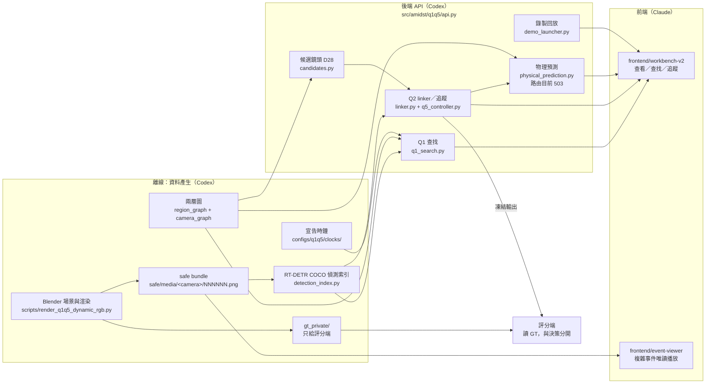
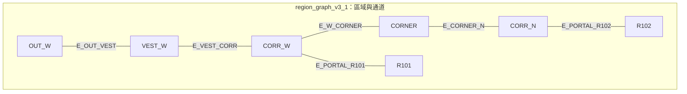

# 系統架構

返回 [README](README.md)。功能規則見 [SPEC.md](SPEC.md)，術語見 [GLOSSARY.md](GLOSSARY.md)。

除非另外註明，本文件引用的 repo 檔案都在 `mainline/q1q5`@`796cc17` 讀取。

## 1. 架構圖

圖中每個方框的出處見 [§2](#2-資料流)。`gt_private/` 只連到評分端，這是 [§4 GT 隔離](#4-gt-隔離邊界) 的核心。

## 2. 資料流

| # | 階段 | 做什麼 | 主要檔案 | 狀態 |
| --- | --- | --- | --- | --- |
| 1 | Blender 渲染 | 依凍結劇本渲染多鏡頭 RGB；A4-1 4 台×250 格、B4-1 5 台×210 格，5 fps，960×540 | `scripts/render_q1q5_dynamic_rgb.py`；收據 `docs/engineering/R004_EVENT_RUNS_RECEIPT.md` | CX-7 已渲染（[D120](https://github.com/Polalalabear/amidst/issues/93#issuecomment-6594169791)）；D124 授權重渲染 |
| 2 | safe bundle | 渲染輸出分成 `safe/`（RGB 影格）和 `gt_private/`；safe 區由 checker 驗結構與 hash | `scripts/check_event_run_bundle.py`；`docs/engineering/CX7T_EVENT_BUNDLE_CHECKER_20261029.md` | production bundle 驗收 NOT_RUN（D120 情境） |
| 3 | RT-DETR 偵測索引 | 離線跑 RT-DETR R18（COCO 80 類）＋HSV 顏色，寫成 JSONL 索引；查詢時不補推論 | `src/amidst/q1q5/detection_index.py`（`OfficialRTDetrR18`）、`scripts/build_q1q5_detection_index.py` | P1 有索引；A4-1／B4-1 等 #118 |
| 4 | Q1 查找 | 只讀索引，依時間、類別、顏色、區域找鏡頭 | `src/amidst/q1q5/q1_search.py`（"index-only Q1 search; no query-time media/inference or GT reads"） | 可用（P1） |
| 5 | Q2 linker／追蹤 | 同鏡頭 IoU 連接；失聯後 Q5 狀態機依 D28 候選決定是否切鏡（RULE_ONLY／AGENT_SEQUENTIAL） | `linker.py`、`q5_controller.py`、`candidates.py`、`q5_agent.py` | 只支援人物（D126）；A4-1／B4-1 等 CX-8 |
| 6 | 物理預測 | 由最後一段偵測框估影像平面方向，排序出口與候選鏡頭，推算時間窗 | `physical_prediction.py`（純函式）；契約 `DEMO_UI_SUPPORT_V1.md` §6 | 路由 `q_physical_prediction` 回 503（`api.py` 第 24、329 行） |
| 7 | 後端 API | POST 路由 `q1_camera_search`、`q2_*`、`q_frames`、`q_media_grant`、`q_recorded_response` 等；只綁本機 | `src/amidst/q1q5/api.py` 第 21–26 行；`p1_workbench.py`、`demo_launcher.py` | 可用 |
| 8 | 工作台 | 監控牆、查找、追蹤（單畫面／多畫面）、俯視圖、決策紀錄、倍速、宣告時鐘 | `frontend/workbench-v2/` | 事件選單與追蹤模式在 [#408](https://github.com/Polalalabear/amidst/pull/408)（OPEN） |
| 9 | 複雜事件播放 | 只送 `safe/media/` PNG，啟動時逐張驗 PNG 結構與 SHA-256，拒絕 metadata 區塊；`gt_private/` 404 | `frontend/event-viewer/server.mjs`、`README.md` | 已合併（#399） |

時間：所有時間在內部都是整數微秒的來源時間；只有顯示時才經宣告時鐘換成台灣時間（`clock_mapping.py`："Declared demo clocks, exact microseconds"）。

## 3. 地點查找：region_graph 與 camera_graph

地點查找不用影像去猜「這裡是哪裡」，而是查一份事先畫好、凍結的兩層圖：

> 上圖逐條照 `region_graph_v3_1.json` 的 `edges[].regions` 繪出；6 條通道都是 `BIDIRECTIONAL`、`state=UNKNOWN`、`traversability=TOPOLOGICAL_ONLY`。連線只表示「依配置可能連通」，不代表人走得過去。

各鏡頭的 `covered_regions`（`camera_graph_v3_1.json`）：

| 鏡頭 | 涵蓋區域 |
| --- | --- |
| CAM_EXT_CAR、CAM_EXT_CLEAR | OUT_W、VEST_W |
| CAM_W1 | CORR_W |
| CAM_W2 | CORR_W、VEST_W |
| CAM_BRANCH、CAM_WIDE | CORNER、CORR_N |
| CAM_R101_IN | R101 |

R102 目前沒有任何鏡頭涵蓋，所以選 R102 查找時不會有鏡頭可回（應回明確的「沒有鏡頭涵蓋」，錯誤碼 **UNKNOWN**，看核心契約）。

| 層 | 檔案 | 內容 | 狀態 |
| --- | --- | --- | --- |
| Region graph | `configs/q1q5/graphs/r004/region_graph_v3_1.json`（SHA-256 `a2f73780…24e1`；`content_sha256` `8c33aba7…0909`） | 7 個區域、6 條通道；所有通道 `state=UNKNOWN`、`traversability=TOPOLOGICAL_ONLY` | `approval_status=DRAFT` |
| Camera graph | `configs/q1q5/graphs/r004/camera_graph_v3_1.json`（SHA-256 `e250413a…8409`；`content_sha256` `708586a2…ba48`） | 7 台追蹤鏡頭，每台有 `covered_regions`、entry／exit zones；22 條轉移 | `approval_status=DRAFT` |
| Tracking scope | `configs/q1q5/graphs/r004/tracking_scope_v3_1.json` | 追蹤鏡頭 7 台、查找鏡頭 8 台（CAM_ENTRY 只供查找，D74）；`G4_approved=false` | `PROPOSED` |

**怎麼解決地點查找**

1. 使用者在選單選一個區域，例如 `R101`。
2. 後端在 camera_graph 裡找 `covered_regions` 含 `R101` 的鏡頭（r004 是 CAM_R101_IN）。
3. 只在這些鏡頭、這段時間裡查索引或回傳畫面。

每筆 `covered_regions` 都有 `basis=MANUAL_ON_STATIC_FRAME`（人工在靜態畫面上標）、`visible_area_m2=null`。所以它回答的是「哪台鏡頭看得到這個區域」，**不代表**物件在那個區域內（`Q1_Q2_FIRST_DEMO_V1.md` §6.1）。追蹤時，camera_graph 的轉移（例如 `T_CAM_BRANCH__CAM_W1`，`relation=UNKNOWN`、`path_has_unknown_state=true`）提供候選鏡頭，由 `candidates.py` 依 D28 決定性排序。

擴充後的 Office 場景（多間教室，例如 R101～R104，D126-2）只要在兩層圖裡加區域和室內鏡頭的 `covered_regions`，查找邏輯不用改；圖要經 Codex 產生、Claude 檢查、使用者核准（`docs/specs/Q1Q5_PRODUCT_SPEC.md` §2）。

## 4. GT 隔離邊界

**規則**（`docs/DEVELOPMENT_RULES.md` 第 56 行）：GT 只供 simulation／export、evaluation、debug visualization；不得進入 inference、graph、candidate ranking、semantic reasoning 或 path score。

| 可以進推論 | 不可以進推論 |
| --- | --- |
| safe RGB 影格（hash 驗證過） | GT 軌跡、mask、visibility、depth |
| 偵測索引（RT-DETR＋HSV） | 渲染軌跡、Blender 物件名、GT actor ID |
| 凍結的兩層圖、宣告時鐘、參數集 | 劇本、情境卡、事件答案、評分窗 |

落實方式：

- **資料夾分開**：渲染輸出分 `safe/` 和 `gt_private/`；event-viewer 對 `gt_private/` 一律 404（`frontend/event-viewer/README.md`）。
- **評分與決策分開**：Q2／Q5 輸出先凍結，評估端再讀獨立 hash-pinned 劇本評分（`Q1Q5_PRODUCT_SPEC.md` §2 GT 隔離、評估兩列）。
- **Agent 也看不到 GT**：Agent 只經 typed tools 讀偵測與顏色證據（`DEVELOPMENT_RULES.md` 第 63 行，D64）。
- **自動守門**：`scripts/check_architecture_guard.py`（不帶 `--allow`）檢查 authority／inference／schemas；#408 跑過 PASS。
- **對外工具也不能碰**：Colab、Antigravity、ChatGPT／Gemini 都不可以碰 `gt_private/`、渲染原檔、OpenAI key（[#279 協調](https://github.com/Polalalabear/amidst/issues/279#issuecomment-6620849868)）。

## 5. 分支與合併規則

| 項目 | 規則 | 出處 |
| --- | --- | --- |
| 整合分支 | `mainline/q1q5`（D63） | [`AGENTS.md`](https://github.com/Polalalabear/amidst/blob/796cc176cd40bedbfe701b95192d3c8679755aa9/AGENTS.md) Git workflow |
| 功能分支 | `codex/*`、`claude/*`、`team/<name>/<task>` | 同上 |
| 合併方式 | **只用 merge commit**，不 squash、不 rebase、不 force push，因為文件引用 commit SHA | 同上 |
| 合併權 | 合併一律等使用者授權 | [#279 協調](https://github.com/Polalalabear/amidst/issues/279#issuecomment-6620849868) |
| `main` | demo 後經 PR 把 `mainline/q1q5` 合進 `main`，合併當下仍要使用者授權；目前擱置 | [D116-1](https://github.com/Polalalabear/amidst/issues/93#issuecomment-6579537960)、D126-1 |
| 刪分支 | 先用乾淨 clone 驗證，main 重跑結果和基準一致才刪；有證據價值的分支不刪 | [D116-補](https://github.com/Polalalabear/amidst/issues/93#issuecomment-6594014349)、[D125](https://github.com/Polalalabear/amidst/issues/93#issuecomment-6620998251) |
| 結果紀錄 | 每個 PR 描述用「實際產出」模板 | `AGENTS.md` Checkpoints and result records |

## 6. Claude 與 Codex 的分工（D126-3）

| 角色 | 負責 | 例子 |
| --- | --- | --- |
| **Claude** | 寫 PROPOSED 契約和驗收測試；前端需要 Claude 時由使用者直接指派；規劃與文件 | 核心契約 `Q_CORE_SEARCH_TRACK_V1.md`（session core-contract-tests）；workbench-v2（#408）；本文件包 |
| **Codex** | 照測試做完前後端；擴充 Office 場景（多間教室＋COCO 物件）；渲染與偵測、追蹤輸出 | D124 重渲染 A4-1／B4-1 → #118 → CX-8 RULE_ONLY |
| **使用者** | 決定範圍、核定參數集、授權合併與對外動作 | [ROADMAP §3](ROADMAP.md#使用者要做的節點) |

原則：「以跑測試為主，減少審查」（D126-3）。PR 在大任務結束時交叉審一次（[#279 協調](https://github.com/Polalalabear/amidst/issues/279#issuecomment-6620849868)）。
