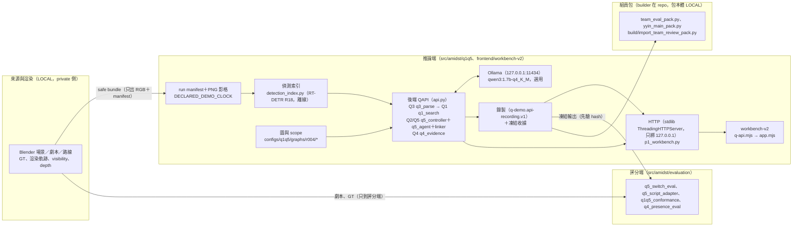

# Q1–Q5 現行系統架構（草稿）

- 狀態：**草稿（DRAFT）**，不進 11-03 批次。第 3 節 API 為 **PROPOSED**，等 Codex 確認（AGENTS.md：API 契約歸 Codex）。
- 日期：2026-11-02。作者：Claude Opus 5.5 / high。
- 用途：報告、外包執行包（#397）、D116 demo 後清掃（main 成為唯一主幹）的依據。
- 取代：`docs/specs/SYSTEM_DESIGN.md`（10-08，Phase 1 規劃，已和實作對不上）。舊文件這次不改，D116 清掃時處理。
- 架構基準：[#306](https://github.com/Polalalabear/amidst/issues/306)（模組邊界、GT 隔離）。本文補技術堆疊、API 清單與啟動方式，不改 #306 的規則。

## 0. 以哪些程式為準

本文**只根據下列 commit 的程式內容**撰寫，不憑舊文件推定。讀法是 `git show <ref>:<path>`、`git grep <ref>`，以及把下列分支依序以 `git merge-tree --write-tree` 疊在 staging 上得到的唯讀合併樹（未提交、未推送）。

| 來源 | commit | 備註 |
| --- | --- | --- |
| `origin/codex/q1q5-staging` | `434e579` | 基底（2026-10-27） |
| FEAT-7 | `1f0a710` | 架構守門 #307：`configs/architecture/*`、`scripts/check_architecture_guard.py` |
| FEAT-3 | `aaf660d` | team-eval P1 C-09 replay |
| FEAT-2 | `46e4673` | team-eval 包、`yyin_main_pack*` |
| FEAT-5 ＋ DEMO-UI-F | `1ffabe6`、`0051d23` | demo 腳本、`--tracking-scope`（`0051d23` 在 `origin/codex/feat-5-demo-ui-f`） |
| FEAT-9 | `7263357` | workbench-v2 預錄 Q2、decision journal |
| FEAT-1 | `18d1a28` | safe bundle、r004 graph v3／v3_1 |
| FEAT-6 | `943a72f` | 錄製、schema、評分端 |
| FEAT-4 | — | 延後（D114-3），**不在本文範圍** |

合併樹有兩處文字衝突：`src/amidst/q1q5/p1_workbench.py`（`0051d23` 加 `tracking_scope` 參數）與 `frontend/workbench-v2/store.test.mjs`（`943a72f`）。本文對 `P1.__init__` 採 `0051d23` 版本描述；實際解法以 11-03 批次合併為準（UNKNOWN，見第 10 節 C-01）。

## 1. 總覽

GT、渲染軌跡、visibility、depth 只能沿右側箭頭進評分端，不能進推論端（第 7 節）。

來源：#306 §2；`src/amidst/q1q5/api.py`、`p1_workbench.py`、`detection_index.py`、`q5_controller.py`、`q5_agent.py`、`llm_provider.py`；`src/amidst/evaluation/`；`src/amidst/q1q5/team_eval_pack.py`、`yyin_main_pack.py`；`scripts/build_team_review_pack.py`、`scripts/import_team_review_pack.py`。

## 2. 各層技術與版本

### 2.1 前端：`frontend/workbench-v2/`

- 技術：原生 ES modules（`.mjs`），沒有 bundler、沒有 `package.json`、沒有第三方 JS 套件。`index.html` 只載入 `app.mjs`。
- 測試：Node 內建 test runner，`node --test frontend/workbench-v2/*.test.mjs`（指令出現在 repo 文件中；Node 版本 UNKNOWN，repo 沒有釘選）。
- 資料入口：所有 Q 請求只經 `q-api.mjs`（same-origin `/api/*`）；`api.mjs` 是舊 v2 消費端請求的唯一入口。前端不讀 GT、劇本或檔案系統。
- 其他頁面：`admin.html`、`event-modes.html`、`long-timeline.html`（各自的 `.mjs`／`.css`）。

| 模組 | 負責（取自各檔第一行註解） |
| --- | --- |
| `app.mjs` | Q 組合根；review 程式碼經獨立動態邊界載入 |
| `store.mjs` | 單一 state＋pure reducer，無 DOM |
| `q-api.mjs` | Demo／review 共用的 Q 請求；不會退回 fixtures；檢查 `SESSION_BINDING` |
| `api.mjs` | v2 讀資料的唯一位置（契約 §6.1–§6.5 的五個請求） |
| `q-validate.mjs` | Q response 邊界驗證，保留原始數值型別以重算 Python canonical hash |
| `q-time.mjs`、`clock.mjs` | SOURCE 整數時間為準；整數毫秒時鐘 |
| `q-playback.mjs` | 只做像素緩衝；不做偵測、身分、插值 |
| `q-tokens.mjs`、`tokens.mjs`、`uncertainty.mjs` | 證據狀態配色與 D44／D45 不確定規則 |
| `q1-wall-model.mjs`、`q1-wall-view.mjs` | Q1 命中鏡頭牆，共用時鐘 |
| `q2-session-model.mjs`、`q2-view.mjs`、`q2-timeline-*.mjs` | Q2 追蹤 session、影格、時間軸 |
| `q3-bar-model.mjs`、`q3-bar-view.mjs` | Q3 解析列（找／追標籤） |
| `q4-evidence-view.mjs` | Q4 證據檢視 |
| `q5-log-model.mjs`、`q5-log-view.mjs`、`q5-steps-model.mjs` | Q5 決策紀錄；一般模式一步一行（D113） |
| `provenance-bar.mjs` | 來源列 |
| `search-dialog-*.mjs`、`search-phase-*.mjs` | 檢索對話框與「牆→檢索中→結果」狀態機（進度條為示意） |
| `monitor-room-*.mjs`、`monitor-wall-model.mjs`、`player-grid.mjs` | 監控牆：預錄 RGB、共用時鐘、1／2／4／8 格 |
| `long-timeline*.mjs`、`timeline-model.mjs` | L2-3 長時間多鏡頭檢視 |
| `track-map-*.mjs` | 追蹤俯視圖（DEMO_UI_SUPPORT_V1 §7）；實線＝observed、虛線＝物理預測、點線＝外部模型推測 |
| `admin.mjs`、`admin.model.mjs` | 管理頁：選事件、調播放、檢索錄製 |
| `event-modes.mjs` | Q5 雙模式工程比較頁 |
| `shell-view.mjs`、`layout.mjs` | DOM 外框、固定版面公式 |
| `review/review-model.mjs`、`review/review-view.mjs` | 評估專用 review 模式；無 API、無推論 |
| `demo.mjs`、`query.mjs`、`grid-view.mjs`、`plan-view.mjs`、`inspector.mjs`、`timeline-view.mjs` | V2-1 預留掛載點（檔頭註明「V2-x fills this in」）；實際內容 UNKNOWN，未逐檔追 |

來源：`git ls-tree combo frontend/workbench-v2/`；各檔第一行註解；`frontend/workbench-v2/index.html`。

### 2.2 後端：`src/amidst/q1q5/`

**啟動入口**

| 入口 | 用途 | 伺服器 |
| --- | --- | --- |
| `scripts/start_q1q5_p1.py` | 啟動 P1 bundle（live 或預錄）；`--bundle`、`--manifest-sha256`、`--state-root`、`--runtime`／`--runtime-sha256`（Ollama）、`--tracking-scope`／`--tracking-scope-sha256`（需 `--current-ui`）、`--current-ui`、`--port`、`--no-open`；寫 `STATE/run-*/SERVER.json` 收據 | `p1_workbench.server()` |
| `scripts/start_q1q5_demo.py`＋`start_demo.command` | 預錄回放；`RecordedAPI` 只允許 `q_recorded_response`、`q2_artifact`、`q_media_grant`、`q_frames`，其他回 `409 RECORDED_READ_ONLY`；`--live` 只記 `LIVE_RUNTIME_NOT_SELECTED`，仍回放 | 同上（`demo_launcher.bind_demo`） |
| `scripts/serve_q1q5_linked_workbench.py` | 舊的 linked SYNTHETIC 鏈（`linked_workbench.py`），經 `amidst.workbench.service.Application`（`wsgiref.simple_server`） | wsgiref；非 demo 主線 |

**HTTP server 實作**：Python 標準庫 `http.server.ThreadingHTTPServer`＋`BaseHTTPRequestHandler`，綁 `('127.0.0.1', port)`，port 預設 0（動態）。`p1_workbench.py` 檔頭明寫「Python stdlib only」。來源：`src/amidst/q1q5/p1_workbench.py` L16、L198–233。

**主要模組**（`src/amidst/q1q5/`）

| 模組 | 角色 |
| --- | --- |
| `api.py` | `QAPI`：路由、session 授權、run 綁定、錄製（`RecordingStore`）、`from_environment()` 讀登錄檔 |
| `p1_workbench.py` | P1 HTTP adapter：bundle 驗證、RGB 授權、靜態檔、`live_tracking_run()` overlay |
| `demo_launcher.py` | 預錄啟動、`RecordedAPI` |
| `q3_parse.py`、`q3_rules.py` | Q3 規則解析＋選用 LLM fallback |
| `q1_search.py` | Q1 鏡頭檢索（讀偵測索引） |
| `q5_controller.py`、`q5_agent.py`、`linker.py`、`candidates.py`、`agent_tools.py` | Q2／Q5 追蹤 session、切鏡、journal |
| `q4_evidence.py`、`hsv_color.py` | Q4 證據與顏色特徵 |
| `graphs.py`、`clock_mapping.py`、`time_source.py` | 圖／scope 載入、時鐘對應 |
| `detection_index.py` | 離線偵測索引產生（RT-DETR R18） |
| `store.py` | 釘選 JSON／JSONL store（`JsonRunStore`、`canonical_hash`）；檔頭：「no database」 |
| `llm_provider.py`、`ollama_runtime.py` | Ollama loopback transport、runtime 檔驗證、錄製 replay |
| `physical_prediction.py` | 俯視圖物理預測純模組（顯示用）；**目前沒有任何模組 import 它**（見 C-06） |
| `source_bundle.py`、`portable_pack.py` | 由本機 Git 物件重建釘選 composition、可攜包 |
| `team_eval_pack.py`、`yyin_main_pack.py`、`yyin_review_pack.py` | 組員包 |
| `production_preflight.py`、`production_plan.py`、`baseline_*.py`、`linked_*.py`、`event_modes.py`、`dynamic_rgb.py` | 前置檢查、基線、工程比較、動態 RGB |

### 2.3 依賴與版本

| 套件 | `pyproject.toml` | `uv.lock` | `linked_baseline_environment.json`（實測環境） | Q1–Q5 用途 |
| --- | --- | --- | --- | --- |
| Python | `>=3.12` | — | 3.12.12，arm64 | 全部 |
| pydantic | `>=2.13.5` | 2.13.5 | 2.13.5 | 舊 workbench／product 路徑 |
| numpy | `>=2.5.3` | 2.5.3 | **2.5.4** | 偵測、影像 |
| networkx | `>=3.7` | 3.7 | 3.7 | 圖 |
| shapely | `>=2.1.2,<3` | 2.1.2 | 2.1.2 | 舊 workbench 幾何 |
| matplotlib | `>=3.10` | 3.11.2 | — | 舊 engineering／圖表 |
| psycopg[binary] | `==3.3.6` | 3.3.6 | 3.3.6 | Q1–Q5 不用（第 6.2 節） |
| rerun-sdk | `>=0.38.1` | 0.38.1 | — | Q1–Q5 不用（第 9 節） |
| imageio-ffmpeg | optional `product` | — | — | 舊 product |
| Pillow | 不在 `pyproject`（matplotlib 依賴） | 12.3.0 | **13.0.0** | PNG |
| torch／torchvision | **不在** | **不在** | 2.6.0／0.21.0 | 偵測索引（離線） |
| PyYAML | **不在** | UNKNOWN | 6.0.3 | RT-DETR 原始碼 |
| Ollama | — | — | 0.35.0 | Q3／Q5 Agent（選用） |

`linked_baseline_environment.json` 自己寫明 `extra_existing_runtime_dependencies: [Pillow, torch, torchvision, PyYAML]`、`installation_performed: false`、`requires_existing_local_model_and_dependencies: true`：也就是**借用既有本機環境**，不是由 `uv.lock` 建出來的。numpy、Pillow 兩處版本不一致（C-08）。

來源：`pyproject.toml`、`uv.lock`、`configs/q1q5/linked_baseline_environment.json`。

## 3. API 端點清單（PROPOSED，等 Codex 確認）

### 3.1 共通規則

- 只綁 `127.0.0.1`；`Host` 必須是 `127.0.0.1:<port>` 或 `localhost:<port>`（`LOOPBACK_HOST_REQUIRED`）。
- POST：`Origin` 必須缺省或等於 `http://<Host>`，且 `Sec-Fetch-Site` 不能是 `cross-site`（`ORIGIN_DENIED`）；`Content-Type: application/json`；body 1–65536 bytes；路徑必須是 `/api/<action>` 且無 query string。
- 回應標頭：`Cache-Control: no-store`、`X-Content-Type-Options: nosniff`。
- 請求 payload 經 `_safe_request()` 拒絕禁用鍵（GT 類鍵名只出現在拒絕清單，#307 例外登錄）。
- 每個 Q 請求要先拿 `session_ref`（`POST /api/session`），之後授權依 `session_ref`→scene 綁定。

來源：`src/amidst/q1q5/p1_workbench.py` L198–233；`src/amidst/q1q5/api.py` L21–23、L52、L310。

### 3.2 端點

P1 server（`p1_workbench.py`）的路由：

| 方法 | 路徑 | 說明 | 回應 schema |
| --- | --- | --- | --- |
| GET | `/`、`/workbench-v2/`、`/workbench-v2/<file>` | 靜態檔，只允許 `.html`／`.mjs`／`.css`／`.json`，根目錄為 bundle 內 `app/frontend/workbench-v2` 或 `--current-ui` 時 checkout 的 `frontend/workbench-v2` | — |
| GET | `/return/`、`/return/index.html` | bundle 的 `RETURN/index.html`（組員回傳頁） | HTML |
| GET | `/api/q_bootstrap` | run 清單、錄製清單（P1 加上 `switch_mode`）、`default_switch_mode: RULE_ONLY`、`gt_read: false`、`identity_verdict: UNCONFIRMED` | `q-demo.api-bootstrap.v1` |
| GET | `/api/controlled_scene_media?token=<t>` | 以 media grant token 取 PNG | `image/png` |
| POST | `/api/session` | `{"role": "research"\|"reviewer"\|"demo"}` → `{session_ref, role}` | — |
| POST | `/api/<action>` | 轉給 `QAPI.call()`，`action` ∈ `POST_ROUTES` | 見下表 |

`POST_ROUTES`（`api.py` L21）：

| action | request | response |
| --- | --- | --- |
| `q3_parse` | `q-demo.q3-parse-request.v1`（含 `context.scene_id`、`context.run_ids`、`parser_mode` ∈ `RULE_ONLY`／`LLM_WITH_RULE_FALLBACK`） | `q-demo.q3-parse-response.v1`／`v2` |
| `q1_camera_search` | `q-demo.q1-request.v1`，或 `{request, parse_response_ref}`（來自 Q3 v2 PARSED） | `q-demo.q1-response.v1`／`v2` |
| `q2_session` | Q2 請求 | `q-demo.q2-response.v1`／`v2` |
| `q2_start_session` | `{request, selected_observation_id, parse_response_ref?}`；`request.switch_mode` ∈ `RULE_ONLY`／`AGENT_SEQUENTIAL` | `q-demo.session-job.v1`（`RUNNING`／`COMPLETE`） |
| `q2_poll_session`、`q2_stop_session` | `{session_ref, session_id}` 類 | `q-demo.session-job.v1` |
| `q2_seed_candidates` | — | `q-demo.seed-candidates.v1`（`CHOICE_REQUIRED`／`AVAILABLE`／`UNAVAILABLE`） |
| `q2_select_seed` | — | UNKNOWN（未逐欄讀） |
| `q2_artifact` | `{session_ref, response_ref, kind, ref}`；`kind` ∈ `decisions`、`links`、`observation`、`snapshot`、`evidence` | `decisions`／`links` → `q-demo.journal.v1`（`kind`、`file_sha256`、`jsonl`） |
| `q_manual_seed` | `{session_ref, response_ref, observation_id, restart_agent?}` | `q-demo.manual-selection.v1`（`QUEUED`） |
| `q_record_response` | `{session_ref, response_ref}` | `q-demo.recording-receipt.v1` |
| `q_recorded_response` | 錄製 ID | 原錄製 response bytes／hash |
| `q_media_grant`、`q_frames` | 影格授權與影格清單 | UNKNOWN（未逐欄讀） |

完整 JSON Schema：`src/amidst/contracts/q_demo/schemas/*.schema.json`（26 個；含 `q1-response.v1/v2`、`q2-response.v1/v2`、`q3-parse-response.v1/v2`、`decision-record.v1`、`link-record.v1/v2`、`detection-index.v1`、`camera-transition-graph.v1`、`region-graph.v1`、`clock-mapping.v1`、`parameter-set.v1`、`agent-decision.v1`）。版本登錄：`configs/architecture/schema_registry_v1.json`。

**前端有呼叫、後端沒有實作的路由**：`track-map-data.mjs` 呼叫 `/api/q_camera_map`、`/api/q_physical_prediction`、`/api/q_external_prediction`（DEMO_UI_SUPPORT_V1）。三者不在 `POST_ROUTES`，P1 會回 `403 FORBIDDEN_DATA_SCOPE`；前端只把 404／405／501／503 視為「路由不存在」，403 的實際顯示 UNKNOWN（C-06、C-07）。

### 3.3 錯誤碼

| HTTP | error_code | 來源與時機 |
| --- | --- | --- |
| 403 | `FORBIDDEN_DATA_SCOPE` | P1：任何 `ValueError`／`KeyError`／`OSError`（含 `LOOPBACK_HOST_REQUIRED`、`ORIGIN_DENIED`、`JSON_REQUIRED`、`BODY_SIZE`、`API_SCOPE`、`STATIC_SCOPE`、`MEDIA_TOKEN_INVALID`、`SESSION_ROLE`、未授權 session）一律收斂成這個碼；QAPI：未知 action、未授權 scene、journal ref 不符 |
| 422 | `FORBIDDEN_INFERENCE_INPUT` | payload 結構或禁用鍵不符（`APIError` 預設 422） |
| 409 | `DataIntegrityError` | 登錄檔、pin、catalog 不符 |
| 409 | `Q_RESPONSE_LIMIT`、`Q_MEDIA_REFERENCE_LIMIT`、`Q_JOB_LIMIT`、`Q_RECORDING_LIMIT`、`RECORDING_SIZE_LIMIT`、`Q_SESSION_RUNNING`、`Q_SESSION_NOT_RUNNING`、`USER_STOPPED`、`RECORDED_READ_ONLY` | 上限、session 狀態、預錄唯讀 |
| 503 | `Q_RUN_NOT_CONFIGURED`、`Q_RGB_NOT_CONFIGURED`、`Q_RECORDING_NOT_CONFIGURED`、`Q_FRAME_NOT_INDEX_BOUND`、`AGENT_ADAPTER_NOT_CONFIGURED`、`Q_RESOURCE_UNAVAILABLE` | 未設定或資源不可用 |

**不是 HTTP 錯誤碼、而是 response 內 reason 的**：`TRACKING_SCOPE_MISSING`（`graphs.py` L294 拋出；`api.from_environment` 吞下後以無 scope 的 `GraphBundle` 繼續，Q2 回 `UNKNOWN`／`TRACKING_SCOPE_MISSING`，不開 session；reason 全序見 `reasons.py`、`evaluation/q1q5_conformance.py` L982）。**前端檢查**：`SESSION_BINDING`（`q-api.mjs` L97，要求 `session_id === 'sess-' + digest[:16]`，不符即拒收）。

來源：`api.py` L44–50、L310–472、L496–522；`p1_workbench.py` L219、L229；`demo_launcher.py` L15–33；`graphs.py` L294；`q-api.mjs` L97。

## 4. Agent

### 4.1 模式與流程

- `switch_mode` ∈ `RULE_ONLY`（預設，`bootstrap.default_switch_mode`）、`AGENT_SEQUENTIAL`。Q3 另有 `parser_mode` ∈ `RULE_ONLY`、`LLM_WITH_RULE_FALLBACK`。
- `AGENT_SEQUENTIAL`：Agent 只「選」，切鏡由共用 Controller 守門並執行（`q5_agent.py` 類別 docstring）。每輪輸出不合 schema → 記 `SCHEMA_INVALID`；超過非法提交上限、逾時或 provider 失敗 → `_fallback()`，之後整個 session 改由規則決定，`decided_by = RULE_FALLBACK`；`RULE_ONLY` 時 `decided_by = RULE_ONLY`，不呼叫模型。
- 預算（`configs/q1q5/parameter_set_v1.json`）：

| 參數 | 值 | 狀態 |
| --- | --- | --- |
| `agent_max_rounds` | 3 | APPROVED |
| `agent_total_budget_ms` | 5000 ms | APPROVED |
| `agent_call_timeout_ms` | 2000 ms | APPROVED |
| `agent_max_illegal_submissions` | 2 | APPROVED |
| `session_max_agent_rounds` | 12 | APPROVED |
| `session_max_research_rounds` | 6 | APPROVED |
| `q3_llm_timeout_ms` | 2000 ms | PROPOSED |
| `q3_max_llm_attempts`、`llm_temperature`、`llm_seed` | 未設（null） | PROPOSED |

每次呼叫的實際逾時是 `min(agent_call_timeout_ms, agent_total_budget_ms − 已用)`（`q5_agent.py` L198）。Q3 若 `q3_max_llm_attempts` 為 null，`LLM_WITH_RULE_FALLBACK` 會拒絕（`q3_parse.py` L141）。

### 4.2 Ollama

- 位址：只接受 HTTP loopback（`localhost` 轉為 `127.0.0.1`），預設 port 11434；不走 proxy、不跟隨 redirect；只允許 `GET /api/tags`、`POST /api/generate`、`POST /api/chat`。回應上限 1 MiB。
- 呼叫參數（`/api/chat`）：`stream: false`、`think: false`、`keep_alive: "60s"`、`num_ctx: 4096`、`format` 為輸出 schema。
- 啟用方式：只有 `--runtime <file> --runtime-sha256 <pin>` 時才設定；runtime 檔為 `q-demo.ollama-runtime.v1`（欄位 `applies_to`、`base_url`、`model`、`model_digest`、`options`、`q3_template`、`q5_template`、`agent_authorization_ref`、`enable_q3`、`enable_q5`、`content_sha256`），模型只允許 `qwen3:1.7b-q4_K_M`，template 版本 `q3-parse.v1/v2`、`q5-agent-v2`。P1 啟動時會先清掉繼承的 `AMIDST_Q1Q5_OLLAMA_RUNTIME*` 環境變數。沒有模型探索、pull 或啟動時呼叫。
- 預錄 replay：`ollama_runtime.py` 的 replay transport 只回放已稽核的同一請求（比對 `input_sha256`、`timeout_ms`），不連模型。
- Prompt：`configs/q1q5/prompts/q3_parse_v1.txt`、`q3_parse_v2.txt`、`q5_agent_v1.txt`、`q5_agent_v2.txt`。

來源：`src/amidst/q1q5/llm_provider.py` L60–90、L125、L131–190；`ollama_runtime.py` L1–148；`p1_workbench.py` P1 `__init__`。

### 4.3 Decision／link journal

- 每個 Q2 session 產生 `<session_id>.decisions.jsonl` 與 `<session_id>.links.jsonl`；response 帶 `decisions_ref`／`decisions_sha256`、`links_ref`／`links_sha256`（`q5_controller.py` L721–722）。
- 取得方式：`POST /api/q2_artifact`，`kind` ∈ `decisions`／`links`，回 `q-demo.journal.v1 {kind, file_sha256, jsonl}`。
- 行格式：`decision-record.v1`（必要欄位含 `decision_id`、`session_id`、`step_index`、`state_before`／`state_after`、`source_time_us`、`switch_mode`、`candidate_snapshot_sha256`、`candidates_considered`、`tool_calls`、`llm_calls`、`submitted`、`accepted`、`rejection_code`、`executed_action`、`decided_by`、`fallback_reason`、`rounds_used`、`budget_used_ms`、`content_sha256` 等）；`link-record.v2`（`link_index`、`camera_id`、`frame_ref`、`prev_observation_id`／`next_observation_id`、`iou`、`elapsed_us`、`gap_samples`、`decision`、`ambiguous_candidates`、`matching_audit`）。

來源：`src/amidst/contracts/q_demo/schemas/decision-record.v1.schema.json`、`link-record.v2.schema.json`、`q2-response.v2.schema.json`。

## 5. 使用的模型

| 模型 | 用途 | 釘選 | 狀態 |
| --- | --- | --- | --- |
| `qwen3:1.7b-q4_K_M`（Ollama 0.35.0） | Q3 LLM fallback、Q5 `AGENT_SEQUENTIAL` | digest `8f68893c685c3ddff2aa3fffce2aa60a30bb2da65ca488b61fff134a4d1730e7` | 選用；預設 `RULE_ONLY`；demo 回放不呼叫模型 |
| RT-DETR R18（官方實作，`OfficialRTDetrR18`） | 離線產生偵測索引；查詢時不推論 | 權重 SHA-256 `3ba8b5c909c9a1c4f21e96d0a7251ab1a485093955ca327d0061fef8d33c66f0`；原始碼 commit `df2a96c8c3a098567a1149bf0248da6efe6d495d`（lyuwenyu/RT-DETR）；CPU、`torch.use_deterministic_algorithms(True)`；程式碼 Apache-2.0，訓練資料條款 UNKNOWN | 離線 |
| OpenAI | 只用於追蹤俯視圖「外部模型推測」示意，預設關閉，不進評分（D107） | **本文範圍內的 commit 沒有任何 OpenAI 程式碼**；只有前端呼叫 `/api/q_external_prediction` 的資料轉接，後端未實作。轉接器歸 Codex（D107-4，DEMO-UI-D）；未交時畫面顯示「外部推測不可用」 | 未實作 |

來源：`configs/q1q5/linked_baseline_environment.json`；`src/amidst/q1q5/llm_provider.py` L125；`src/amidst/q1q5/detection_index.py` L196–276；`frontend/workbench-v2/track-map-data.mjs`；#93 D107。

## 6. 資料與儲存

### 6.1 檔案型儲存（Q1–Q5 實際使用）

| 資料 | 形式 | 位置 | 來源檔 |
| --- | --- | --- | --- |
| safe bundle（P1） | `BUNDLE.json`（`q-demo.p1-bundle.v1`，`source_kind: SYNTHETIC`）＋`MANIFEST`（`q-demo.p1-bundle-manifest.v1`，≤4096 檔，`MANIFEST.sha256`）＋`app/`（程式與 UI 快照）＋`RETURN/` | LOCAL：`$AMIDST_ARTIFACTS/<P1 bundle>`（確切路徑 UNKNOWN，見第 8 節） | `p1_workbench.py` `verify_bundle`；`scripts/build_q1q5_portable.py`；safe bundle 規則見 FEAT-1 `18d1a28` |
| 登錄檔 | `q-demo.api-registry.v1`（`data_root`、`documents` pins、`runs`、`recording_root`、`recordings`、`limits`、`content_sha256`）；經 `AMIDST_Q1Q5_REGISTRY`＋`AMIDST_Q1Q5_REGISTRY_SHA256` 指定 | P1 啟動時寫到 state-root | `api.py` `from_environment` |
| 偵測索引 | JSONL records＋manifest（`detection-index.v1`，`content_sha256`、`records_file_sha256`、偵測器 metadata）；收據檢查 `scripts/check_detection_index_receipt.py` | LOCAL（run 目錄） | `detection_index.py`、`scripts/build_q1q5_detection_index.py` |
| 圖與 scope | `camera_graph_v3*.json`、`region_graph_v3*.json`、`tracking_scope_v3*.json`、`source_pins_v3*.json` 等 | `configs/q1q5/graphs/r004/`（committed） | `graphs.py` |
| 參數、時鐘、別名、prompt | `parameter_set_v1.json`、`clocks/r004_*_v1.json`、`class_alias_v1.json`、`prompts/*` | `configs/q1q5/`（committed） | — |
| 錄製 | `q-demo.api-recording.v1`（`data_origin: RECORDED`，保留原 response bytes／hash）＋`q-demo.recording-receipt.v1`；單檔上限 16 MiB | bundle 內 `recordings_ref`（唯讀）；新錄製寫 `<state-root>/recordings/` | `api.py` `RecordingStore` |
| state-root | 每次啟動新建，必須不存在且父目錄可用空間 ≥ 8 GiB；含 `registry.json`、`recordings/`、`SERVER.json` 收據 | 預設 `<bundle>/STATE/run-<hex>`（P1）；demo 要求在 bundle 外 | `p1_workbench.py`、`demo_launcher.py`、`start_q1q5_p1.py` |
| PNG 影格 | `rgb_ref` 指向的 RGB 檔，`rgb_file_sha256` 釘選；經 media grant token 以 `/api/controlled_scene_media` 提供 | bundle 內（LOCAL） | `p1_workbench.py` `RGB` |

`store.py` 檔頭：「Pinned JSON/JSONL store for Q1–Q5 (§10); no database or inference side effects.」

### 6.2 PostgreSQL（`psycopg`）

**結論：Q1–Q5 的推論路徑與 demo 路徑都沒有用到 PostgreSQL。**

查法與證據（在第 0 節的合併樹上）：

1. `git grep -n psycopg combo -- src scripts`：只出現在 `src/amidst/local_storage/postgres.py`、`bootstrap.py`。
2. `amidst.local_storage` 的 importer 只有 `scripts/phase2_local_postgres.py` 與 `src/amidst/workbench/phase2_suite.py` L144（函式內延遲 import）。
3. 從 `scripts/start_q1q5_p1.py`、`scripts/start_q1q5_demo.py` 出發做 import 遞移閉包（regex 掃 `import`／`from … import`，**包含函式內延遲 import**，所以是上界）：124／125 個模組，**沒有 `local_storage`、沒有 `psycopg`**。
4. 從 `scripts/serve_q1q5_linked_workbench.py`（舊 linked 鏈，非 demo）出發，上界閉包會經 `workbench/service.py → phase2_suite.py → local_storage` 碰到 `psycopg`；但 `Phase2Suite(...)` 只在 `service.configure_extensions()` 建構，而它只被 `workbench/service.py` 的 `main()` 呼叫（舊 workbench 入口），且要 `data/engineering/local_run/phase2_abc/postgres/settings.json` 存在才 import。linked 鏈本身不呼叫它。

注意：P1／demo 的上界閉包仍經 `api.py` 的函式內 import（`QAPI.dispatch` 內 `from amidst.workbench.product_bridge import BinaryResponse`）連到 `workbench`、`product`、`engineering` 等舊套件，因此會帶出 `sqlite3`（`product/store.py`）、`pydantic`、`shapely`、`matplotlib`。P1 server 走 `QAPI.call()`、不走 `dispatch()`，所以這些在 P1 執行時是否實際載入 UNKNOWN；要確認可在 bundle 環境跑 `python -X importtime scripts/start_q1q5_p1.py ...` 或啟動後檢查 `sys.modules`（本次未執行，見 C-09）。

## 7. GT 隔離邊界

- 推論端：`src/amidst/q1q5/`、`frontend/workbench-v2/`。評分端：`src/amidst/evaluation/`、`tests/evaluation/`。GT、劇本 `t_X`／`t_N`、評分窗只出現在評分端（#306 §2 表格「評分端」列）。
- 推論端不得 import 評分端讀劇本或 GT 的模組（#306 §2）。守門由 #307 實作（FEAT-7 `1f0a710`）：
  - 設定：`configs/architecture/inference_import_rules_v1.json`。`python_roots = [src/amidst/q1q5]`、`javascript_roots = [frontend/workbench-v2]`；禁止 import 前綴 `amidst.evaluation.q5_switch_eval`、`amidst.evaluation.q5_script_adapter`；禁止字串 `(?i)(?:^|[^a-z0-9])(?:ground_truth|gt_[a-z0-9_]*|visibility|depth|trajector(?:y|ies)|renderer_track)`。
  - `baseline`：62 筆 staging@`434e579` 既有出現（以行 SHA-256 釘選，只承認既有、不給新權限）。
  - `exceptions`（允許清單）：22 筆，分布在 `api.py`（6，`_safe_request` 的拒絕鍵）、`long-timeline-data(.test).mjs`（8）、`q-playback.mjs`（2）、`yyin_review_pack.py`（2）、`p1_workbench.py`、`yyin_main_pack.py`、`demo_launcher.py`、`monitor-wall-model.test.mjs`（各 1），每筆附 issue 與原因。
  - 其他：`authority_pins_v1.json`（權威文件 pin；D114-4 的 #258@`0b6e800` 重釘）、`schema_registry_v1.json`（schema 版本登錄）。
  - 指令：`python scripts/check_architecture_guard.py --repo . --base origin/codex/q1q5-staging [--report <path>]`。
- 執行期防線：`_safe_request()` 拒絕禁用鍵；`physical_prediction.py` 拒收 GT、渲染軌跡、visibility、depth、劇本，並丟棄 `as_of_us` 之後的框；`team_eval_pack.py` 對輸出掃 `ground_truth`、`gt_`、`visibility`、`depth` 與 `\bGT\b`；bootstrap 與收據固定 `gt_read: false`。
- 身分一律 `UNCONFIRMED`；物理通行與碰撞 `UNKNOWN`（#306 §2）。

## 8. 啟動與部署

### 8.1 live 與預錄要分開啟動（D113）

- **預錄（demo 主線）**：`start_demo.command` → `scripts/start_q1q5_demo.py --bundle <P1> --manifest-sha256 <pin> --state-root <bundle 外的新目錄>`。只回放 bundle 的 `default_recording_id`，`model_calls: 0`。
- **live（B-05a，預期 fail-closed）**：`scripts/start_q1q5_p1.py --bundle <P1> --current-ui --tracking-scope configs/q1q5/p1_live_tracking_scope.json --tracking-scope-sha256 <pin>`。加了 `--tracking-scope` 時，`P1.__init__` 把 `pins=()`，**bundle 的錄製不會被登錄**（舊錄製綁原 graph bytes，不綁 overlay），URL 也不帶 `&recording=`。overlay 只接受 `SYNTHETIC`／`ENGINEERING_DYNAMIC_SCENE`／`SYNTHETIC_ENGINEERING_ONLY`、scope `status: PROPOSED`、`G4_approved: false`。所以同一個 process 不能同時 live 與預錄，兩段要各自啟動。
- **Agent live**：再加 `--runtime <ollama-runtime.json> --runtime-sha256 <pin>`；Ollama 須已在本機 loopback 執行且已有該模型。

### 8.2 位置（LOCAL 佔位）

| 項目 | 位置 |
| --- | --- |
| P1 bundle | LOCAL：`$AMIDST_ARTIFACTS/<P1 bundle 目錄>`（確切相對路徑、大小、MANIFEST SHA-256：UNKNOWN，以 FEAT-6 `943a72f` 交件文件與 #306 P1 pin 為準） |
| Ollama 模型 | LOCAL：Ollama 自己的模型庫 |
| RT-DETR 權重與原始碼 | LOCAL（`detection_index.py` 以參數傳入 `source_root`、`weights`） |
| state-root | 每次新建；父目錄須 ≥ 8 GiB 可用 |

### 8.3 環境需求

Python ≥ 3.12（啟動腳本自查）；只綁 loopback；P1／demo 執行時不需要 torch（偵測索引是離線產物）；Agent live 需 Ollama 0.35.0＋`qwen3:1.7b-q4_K_M`（digest 同第 5 節）；macOS arm64 為實測環境（其他平台 UNKNOWN）；瀏覽器版本 UNKNOWN。

### 8.4 D116「clone main 就能跑」目前還缺什麼

1. **環境不是由 lock 建的**：`linked_baseline_environment.json` 宣告借用既有環境（`installation_performed: false`）；torch、torchvision、PyYAML 不在 `pyproject`／`uv.lock`；numpy、Pillow 版本與 lock 不一致。審查與測試借用 `phase1-finalization` worktree 的 `.venv`（D116-1）。需要：把離線索引所需依賴放進 optional group（或明確標為離線工具），並加環境檢查腳本（D116-2）。
2. **資料不在 repo**：P1 bundle、RGB、偵測索引、錄製都是 LOCAL；需要一份 committed 的取得／重建文件（AGENTS.md「Handoff documents go on GitHub」）。
3. **前端測試沒有釘 Node 版本**。
4. **API 契約的 mainline 副本未更新**（AGENTS.md：現行契約 B 在 staging，mainline 副本不手改）。
5. **舊程式仍在依賴圖上**：`api.py` 的函式內 import 連到 `workbench`、`product`，使 pydantic、shapely、matplotlib、sqlite3 仍在上界閉包內（第 6.2 節）。
6. **`p1_workbench.py` 兩個 feature 的衝突**需在 11-03 批次解（C-01）。

## 9. 舊介面（非 demo 主線，清掃候選）

| 項目 | 現況 | 證據 |
| --- | --- | --- |
| `frontend/workbench/`（57 檔） | 舊工作台；AGENTS.md 已改以 `workbench-v2` 為唯一 UI 入口（#306 §2） | — |
| `frontend/product/`、`frontend/phase2/` | 舊 product／Phase 2 UI | — |
| `src/amidst/workbench/`（42 檔）、`src/amidst/product/`、`src/amidst/engineering/`、`src/amidst/phase2_research/`、`src/amidst/local_agent/`、`src/amidst/local_storage/` | 舊服務；`api.py` 仍以函式內 import 引用 `workbench.product_bridge.BinaryResponse` | 第 6.2 節 |
| `scripts/serve_q1q5_linked_workbench.py`、`linked_workbench.py` | 經 `workbench.service.Application`（wsgiref） | 第 2.2 節 |
| rerun-sdk | 只被 `visualization/rerun_adapter.py`、`engineering/evaluation.py`、`finalization/reviewed_pipeline.py`、`scripts/replay_phase1_finalization_diagnostics.py`、`scripts/visualize_pilot_downstream.py` 使用；Q1–Q5 路徑不用 | `git grep 'import rerun'` |
| psycopg | 只有 `local_storage`（第 6.2 節） | — |
| `start-office-demo.command`、`scripts/start_office_demo.py`、`scripts/office_demo_backend.py` | Office demo（已封存，見 `docs/archive/ARCHIVE_20261027.md`） | — |

刪除與否由 D116 清單決定（Haiku 盤點 → Sonnet 驗證 → Opus 決定 → 使用者確認）。

## 10. 不確定與待確認

| # | 項目 | 誰確認 |
| --- | --- | --- |
| C-01 | `p1_workbench.py` `P1.__init__` 在 `0051d23` 與其他 feature 間的衝突解法；`store.test.mjs` 衝突 | Codex |
| C-02 | 第 3 節整份端點清單、request／response 欄位、錯誤碼對照（PROPOSED） | Codex |
| C-03 | `q2_select_seed`、`q_media_grant`、`q_frames`、`q_recorded_response`、`q2_session` 的 request／response 確切欄位 | Codex |
| C-04 | P1 adapter 把所有 `ValueError`／`KeyError`／`OSError` 收斂成 `403 FORBIDDEN_DATA_SCOPE`，而 `QAPI.dispatch` 會區分 403／409／422／503：兩者是否應一致 | Codex |
| C-05 | `/api/session` 只存在於 P1 adapter，不在 `POST_ROUTES`；是否列入契約 | Codex |
| C-06 | `/api/q_camera_map`、`/api/q_physical_prediction`、`/api/q_external_prediction` 後端未實作；`physical_prediction.py` 沒有接線；OpenAI 轉接器（DEMO-UI-D）未交 | Codex（後端、轉接器）；Claude（純模組） |
| C-07 | 俯視圖前端遇 403 的實際顯示（`MISSING` 只含 404／405／501／503） | Claude |
| C-08 | numpy（lock 2.5.3／環境 2.5.4）、Pillow（12.3.0／13.0.0）不一致；torch、torchvision、PyYAML 不在 lock | Codex（環境、後端）；D116-2 |
| C-09 | P1／demo 執行時實際載入的模組（`-X importtime` 或 `sys.modules`），確認舊套件是否真的被載入 | Claude（驗證）；Codex（若要移除依賴） |
| C-10 | P1 bundle 的 `$AMIDST_ARTIFACTS` 相對路徑、大小、MANIFEST SHA-256 | Codex |
| C-11 | `q3_max_llm_attempts`、`llm_temperature`、`llm_seed`、`q3_llm_timeout_ms` 仍 PROPOSED | Codex（參數）；使用者核定 |
| C-12 | `demo.mjs`、`query.mjs`、`grid-view.mjs`、`plan-view.mjs`、`inspector.mjs`、`timeline-view.mjs` 是否仍是空掛載點 | Claude |
| C-13 | Node 版本、瀏覽器版本、非 macOS arm64 平台 | Claude（前端）；Codex（後端） |
